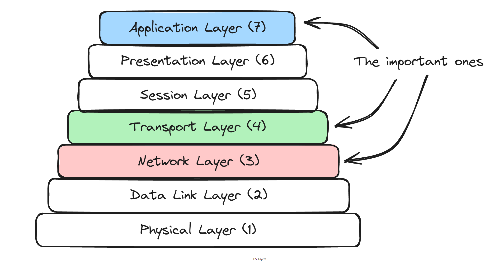
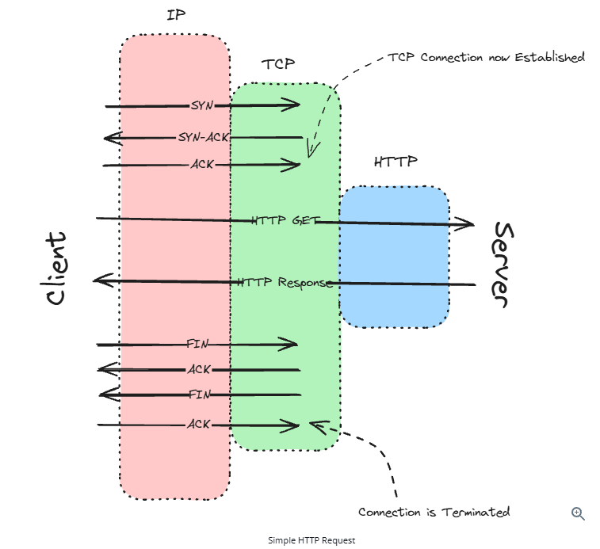

# Networking 101

At its core, networking is about connecting devices and enabling them to communicate. Networks are built on a layered architecture (the so-called "OSI model") which greatly simplifies the world for us application developers who sit on top of it.

Effectively, network layers are just abstractions that allow us to reason about the communication between devices in simpler terms relevant to our application. This way, when you're requesting a webpage, you don't need to know which voltages represent a 1 or a 0 on the network wire (modern networking hardware is even more sophisticated than this!) — you just need to know how to use the next layer down the stack. Think of it like how you might use `open` in your language of choice instead of manually instructing the disk how to read bytes off a disk.

## The OSI Model and Networking Layers

The OSI (Open Systems Interconnection) model is a conceptual framework used to understand and design network systems. It divides the networking process into seven distinct layers, each with specific responsibilities. From top to bottom, the layers are:

### Network Layer (Layer 3)

At this layer is IP, the protocol that handles routing and addressing. It's responsible for breaking the data into packets, handling packet forwarding between networks, and providing best-effort delivery to any destination IP address on the network. While there are other protocols at this layer (like InfiniBand, which is used extensively for massive ML training workloads), IP by far the most common for system design interviews.

### Transport Layer (Layer 4)

At this layer, we have TCP, QUIC, and UDP, which provide end-to-end communication services. Think of them like a layer that provides features like reliability, ordering, and flow control on top of the network layer.

### Application Layer (Layer 7)

At the final layer are the application protocols like DNS, HTTP, Websockets, WebRTC. These are common protocols that build on top of TCP (or UDP, in the case of WebRTC) to provide a layer of abstraction for different types of data typically associated with web applications. We'll cover them in depth.

These layers work together to enable all our network communications. To see how they interact in practice, let's walk through a concrete example of how a simple web request works.

## Example: A Simple Web Request

When you type a URL into your browser, several layers of networking protocols spring into action. Let's break down how these layers work together to retrieve a simple web page over HTTP on TCP.

First, we use DNS to convert a human-readable domain name like hellointerview.com into an IP address like 32.42.52.62. Then, a series of carefully orchestrated steps begins. We set up a TCP connection over IP, send our HTTP request, get a response, and tear down the connection.

### Request/Response Flow

1. **DNS Resolution:** The client starts by resolving the domain name of the website to an IP address using DNS (Domain Name System).

2. **TCP Handshake:** The client initiates a TCP connection with the server using a three-way handshake:
   - **SYN:** The client sends a SYN (synchronize) packet to the server to request a connection.
   - **SYN-ACK:** The server responds with a SYN-ACK (synchronize-acknowledge) packet to acknowledge the request.
   - **ACK:** The client sends an ACK (acknowledge) packet to establish the connection.

3. **HTTP Request:** Once the TCP connection is established, the client sends an HTTP GET request to the server to request the web page.

4. **Server Processing:** The server processes the request, retrieves the requested web page, and prepares an HTTP response. (This is usually the only latency most SWE's think about and control!)

5. **HTTP Response:** The server sends the HTTP response back to the client, which includes the requested web page content.

6. **TCP Teardown:** After the data transfer is complete, the client and server close the TCP connection using a four-way handshake:
   - **FIN:** The client sends a FIN (finish) packet to the server to terminate the connection.
   - **ACK:** The server acknowledges the FIN packet with an ACK.
   - **FIN:** The server sends a FIN packet to the client to terminate its side of the connection.
   - **ACK:** The client acknowledges the server's FIN packet with an ACK.

## Key Observations

While the specific details of TCP handshakes and teardowns might seem too esoteric to apply to interviews, there are a few important things to observe which we'll build upon:

### Application-Level Abstraction
As an application developer we are able to simplify our mental models dramatically. The application can take for granted that the data is transmitted with a degree of reliability and ordering: the TCP layer ensures that the data is delivered correctly and in order, and will provide a response to the application if it doesn't arrive. We also never have to concern ourselves with finding a specific server in the world and driving a pulse train of electrons to get there. With DNS, we can look up the IP address, and with IP the various networking hardware between us, our ISP, backbone providers, etc. can route the data to the destination. Nice!

### Hidden Complexity and Latency
While we have one conceptual "request" and "response" here, there were many more packets and requests exchanged between servers to make it happen. All of these introduce latency that we can ignore ... until we can't. The higher in the stack we go, the more latency and processing required. This is relevant for our load balancer discussion shortly!

### Connection State and Overhead
Finally note that the connection between the client and server is a state that both the client and server must maintain. Unless we use features like HTTP keep-alive or HTTP/2 multiplexing, we need to repeat this connection setup process for every request - a potentially significant overhead. This will become important for designing systems which need persistent connections, like those handling Realtime Updates.

## Network Layer Protocols

The first layer in our journey are the network layer protocols. This layer is dominated by the IP protocol, which is responsible for routing and addressing. In a system, nodes are assigned IPs usually by a DHCP server when they boot up. These IP addresses are arbitrary and only mean something in as much as we tell people about them. If I want to, I can create a private network with my servers and give them any IP address I want, but if you want internet traffic to be able to find them you'll need to use IP addresses that are routable and allocated by a RIR.

These assigned IP addresses are called public IPs and are used to identify devices on the internet. The most important thing about them is that internet routing infrastructure is optimized to route traffic between public IPs and knows where they are. Any address starting with 17 (e.g. 17.0.0.0) is part of Apple — the backbone of the internet knows that when you want to send a packet to these addresses, you need to send it to their routers.

There's a lot more to cover in internet routing but it's not going to be important for our purposes so we'll keep it simple and move up the stack to our next layer: the transport layer.

