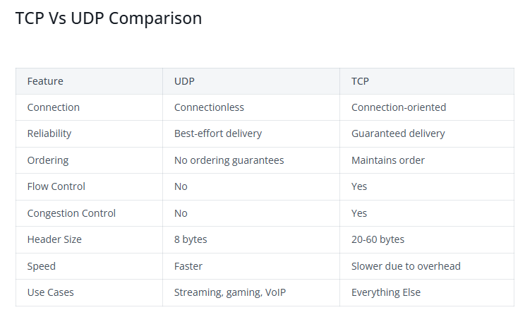

# Transport Layer Protocols

The transport layer is where we establish end-to-end communication between applications. They give us some guarantees instead of handing us a jumbled mess of packets. The three primary protocols at this layer are TCP, UDP, and QUIC, each with distinct characteristics that make them suitable for different use cases.

For most system design interviews, the real choice you'll be faced with is between TCP and UDP. QUIC is a new protocol that aims to provide some of the same benefits of TCP with some modernization and performance benefits. While QUIC is becoming more popular, it's still a relatively new protocol and not yet ubiquitous - for our purposes we'll consider it a better version of TCP but without the same broad baseline of adoption.

## UDP - Fast but Unreliable

User Datagram Protocol (UDP) is the machinegun of protocols. It offers few features on top of IP but is very fast. Spray and pray is the right way to think about this. It provides a simpler, connectionless service with no guarantees of delivery, ordering, or duplicate protection.

If you write an application that receives UDP datagrams, you'll be able to see where they came from (i.e. the source IP address and port) and where they're going (i.e. the destination IP address and port). But that's it! The rest is a binary blob.

### UDP Characteristics

- **Connectionless:** No handshake or connection setup, meaning the sender can just start sending packets without establishing a connection first.
- **No guarantee of delivery:** Packets may be lost without notification
- **No ordering:** Packets may arrive in a different order than sent
- **Lower latency:** Less overhead means faster transmission

No setup sounds great but the lack of delivery guarantees and ordering kinda suck, so why would you want to use UDP?

UDP is perfect for applications where speed is more important than reliability, such as live video streaming, online gaming, VoIP, and DNS lookups. In these cases the application or client is equipped to handle the occasional packet loss or out of order packet. For VOIP as an example, the client might just drop the occasional packet leading to a hiccup in the audio but overall the conversation is still intelligible. This is vastly preferable to retransmitting those lost packets and clogging up the network with ACKs.

Browsers don't have widespread support for UDP yet outside of WebRTC (we'll get into it). If you're thinking about a design which could use UDP (like the spamming of hearts and reactions in Facebook Live Comments), think about what you'll do for your browser-based users. It might be that your app-based users get a real-time UDP stream of reactions while browser-based users a slower, batched HTTP stream which you spread out over time in the UI.

## TCP - Reliable but with Overhead

Transmission Control Protocol (TCP) is the workhorse of the internet. It provides reliable, ordered, and error-checked delivery of data. It establishes a connection through a three-way handshake (we saw this illustrated above with the HTTP example) and maintains that connection throughout the communication session.

This connection is called a "stream" and is a stateful connection between the client and server — it also gives us a basis to talk about ordering: two messages sent in the same stream/connection will arrive in the same order. TCP will ensure that recipients of messages acknowledge their receipt and, if they don't, will retransmit the message until it is acknowledged.

### TCP Characteristics

- **Connection-oriented:** Establishes a dedicated connection before data transfer
- **Reliable delivery:** Guarantees that data arrives in order and without errors
- **Flow control:** Prevents overwhelming receivers with too much data
- **Congestion control:** Adapts to network congestion to prevent collapse

TCP is ideal for applications where data integrity is critical — that is, basically everything where UDP is not a good fit.

## When to Choose Each Protocol

In system design interviews, most interviewers will expect you're using TCP by default — it often doesn't need to be directly mentioned. That's good because that's also our recommendation!

But you'll be able to earn extra points if you can make the case for a UDP application and not bungle the details. So the question you should be asking yourself is whether UDP is a better fit for your use-case.

### Choose UDP When

- Low latency is critical (real-time applications, gaming)
- Some data loss is acceptable (media streaming)
- You're handling high-volume telemetry or logs where occasional loss is acceptable
- You don't need to support web browsers (or you have an alternative for that client)

### Protocol Comparison

Modern applications often use both protocols. For example, a web-based video conferencing app might use TCP/HTTP for signaling and authentication but UDP/WebRTC for the actual audio/video streams.

