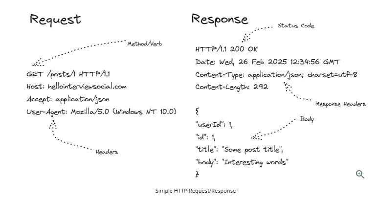
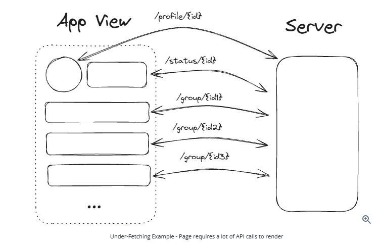
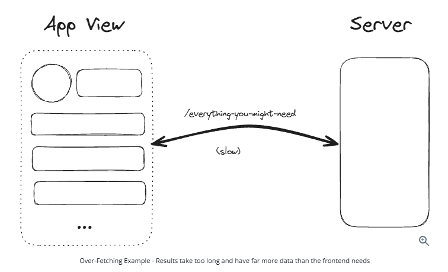
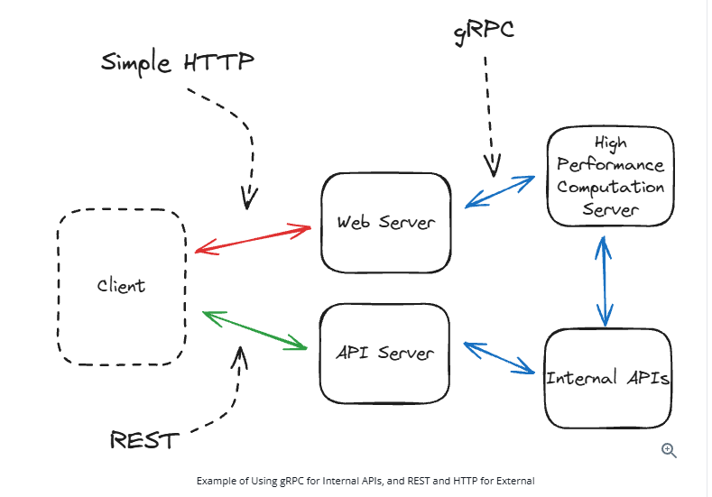
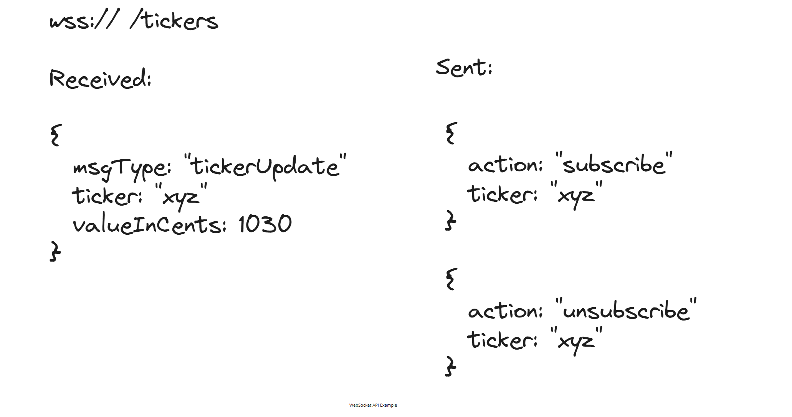
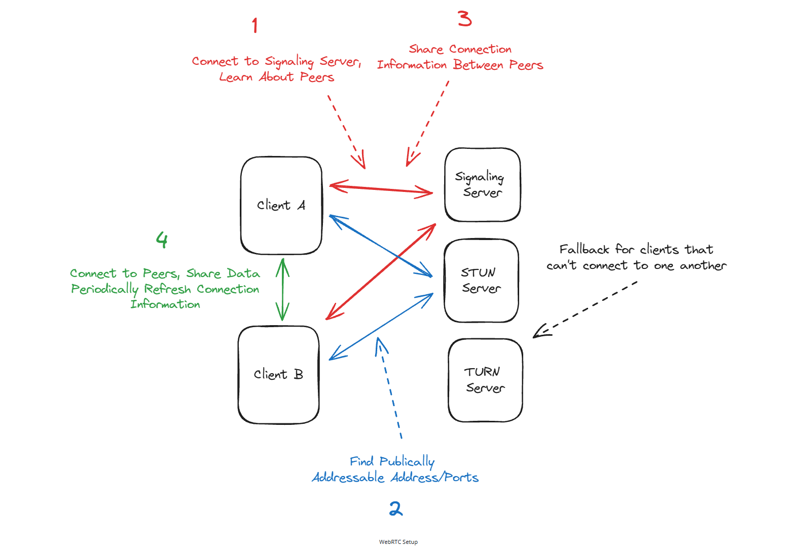

# Application Layer Protocols

The application layer is where most developers spend their time. These protocols define how applications communicate and are built on top of the transport layer protocols we just discussed.

Typically the application layer is processed in "User Space" whereas layers beneath it are processed in the OS kernel in "Kernel Space". This means that the application layer is more flexible and can be more easily modified than lower layers, whereas lower layers are difficult to change but can be very efficient.

## HTTP/HTTPS: The Web's Foundation

Hypertext Transfer Protocol (HTTP) is the de-facto standard for data communication on the web. It's a request-response protocol where clients send requests to servers, and servers respond with the requested data.

HTTP is a stateless protocol, meaning that each request is independent and the server doesn't need to maintain any information about previous requests. This is generally a good thing. In system design you'll want to minimize the surface area of your system that needs to be stateful where possible. Most simple HTTP servers can be described as a function of the request parameters — they're stateless!

Here's a simple HTTP request/response. You can actually open up a TCP connection and send an HTTP request/response by hand with netcat (nc on the command line) if you'd like!



### Key HTTP Concepts

- **Request methods:** GET, POST, PUT, DELETE, etc.
- **Status codes:** 200 OK, 404 Not Found, 500 Server Error, etc.
- **Headers:** Metadata about the request or response
- **Body:** The actual content being transferred

The HTTP request methods and status codes are well-defined and standardized (think of them like enums). It's good to know some of the common ones, but most interviewers aren't going to get into this level of detail except if you're using a RESTful API.

### Common Request Methods

- **GET:** Request data from the server. GET requests should be idempotent and don't have a body.
- **POST:** Send data to the server.
- **PUT:** Update data on the server.
- **PATCH:** Update a resource partially.
- **DELETE:** Delete data from the server. DELETE requests should be idempotent.

### Common Status Codes

#### Success (2xx)
- **200 OK:** The request was successful
- **201 Created:** The request was successful and a new resource was created

#### Moved (3xx)
- **302 Found:** The requested resource has been moved temporarily
- **301 Moved Permanently:** The requested resource has been moved permanently

#### Client Error (4xx)
- **404 Not Found:** The requested resource was not found
- **401 Unauthorized:** The request requires authentication
- **403 Forbidden:** The server understood the request but refuses to authorize it
- **429 Too Many Requests:** The client has sent too many requests in a given amount of time

#### Server Error (5xx)
- **500 Server Error:** The server encountered an error
- **502 Bad Gateway:** The server received an invalid response from the upstream server

### HTTP Headers

The headers are much more flexible (think of them like key/value pairs). This flexibility demonstrates the pragmatic design philosophy that underlies much of the HTTP spec.

#### Common Headers

- **Content-Type:** Indicates the media type of the resource or the data being sent
- **Authorization:** Contains credentials for authenticating the client with the server
- **User-Agent:** Provides information about the client making the request
- **Accept:** Specifies the media types that the client can handle
- **Cache-Control:** Directives for caching mechanisms in both requests and responses

HTTP headers are a great example of how to design an interface that is flexible to unknown future use-cases and provides a good lesson for API design. Content negotiation is a perfect case study.

The HTTP Accepts-Encoding header as an example provides clients a way to indicate they can handle different types of content encoding. This allows servers to provide (e.g.) gzip or br (brotli) encoded responses if they're available. Servers can then respond with the most efficient encoding for that client with Content-Encoding: X providing both backward compatibility and graceful degradation.

### HTTPS Security

HTTPS adds a security layer (TLS/SSL) to encrypt communications, protecting against eavesdropping and man-in-the-middle attacks. If you're building a public website you're going to be using HTTPS without exception. Generally speaking this means that the contents of your HTTP requests and responses are encrypted and safe in transit.

#### Security Concerns

While the contents of your HTTPS requests and responses are encrypted, they aren't guaranteed to be generated by your client! Your API should never trust the contents of the request body without validating it. A common mistake is to include the user's ID in the request body and use it to make a database call. If an attacker can change the request body, they can change the user ID and read arbitrary user data. Ouch!

This doesn't mean you can't include user IDs in your requests. It just means you need to be able to validate them on the server and your API shouldn't ask for anything you can't trust.

---

## REST: Simple and Flexible

While HTTP can be used directly to build websites, oftentimes system designs are concerned with the communication between services via APIs. For creating these APIs, we have three main paradigms: REST, GraphQL, and gRPC.

REST is the most common API paradigm you'll use in system design interviews. It's a simple and flexible way to create APIs that are easy to understand and use. The core principle behind REST is that clients are often performing simple operations against resources (think of them like database tables or files on a server).

In RESTful API design, the primary challenge is to model your resources and the operations you can perform on them. RESTful API's take advantage of the HTTP methods or verbs together with some opinionated conventions about the paths and the body of the request. They often use JSON to represent the resources in both the request and response bodies — although it's not strictly required.

If you've followed our Delivery Framework, your Core Entities will oftentimes map directly to the resources in your API. Bonus!

### REST Examples

A simple RESTful API might look like this (where User is a JSON object representing a user):

```
GET /users/{id} -> User
```

Here we're using the HTTP method "GET" to indicate that we're requesting a resource. The `{id}` is a placeholder for the resource ID, in this case the user ID of the user we want to retrieve.

When we want to update that user, we can use the HTTP method "PUT" to indicate that we're updating a pre-existing resource.

```
PUT /users/{id} -> User
{
  "username": "john.doe",
  "email": "john.doe@example.com"
}
```

We can also create new resources by using the HTTP method "POST". We'll include the body the content of the resource we want to create. Note that I'm not specifying an ID here because the server will assign one.

```
POST /users -> User
{
  "username": "stefan.mai",
  "email": "stefan@hellointerview.com"
}
```

Finally, resources can be nested to represent relationships between resources. For example, a user might have many posts, so we can represent that relationship by nesting the posts under the user resource.

```
GET /users/{id}/posts -> [Post]
```

### REST Design Principles

Many engineers often think in terms of methods like `updateUser` or `startGame`. These are operations, not resources, so they're not RESTful.

In REST, we want to think in terms of resources and the operations you can perform on them. So our `updateUser` might be `PUT /users/{id}` and our `startGame` might be `PATCH /games` with `{ "status": "started" }`.

In summary, RESTful APIs are all about resources and the standard HTTP methods to interact with them. By thinking in terms of resources rather than actions, we can design APIs that are more consistent, predictable, and easier to understand.

### When to Use REST

Overall REST is very flexible for a wide variety of use-cases and applications. ElasticSearch uses it to manage documents, configure indexes, and more. Check out that deep dive if you want to see a great example of a RESTful API.

REST is not going to be the most performant solution for very high throughput services, and generally speaking JSON is a pretty inefficient format for serializing and deserializing data.

That said, most applications aren't going to be bottlenecked by request serialization. Like TCP, REST is where we'd suggest you default for your interviews. It's well-understood and a good baseline for building scalable systems. You should reach for GraphQL, gRPC, SSE, or WebSockets if you have specific needs that REST can't meet. For practical REST API design patterns, see our API Design guide.

---

## GraphQL: Flexible Data Fetching

GraphQL is a more recent API paradigm (open-sourced circa 2015 by Facebook) that allows clients to request exactly the data they need.

### The GraphQL Problem

Here's the problem GraphQL solves: Frequently teams and systems are organized into frontend and backend. As an example, the frontend might be a mobile app and the backend a database-based API.

When the frontend team wants to display a new page, they can either:
1. Cobble together a bunch of different requests to backend endpoints (imagine querying 1 API for a list of users and making 10 API calls to get their details)
2. Create huge aggregation APIs which are hard to maintain and slow to change
3. Write brand new APIs for every new page they want to display

None of these are particularly good solutions but it's easy to run into them with a standard REST API.

The problem with **under-fetching** is that you may need multiple requests and round trips. This adds overhead and latency to the page load.



**Over-fetching** is the opposite: when we pack way more than we need in an API response to guard ourselves against future use-cases that we don't have today. It means that APIs take a long time to load and return too much data.



And writing brand new APIs for every new page is a nightmare.

### GraphQL Solution

GraphQL solves these problems by allowing the frontend team to flexibly query the backend for exactly the data they need. The backend can then respond with the data in the shape that the frontend needs it. This is a great fit for mobile apps and other use-cases where you want to reduce the amount of data transferred.

Here's an example of a GraphQL query which fetches just the data the frontend needs for a sophisticated page which shows both users with their profiles and groups they're a member of.

```graphql
query GetUsersWithProfilesAndGroups($limit: Int = 10, $offset: Int = 0) {
  users(limit: $limit, offset: $offset) {
    id
    username
    
    profile {
      id
      fullName
      avatar
    }
    
    groups {
      id
      name
      description
      
      category {
        id
        name
        icon
      }
    }
    
    status {
      isActive
      lastActiveAt
    }
  }
  
  _metadata {
    totalCount
    hasNextPage
  }
}
```

The graphQL code here is basically specifying which fields and nested objects we want to fetch. The backend can interpret this query and respond with just the data the frontend needs.

In our example, instead of writing a bunch of different APIs, the frontend team can just write a single query to get the data they need and the backend can (in theory) respond with the data in the shape that the frontend needs it.

### When to Use GraphQL

GraphQL is a great fit for use-cases where the frontend team needs to iterate quickly and adjust. They can flexibly query the backend for exactly the data they need. On the other hand, execution of these GraphQL queries can be a source of latency and complexity for the backend — sometimes involving the same bespoke backend code that we're trying to avoid. In practice, GraphQL finds its sweet spot with complex clients and when multiple teams are making wide queries to overlapping data.

For system design interviews specifically, the benefits of GraphQL are murky. In the interview you'll have a fixed set of requirements (not the moving targets of iterating on a mobile app or web frontend where GraphQL starts to shine). Additionally, the interviewer will frequently want to see how you optimize specific query patterns and while you can talk about custom resolvers — GraphQL is frequently just in the way.

We recommend bringing up GraphQL in cases where the problem is clearly focused on flexibility (e.g. the interviewer tells us we need to be able to adapt our apps quickly to changing requirements) or when the requirements in the interview are deliberately uncertain. For more interview-focused GraphQL guidance, see our API Design article.

---

## gRPC: Efficient Service Communication

gRPC is a high-performance RPC (Remote Procedure Call) framework from Google (the "g") that uses HTTP/2 and Protocol Buffers.

Think of Protocol Buffers like JSON but with a more rigid schema that allows for better performance and more efficient serialization. Here's an example of a Protocol Buffer definition for a User resource:

```protobuf
message User {
  string id = 1;
  string name = 2;
}
```

Instead of a chunky JSON object with embedded schema (40 bytes):

```json
{
  "id": "123",
  "name": "John Doe"
}
```

We have a binary encoding (15 bytes) of the same data with very skinny tags and variable length encoding of the strings. Less space and less CPU to parse!

```
0A 03 31 32 33 12 08 6A 6F 68 6E 20 64 6F 65
```

gRPC builds on this to provide service definitions. Here's an example of a gRPC service definition for a UserService:

```protobuf
message GetUserRequest {
  string id = 1;
}

message GetUserResponse {
  User user = 1;
}

service UserService {
  rpc GetUser (GetUserRequest) returns (GetUserResponse);
}
```

These definitions are compiled into a client and server stub which a wide variety of languages and frameworks can consume to build services and clients. gRPC includes a bunch of features relevant for operating microservice architectures at scale (it was invented by Google after all) like streaming, deadlines, client-side load balancing and more. But the most important thing to know is that it's a binary protocol that's faster and more efficient than JSON over HTTP.

### When to Use gRPC

gRPC shines in microservices architectures where services need to communicate efficiently. Its strong typing helps catch errors at compile time rather than runtime, and its binary protocol is more efficient than JSON over HTTP (some benchmarks show a factor of 10x throughput!). Consider gRPC for internal service-to-service communication, especially when performance is critical or when latencies are dominated by the network rather than the work the server is doing.

That said, you generally won't use gRPC for public-facing APIs, especially for clients you don't control, because it's a binary protocol and the tooling for working with it is less mature than simple JSON over HTTP. Having internal APIs using gRPC and external APIs using REST is a great way to get the benefits of a binary protocol without the complexity of a public-facing API. There are definitely engineers who would love it if gRPC was more widely adopted, but it's not there yet.



As such, we recommend using REST for public-facing APIs and leaving gRPC for internal service-to-service communication — especially if binary data is being exchanged or performance is critical. In many interviews, using REST both for internal and external APIs is fine and you can build from there depending on the needs of the problem and probes from your interviewer.

**Premature Optimization Note:** Sometimes engineers think the point of a system design interview is to draw up an optimal solution to a problem on a whiteboard. But interviewers typically are trying to understand how you think through a problem and how you react to challenges and constraints you may not have seen before. Be wary of hyperoptimizing your RPC protocol choice before you've handled other substantial bottlenecks in the problem. Premature optimization is the root of all evil!

---

## Server-Sent Events (SSE): Real-Time Push Communication

So far we've been talking mostly about request/response style APIs, but many applications need to "push" data to clients in a more streaming fashion. While gRPC does support streaming, it's not ideal for external APIs due to limited support (e.g. no browsers support gRPC today). Server-Sent Events (SSE) is a spec defined on top of HTTP that allows a server to push many messages to the client over a single HTTP connection.

Here's how to think of it: SSE is a nice hack on top of HTTP that allows a server to stream many messages, over time, in a single response from the server.

With most HTTP APIs you'd get a single, cohesive JSON blob as a response from the server that is processed once the whole thing has been received:

```json
{
  "events": [
    { "id": 1, "timestamp": "2025-01-01T00:00:00Z", "description": "Event 1" },
    { "id": 2, "timestamp": "2025-01-01T00:00:01Z", "description": "Event 2" },
    ...
    { "id": 100, "timestamp": "2025-01-01T00:00:10Z", "description": "Event 100" }
  ]
}
```

Since we have to wait for the whole response to come in before we can process it, it's not much good for push notifications!

On the other hand, with SSE, the server can push many messages as "chunks" in a single response from the server:

```
data: {"id": 1, "timestamp": "2025-01-01T00:00:00Z", "description": "Event 1"}
data: {"id": 2, "timestamp": "2025-01-01T00:00:01Z", "description": "Event 2"}
...
data: {"id": 100, "timestamp": "2025-01-01T00:00:10Z", "description": "Event 100"}
```

Each line here is received as a separate message from the server. The client can then process each message as it comes in. It's still one big HTTP response (same TCP connection), but it comes in over many smaller packets and clients are expected to process each line of the body individually to allow them to react to the data as it comes in.

### SSE Limitations

Now with all good hacks, SSE comes with some acute limitations. We can't keep an SSE connection open for too long because the server (or the load balancer, or a middle box proxy) will close down the connection. So the SSE standard defines the behavior of an EventSource object that, once the connection is closed, will automatically reconnect with the ID of the last message received. Servers are expected to keep track of prior messages that may have been missed while the client was disconnected and resend them.

In practice there are also some nasty, misbehaving networks that will batch up all SSE responses into a single response making it behave a lot like what we're trying to avoid. Tradeoffs!

Most interviewers are not familiar with these limitations and will gladly let you assume they don't exist. But it's good to be aware of them because anyone who has actually implemented SSE has an enduring headache from these issues and will try to get a sense for whether you've actually used it in practice.

### When to Use SSE

You'll find SSE useful in system design interviews in situations where you want clients to get notifications or events as soon as they happen. SSE is a great option for keeping bidders up-to-date on the current price of an auction, for example.

We touch on this pattern in greater detail in our Realtime Updates deep dive, which also covers the server-side implications of an SSE implementation.

---

## WebSockets: Real-Time Bidirectional Communication

Now while SSE is a great way to push from the server to client, many applications need real-time bidirectional communication. And while gRPC does support streaming, it's still (broken record?) not ideal for external APIs due to limited support (e.g. no browsers support gRPC today). So what's an interview candidate to do?

Enter WebSockets! WebSockets provide a persistent, TCP-style connection between client and server, allowing for real-time, bidirectional communication with broad support (including browsers). Unlike HTTP's request-response model, WebSockets enable servers to push data to clients without being prompted by a new request. Similarly clients can push data back to the server without the same wait.

WebSockets are initiated via an HTTP "upgrade" protocol, which allows an existing TCP connection to change L7 protocols. This is super convenient because it means you can utilize some of the existing HTTP session information (e.g. cookies, headers, etc.) to your advantage.

### WebSocket Infrastructure Challenges

Just because clients can upgrade from HTTP to WebSocket doesn't mean that the infrastructure will support it. Every piece of infrastructure between the client and server will need to support WebSocket connections.

If you've ever implemented Websockets you've probably hit a bunch of issues with firewalls, proxies, load balancers, and other infrastructure that don't support WebSocket connections.

### WebSocket Connection Flow

Here's how it works:
1. Client initiates WebSocket handshake over HTTP (with a backing TCP connection)
2. Connection upgrades to WebSocket protocol, WebSocket takes over the TCP connection
3. Both client and server can send binary messages to each other over the connection
4. The connection stays open until explicitly closed

WebSockets don't dictate an application protocol, you effectively have a channel where you can send binary packets to the server from the client and vice versa. This means you'll need some way of defining what it is your client and server are exchanging. For many WebSocket applications, simple serialized JSON messages are a great option! This also gives you a chance to define the API of your service for your design:



### When to Use WebSockets

WebSockets come up in system design interviews when you need high-frequency, persistent, bi-directional communication between client and server. Think real-time applications, games, and other use-cases where you need to send and receive messages as soon as they happen.

For applications where either you just need to be able to send requests and receive responses, or situations where you can make due with the push notifications provided by SSE, WebSockets are overkill.

In system design interviews, launching into a WebSocket implementation without justifying why they are needed is a great way to get a "thumbs down" from your interviewer. WebSockets are powerful, but the infra required to support them can be expensive and the overhead of stateful connections (especially at scale) will require significant accommodations in your design. Hold off unless you really need them!

---

## WebRTC: Peer-to-Peer Communication

The last protocol we'll cover is the most unique. WebRTC enables direct peer-to-peer communication between browsers without requiring an intermediary server for the data exchange. WebRTC can be perfect for collaborative applications like document editors and is especially useful for video/audio calling and conferencing applications. Oh, and it's the only application-level protocol we'll cover that uses UDP!

The WebRTC spec is comprised of several pieces of infra and protocols that are necessary to establish a peer-to-peer connection between browsers. From a networking perspective, peer-to-peer connections are more complex than the client-server models we've been discussing so far because most clients don't allow inbound connections for security reasons.

### WebRTC Connection Establishment

With WebRTC, clients talk to a central "signaling server" which keeps track of which peers are available together with their connection information. Once a client has the connection information for another peer, they can try to establish a direct connection without going through any intermediary servers.

In practice, most clients don't allow inbound connections for security reasons and the majority of users are behind a NAT (network address translation) device which keeps them from being connected to directly. So if we stopped there, most peers wouldn't be able to "speak" to each other.

The WebRTC standard includes two methods to work around these restrictions:

#### STUN: Session Traversal Utilities for NAT

STUN is a protocol and a set of techniques like "hole punching" which allows peers to establish publically routable addresses and ports. I won't go into details here, but as hacky as it sounds it's a standard way to deal with NAT traversal and it involves repeatedly creating open ports and sharing them via the signaling server with peers.

#### TURN: Traversal Using Relays around NAT

TURN is effectively a relay service, a way to bounce requests through a central server which can then be routed to the appropriate peer.



### WebRTC Connection Steps

There's effectively 4 steps to a WebRTC connection:
1. Clients connect to a central signaling server to learn about their peers.
2. Clients reach out to a STUN server to get their public IP address and port.
3. Clients share this information with each other via the signaling server.
4. Clients establish a direct peer-to-peer connection and start sending data.

This is the happy case! In reality, sometimes these connections fail and you need to have fallbacks like our TURN server.

### When to Use WebRTC

WebRTC is ideal for audio/video calling and conferencing applications. It can also occasionally be appropriate for collaborative applications like document editors, especially if they need to scale to many clients.

In practice, most collaborative editors don't require scaling to thousands of clients. Additionally, you often need a central server anyways to store the document and coordinate between clients. That's why we're using Websockets in our Google Docs problem breakdown. But there is an alternative to use WebRTC and CRDTs (Conflict-free Replicated Data Types) to send updates directly between clients over a peer-to-peer data path.

For interviews, we suggest sticking to WebRTC for video/audio calling and conferencing applications.

### WebRTC Complexity Warning

WebRTC is an absolute pain to get right and even the best implementations still suffer connection losses. It is a niche solution.

In interviews, I've seen more candidates go wildly off trail trying to design peer-to-peer systems using WebRTC than I have seen them successfully implement them. Most problems don't require peer-to-peer connections and it's easy to try to wrap a solution around a problem that doesn't actually need it.

If you stick to only using WebRTC for video/audio calling and conferencing, you'll be in good shape.
In summary, RESTful APIs are all about resources and the standard HTTP methods to interact with them. By thinking in terms of resources rather than actions, we can design APIs that are more consistent, predictable, and easier to understand.

#### Where to use it

Overall REST is very flexible for a wide variety of use-cases and applications. ElasticSearch uses it to manage documents, configure indexes, and more. Check out that deep dive if you want to see a great example of a RESTful API.
REST is not going to be the most performant solution for very high throughput services, and generally speaking JSON is a pretty inefficient format for serializing and deserializing data.
That said, most applications aren't going to be bottlenecked by request serialization. Like TCP, REST is where we'd suggest you default for your interviews. It's well-understood and a good baseline for building scalable systems. You should reach for GraphQL, gRPC, SSE, or WebSockets if you have specific needs that REST can't meet. For practical REST API design patterns, see our API Design guide.

### GraphQL: Flexible Data Fetching

GraphQL is a more recent API paradigm (open-sourced circa 2015 by Facebook) that allows clients to request exactly the data they need.
Here's the problem GraphQL solves: Frequently teams and systems are organized into frontend and backend. As an example, the frontend might be a mobile app and the backend a database-based API.
When the frontend team wants to display a new page, they can either (a) cobble together a bunch of different requests to backend endpoints (imagine querying 1 API for a list of users and making 10 API calls to get their details), (b) create huge aggregation APIs which are hard to maintain and slow to change, or (c) write brand new APIs for every new page they want to display. None of these are particularly good solutions but it's easy to run into them with a standard REST API.
The problem with under-fetching is that you may need multiple requests and round trips. This adds overhead and latency to the page load.


Over-fetching is the opposite: when we pack way more than we need in an API response to guard ourselves against future use-cases that we don't have today. It means that APIs take a long time to load and return too much data.


And writing brand new APIs for every new page is a nightmare.
GraphQL solves these problems by allowing the frontend team to flexibly query the backend for exactly the data they need. The backend can then respond with the data in the shape that the frontend needs it. This is a great fit for mobile apps and other use-cases where you want to reduce the amount of data transferred.
Here's an example of a GraphQL query which fetches just the data the frontend needs for a sophisticated page which shows both users with their profiles and groups they're a member of.

```graphql
query GetUsersWithProfilesAndGroups($limit: Int = 10, $offset: Int = 0) {
  users(limit: $limit, offset: $offset) {
    id
    username
    //...
    
    profile {
      id
      fullName
      avatar
      // ...
    }
    
    groups {
      id
      name
      description
      // ...
      
      category {
        id
        name
        icon
      }
    }
    
    status {
      isActive
      lastActiveAt
    }
  }
  
  _metadata {
    totalCount
    hasNextPage
  }
}
```

The graphQL code here is basically specifying which fields and nested objects we want to fetch. The backend can interpret this query and respond with just the data the frontend needs.
In our example, instead of writing a bunch of different APIs, the frontend team can just write a single query to get the data they need and the backend can (in theory) respond with the data in the shape that the frontend needs it.

#### Where to use it

GraphQL is a great fit for use-cases where the frontend team needs to iterate quickly and adjust. They can flexibly query the backend for exactly the data they need. On the other hand, execution of these GraphQL queries can be a source of latency and complexity for the backend — sometimes involving the same bespoke backend code that we're trying to avoid. In practice, GraphQL finds its sweet spot with complex clients and when multiple teams are making wide queries to overlapping data.
For system design interviews specifically, the benefits of GraphQL are murky. In the interview you'll have a fixed set of requirements (not the moving targets of iterating on a mobile app or web frontend where GraphQL starts to shine). Additionally, the interviewer will frequently want to see how you optimize specific query patterns and while you can talk about custom resolvers — GraphQL is frequently just in the way.
We recommend bringing up GraphQL in cases where the problem is clearly focused on flexibility (e.g. the interviewer tells us we need to be able to adapt our apps quickly to changing requirements) or when the requirements in the interview are deliberately uncertain. For more interview-focused GraphQL guidance, see our API Design article.

### gRPC: Efficient Service Communication

gRPC is a high-performance RPC (Remote Procedure Call) framework from Google (the "g") that uses HTTP/2 and Protocol Buffers.
Think of Protocol Buffers like JSON but with a more rigid schema that allows for better performance and more efficient serialization. Here's an example of a Protocol Buffer definition for a User resource:

message User {
  string id = 1;
  string name = 2;
}

Instead of a chunky JSON object with embedded schema (40 bytes) ...

{
  "id": "123",
  "name": "John Doe"
}

... we have a binary encoding (15 bytes) of the same data with very skinny tags and variable length encoding of the strings. Less space and less CPU to parse!

0A 03 31 32 33 12 08 6A 6F 68 6E 20 64 6F 65

gRPC builds on this to provide service definitions. Here's an example of a gRPC service definition for a UserService:

message GetUserRequest {
  string id = 1;
}

message GetUserResponse {
  User user = 1;
}

service UserService {
  rpc GetUser (GetUserRequest) returns (GetUserResponse);
}

These definitions are compiled into a client and server stub which a wide variety of languages and frameworks can consume to build services and clients. gRPC includes a bunch of features relevant for operating microservice architectures at scale (it was invented by Google after all) like streaming, deadlines, client-side load balancing and more. But the most important thing to know is that it's a binary protocol that's faster and more efficient than JSON over HTTP.

#### Where to use it

gRPC shines in microservices architectures where services need to communicate efficiently. Its strong typing helps catch errors at compile time rather than runtime, and its binary protocol is more efficient than JSON over HTTP (some benchmarks show a factor of 10x throughput!). Consider gRPC for internal service-to-service communication, especially when performance is critical or when latencies are dominated by the network rather than the work the server is doing.
That said, you generally won't use gRPC for public-facing APIs, especially for clients you don't control, because it's a binary protocol and the tooling for working with it is less mature than simple JSON over HTTP. Having internal APIs using gRPC and external APIs using REST is a great way to get the benefits of a binary protocol without the complexity of a public-facing API. There are definitely engineers who would love it if gRPC was more widely adopted, but it's not there yet.


As such, we recommend using REST for public-facing APIs and leaving gRPC for internal service-to-service communication — especially if binary data is being exchanged or performance is critical. In many interviews, using REST both for internal and external APIs is fine and you can build from there depending on the needs of the problem and probes from your interviewer.

Sometimes engineers think the point of a system design interview is to draw up an optimal solution to a problem on a whiteboard. But interviewers typically are trying to understand how you think through a problem and how you react to challenges and constraints you may not have seen before. Be wary of hyperoptimizing your RPC protocol choice before you've handled other substantial bottlenecks in the problem. Premature optimization is the root of all evil!

### Server-Sent Events (SSE): Real-Time Push Communication

So far we've been talking mostly about request/response style APIs, but many applications need to "push" data to clients in a more streaming fashion. While gRPC does support streaming, it's not ideal for external APIs due to limited support (e.g. no browsers support gRPC today). Server-Sent Events (SSE) is a spec defined on top of HTTP that allows a server to push many messages to the client over a single HTTP connection.
Here's how to think of it: SSE is a nice hack on top of HTTP that allows a server to stream many messages, over time, in a single response from the server.
With most HTTP APIs you'd get a single, cohesive JSON blob as a response from the server that is processed once the whole thing has been received.

{
  "events": [
    { "id": 1, "timestamp": "2025-01-01T00:00:00Z", "description": "Event 1" },
    { "id": 2, "timestamp": "2025-01-01T00:00:01Z", "description": "Event 2" },
    ...
    { "id": 100, "timestamp": "2025-01-01T00:00:10Z", "description": "Event 100" }
  ]
}

Since we have to wait for the whole response to come in before we can process it, it's not much good for push notifications!
On the other hand, with SSE, the server can push many messages as "chunks" in a single response from the server:

data: {"id": 1, "timestamp": "2025-01-01T00:00:00Z", "description": "Event 1"}
data: {"id": 2, "timestamp": "2025-01-01T00:00:01Z", "description": "Event 2"}
...
data: {"id": 100, "timestamp": "2025-01-01T00:00:10Z", "description": "Event 100"}

Each line here is received as a separate message from the server. The client can then process each message as it comes in. It's still one big HTTP response (same TCP connection), but it comes in over many smaller packets and clients are expected to process each line of the body individually to allow them to react to the data as it comes in.
Now with all good hacks, SSE comes with some acute limitations. We can't keep an SSE connection open for too long because the server (or the load balancer, or a middle box proxy) will close down the connection. So the SSE standard defines the behavior of an EventSource object that, once the connection is closed, will automatically reconnect with the ID of the last message received. Servers are expected to keep track of prior messages that may have been missed while the client was disconnected and resend them.
In practice there are also some nasty, misbehaving networks that will batch up all SSE responses into a single response making it behave a lot like what we're trying to avoid. Tradeoffs!

Most interviewers are not familiar with these limitations and will gladly let you assume they don't exist. But it's good to be aware of them because anyone who has actually implemented SSE has an enduring headache from these issues and will try to get a sense for whether you've actually used it in practice.

#### Where to use it

You'll find SSE useful in system design interviews in situations where you want clients to get notifications or events as soon as they happen. SSE is a great option for keeping bidders up-to-date on the current price of an auction, for example.
We touch on this pattern in greater detail in our Realtime Updates deep dive, which also covers the server-side implications of an SSE implementation.

### WebSockets: Real-Time Bidirectional Communication

Now while SSE is a great way to push from the server to client, many applications need real-time bidirectional communication. And while gRPC does support streaming, it's still (broken record?) not ideal for external APIs due to limited support (e.g. no browsers support gRPC today). So what's an interview candidate to do?
Enter WebSockets! WebSockets provide a persistent, TCP-style connection between client and server, allowing for real-time, bidirectional communication with broad support (including browsers). Unlike HTTP's request-response model, WebSockets enable servers to push data to clients without being prompted by a new request. Similarly clients can push data back to the server without the same wait.
WebSockets are initiated via an HTTP "upgrade" protocol, which allows an existing TCP connection to change L7 protocols. This is super convenient because it means you can utilize some of the existing HTTP session information (e.g. cookies, headers, etc.) to your advantage.

Just because clients can upgrade from HTTP to WebSocket doesn't mean that the infrastructure will support it. Every piece of infrastructure between the client and server will need to support WebSocket connections.
If you've ever implemented Websockets you've probably hit a bunch of issues with firewalls, proxies, load balancers, and other infrastructure that don't support WebSocket connections.

Here's how it works:
Client initiates WebSocket handshake over HTTP (with a backing TCP connection)
Connection upgrades to WebSocket protocol, WebSocket takes over the TCP connection
Both client and server can send binary messages to each other over the connection
The connection stays open until explicitly closed
WebSockets don't dictate an application protocol, you effectively have a channel where you can send binary packets to the server from the client and vice versa. This means you'll need some way of defining what it is your client and server are exchanging. For many WebSocket applications, simple serialized JSON messages are a great option! This also gives you a chance to define the API of your service for your design:


#### Where to use it

WebSockets come up in system design interviews when you need high-frequency, persistent, bi-directional communication between client and server. Think real-time applications, games, and other use-cases where you need to send and receive messages as soon as they happen.
For applications where either you just need to be able to send requests and receive responses, or situations where you can make due with the push notifications provided by SSE, WebSockets are overkill.

In system design interviews, launching into a WebSocket implementation without justifying why they are needed is a great way to get a "thumbs down" from your interviewer. WebSockets are powerful, but the infra required to support them can be expensive and the overhead of stateful connections (especially at scale) will require significant accommodations in your design. Hold off unless you really need them!

### WebRTC: Peer-to-Peer Communication

The last protocol we'll cover is the most unique. WebRTC enables direct peer-to-peer communication between browsers without requiring an intermediary server for the data exchange. WebRTC can be perfect for collaborative applications like document editors and is especially useful for video/audio calling and conferencing applications. Oh, and it's the only application-level protocol we'll cover that uses UDP!
The WebRTC spec is comprised of several pieces of infra and protocols that are necessary to establish a peer-to-peer connection between browsers. From a networking perspective, peer-to-peer connections are more complex than the client-server models we've been discussing so far because most clients don't allow inbound connections for security reasons.
With WebRTC, clients talk to a central "signaling server" which keeps track of which peers are available together with their connection information. Once a client has the connection information for another peer, they can try to establish a direct connection without going through any intermediary servers.
In practice, most clients don't allow inbound connections for security reasons and the majority of users are behind a NAT (network address translation) device which keeps them from being connected to directly. So if we stopped there, most peers wouldn't be able to "speak" to each other.
The WebRTC standard includes two methods to work around these restrictions:
STUN: "Session Traversal Utilities for NAT" is a protocol and a set of techniques like "hole punching" which allows peers to establish publically routable addresses and ports. I won't go into details here, but as hacky as it sounds it's a standard way to deal with NAT traversal and it involves repeatedly creating open ports and sharing them via the signaling server with peers.
TURN: "Traversal Using Relays around NAT" is effectively a relay service, a way to bounce requests through a central server which can then be routed to the appropriate peer.


There's effectively 4 steps to a WebRTC connection:
Clients connect to a central signaling server to learn about their peers.
Clients reach out to a STUN server to get their public IP address and port.
Clients share this information with each other via the signaling server.
Clients establish a direct peer-to-peer connection and start sending data.
This is the happy case! In reality, sometimes these connections fail and you need to have fallbacks like our TURN server.

#### Where to use it

WebRTC is ideal for audio/video calling and conferencing applications. It can also occasionally be appropriate for collaborative applications like document editors, especially if they need to scale to many clients.
In practice, most collaborative editors don't require scaling to thousands of clients. Additionally, you often need a central server anyways to store the document and coordinate between clients. That's why we're using Websockets in our Google Docs problem breakdown. But there is an alternative to use WebRTC and CRDTs (Conflict-free Replicated Data Types) to send updates directly between clients over a peer-to-peer data path.
For interviews, we suggest sticking to WebRTC for video/audio calling and conferencing applications.

WebRTC is an absolute pain to get right and even the best implementations still suffer connection losses. It is a niche solution.
In interviews, I've seen more candidates go wildly off trail trying to design peer-to-peer systems using WebRTC than I have seen them successfully implement them. Most problems don't require peer-to-peer connections and it's easy to try to wrap a solution around a problem that doesn't actually need it.
If you stick to only using WebRTC for video/audio calling and conferencing, you'll be in good shape.


