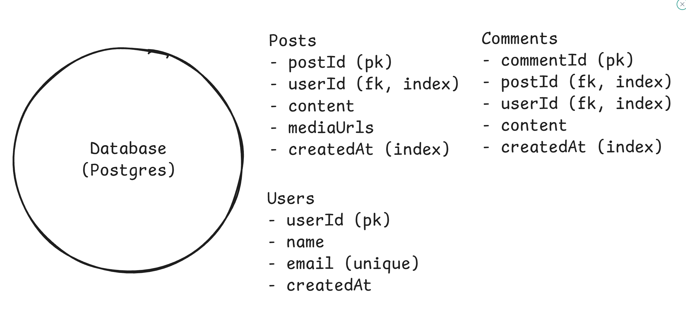
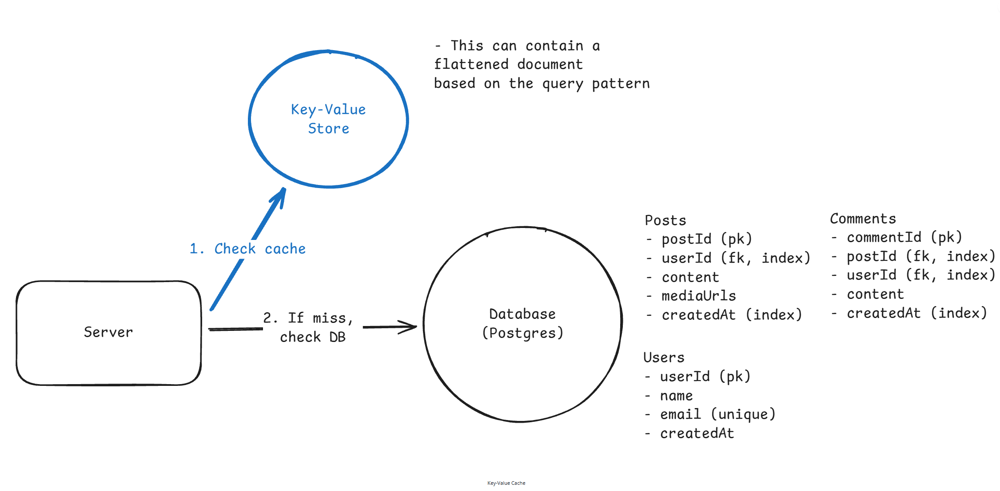
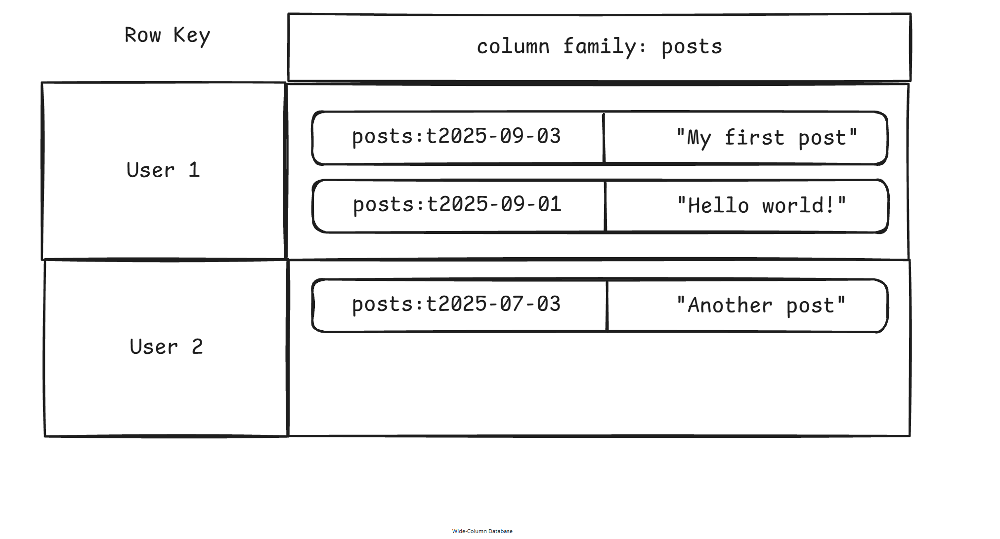
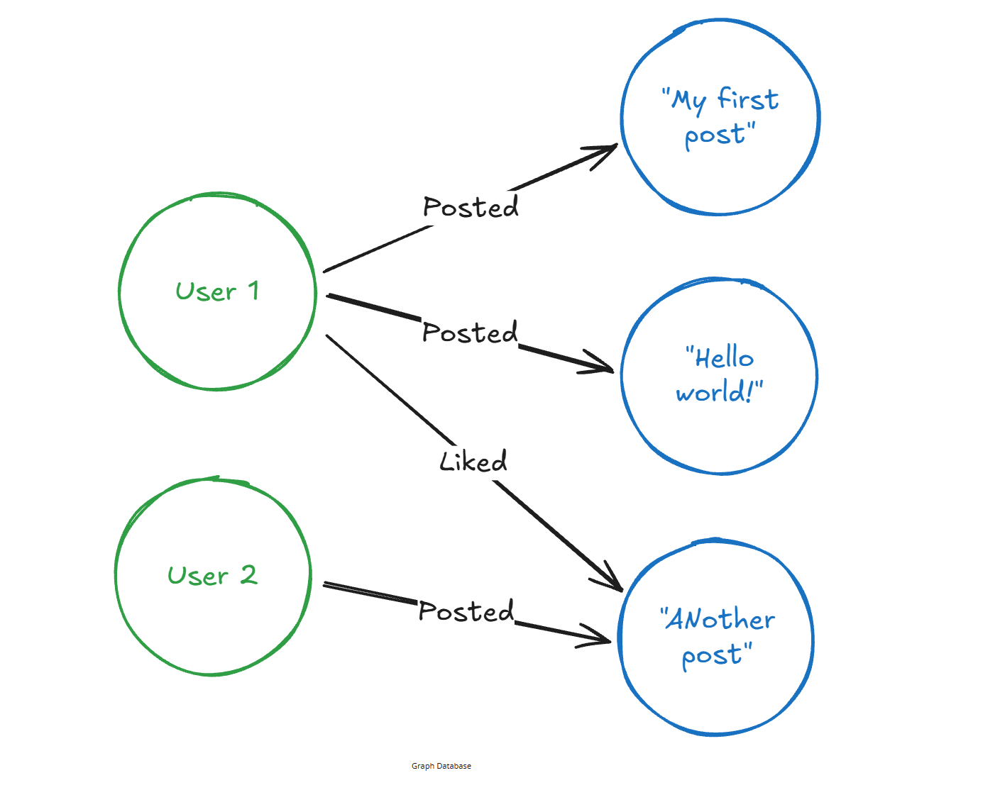

# Database Model Options

Data modeling is the process of defining how your application's data is structured, stored, and related. In practice, this means deciding what entities exist, how they're identified, and how they connect to one another. For a system design interview, the bar is much lower than in a dedicated data modeling interview (commonplace in data engineering loops). You're not expected to normalize everything or produce a complete schema diagram, you're just expected to design something clear, functional, and aligned with your system's requirements.

In the Delivery framework, this comes up twice. First, during requirements gathering, you'll identify your core entities. These usually map 1:1 with tables or collections and form the backbone of your schema. Later, in the High-Level Design step, you'll sketch a basic schema alongside your database component. Include the key fields, relationships, and a note on how you'd index or partition to support the main query patterns. That's enough for most interviewers to see that your data model won't crumble under expected usage.



Still, a reasonable schema is more than box-drawing. It sets up the rest of your design, such as scaling reads and writes, preserving consistency when it matters, and answering questions about growth or auditability without backtracking. A sloppy data model can lead to painful issues later. A solid, "good enough" one lets the conversation stay focused where it belongs.

---

## Database Model Options

Before you can design a schema, you need to pick what type of database you're working with. Different database models shape how you structure your data, so this choice affects everything that follows.

In interviews, the temptation is to show off by choosing exotic database types. Resist this. Most of the time, the right answer is a relational database. It's the default unless your requirements clearly signal a specialized model. Unless you have significant experience and, with it, strong opinions about another database, my recommendation is to stick with PostgreSQL.

That doesn't mean other database models aren't worth knowing. Showing you understand when they might be useful demonstrates that you're thinking about trade-offs, not just parroting the default. Still, the star of the show is SQL, so we'll start there before briefly touching on the alternatives.

---

## Relational Databases (SQL)

Relational databases organize data into tables with fixed schemas, where rows represent entities and columns represent attributes. They enforce relationships through foreign keys and provide ACID guarantees for transactions.

Most system design problems map naturally onto this model. A social media app has users, posts, comments, and likes, all entities with clear relationships. An e-commerce system has users, products, orders, and payments. These fit neatly into relational tables where constraints and foreign keys preserve integrity.

### Schema Example

**Users table:**
| id (primary key) | username | email | created_at |
|---|---|---|---|
| 1 | john_doe | john@example.com | 2024-01-01 10:00:00 |
| 2 | jane_doe | jane@example.com | 2024-01-01 10:05:00 |
| 3 | bob_smith | bob@example.com | 2024-01-01 10:10:00 |

**Posts table:**
| id (primary key) | user_id (foreign key) | content | created_at |
|---|---|---|---|
| 1 | 1 | Hello, world! | 2024-01-01 10:00:00 |
| 2 | 1 | My first post | 2024-01-01 10:05:00 |
| 3 | 2 | Another post | 2024-01-01 10:10:00 |

**Likes table:**
| id (primary key) | user_id (foreign key) | post_id (foreign key) | created_at |
|---|---|---|---|
| 1 | 1 | 1 | 2024-01-01 10:00:00 |
| 2 | 1 | 2 | 2024-01-01 10:05:00 |
| 3 | 2 | 3 | 2024-01-01 10:10:00 |

### Why SQL Works

SQL is great at handling complex queries. If you need to fetch "all posts by users that a given user follows, ordered by recency," joins make that straightforward. However, be careful with multi-table joins like this - they can become performance traps at scale. In interviews, mentioning complex reporting-style queries often raises yellow flags about performance, so you'll want to think through whether they're actually performant enough or if you need denormalized views, caching, or pre-computed results.

When strong consistency is a non-functional requirement, like ensuring payments don't double-charge or inventory doesn't oversell, SQL's ACID guarantees are the right tool for the job.

### Scaling SQL

The usual knock on relational databases is scalability, but this is often exaggerated. Modern SQL databases scale with techniques like read replicas, sharding, connection pooling, and caching. Some of the largest companies in the world (Facebook, Airbnb) rely on relational foundations. Scaling isn't just about the database you choose, but how you architect around it.

**Example technologies:** PostgreSQL, MySQL, SQLite

---

## Document Databases

Document databases store data as JSON-like documents with flexible schemas, making them good for rapidly evolving applications where you don't know all your data fields upfront. Your data modeling becomes more about nesting and embedding related information within documents rather than normalizing across tables.

Notice how the same data from our SQL example gets restructured. Instead of separate tables, we embed posts directly within each user document. This eliminates joins but means updating a post requires finding and modifying the entire user document.

### Schema Example

**Users collection:**
```json
{
  "_id": "507f1f77bcf86cd799439011",
  "username": "john_doe",
  "email": "john@example.com",
  "posts": [
    {
      "content": "Hello, world!",
      "created_at": "2024-01-01T10:00:00Z"
    },
    {
      "content": "My first post",
      "created_at": "2024-01-01T10:05:00Z"
    }
  ],
  "created_at": "2024-01-01T10:00:00Z"
}
```

### When to Consider Document Databases

System design interviews intentionally scope functional requirements to a clear, concise set. This means you're unlikely to have "evolving schemas" in the first place, which removes the main reason to choose document databases. Only consider them if your interviewer explicitly mentions rapidly changing data structures.

**Consider when:**
- Your schema changes frequently
- You have deeply nested data that would require many joins in SQL
- Different records have vastly different structures (e.g., user profile system where some users have extensive work histories while others have minimal data)

### Data Modeling Impact

You'll denormalize more aggressively, embedding related data within documents to avoid expensive lookups across collections. This trades storage space and update complexity for read performance.

**Example technologies:** MongoDB, Firestore, CouchDB

---

## Key-Value Stores

Key-value stores provide simple lookups where you fetch values by exact key match. They're extremely fast but offer limited query capabilities beyond that basic operation.

### When to Consider Key-Value Stores

Use key-value stores for:
- Caching
- Session storage
- Feature flags
- Any scenario where you only need to look up data by a single identifier
- High-write scenarios where you need maximum performance and don't need complex queries

### In Practice

**Important note:** "Over SQL" is misleading here. In practice, you'll often use both together. SQL as your source of truth with a key-value cache (like Redis) in front for hot data. This gives you fast access without sacrificing durability or complex queries.

### Data Modeling Impact

Your schema becomes very flat. You'll denormalize heavily and duplicate data across multiple keys to support different access patterns, since you can't join or query across relationships. This is great for reads but terrible for consistency when data changes.



**Example technologies:** Redis, DynamoDB, Memcached

---

## Wide Column Databases

Wide-column databases organize data into column families where rows can have different sets of columns. They're optimized for massive write-heavy workloads and time-series data.

### Schema Example



### When to Consider Wide Column Databases

Consider wide-column databases when you have:
- Enormous write volumes
- Time-series data
- Analytics workloads where you primarily append data and run aggregations
- Telemetry, event logging, or IoT sensor data

### Data Modeling Impact

You'll design around query patterns even more than with SQL, often duplicating data across different column families to support various access patterns. Time becomes a first-class citizen in your modeling.

**Example technologies:** Cassandra, HBase

---

## Graph Databases

Graph databases store data as nodes and edges, optimizing for traversing relationships between entities.



### When to Consider Graph Databases

**Honestly? Almost never in interviews.** The classic examples are social networks and recommendation engines, but even Facebook models their social graph with MySQL. If it's good enough for the world's largest social network, it's probably good enough for your interview.

### A Word of Caution

Graph databases are a common mistake in interviews. They sound sophisticated but add unnecessary complexity. Even "graph-heavy" companies like LinkedIn and Twitter use SQL for their core relationship data. Other databases can handle the primary query patterns without the operational complexity that comes with specialized graph systems.

**Example technologies:** Neo4j, Amazon Neptune
