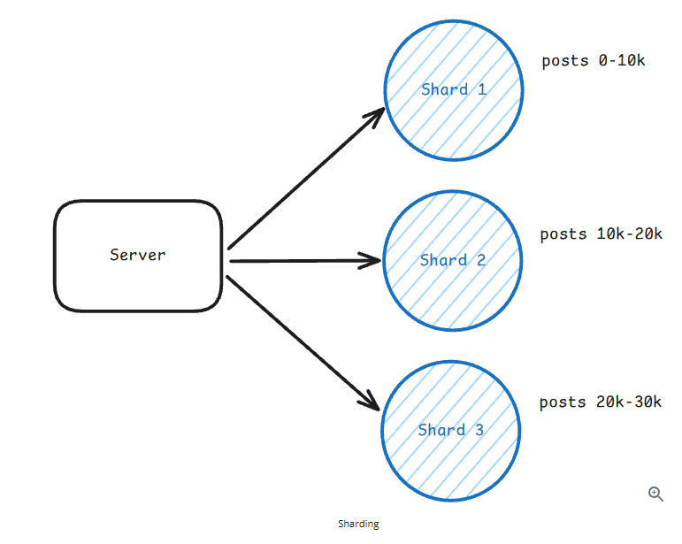

# Schema Design Fundamentals

Once you've picked your database type, you need to design a schema that supports your system's requirements.

---

## Requirements

Everything flows from three key factors that require careful consideration and were likely already determined during the requirements gathering and API design phases.

### Data Volume

Data volume determines where your data can physically live. A social media app with millions of users might need data spread across multiple data stores, which drives schema design choices. If user data and post data need to live on separate systems for performance or organizational reasons, they necessarily need distinct schemas with careful consideration of how they reference each other.

### Access Patterns

Access patterns are the most important factor and drive most of your design decisions. How will your data be queried? A news feed that loads "recent posts by followed users" suggests you'll want denormalized data or carefully designed indexes. An analytics dashboard that aggregates data across time periods might need different table structures entirely. This comes naturally from your APIs. Just ask: *What queries will I need to support each endpoint?*

### Consistency Requirements

Consistency requirements determine how tightly coupled your data can be. Financial transactions need strong consistency (no partial charges), which often means keeping related data in the same database with ACID guarantees. But a user's activity feed can handle eventual consistency (it's okay if a like shows up a few seconds later), which allows you to distribute that data across separate systems with different schemas optimized for different access patterns.

### In Interviews

In interviews, explicitly tie your schema choices back to these factors. For example, "Since we need to load feeds quickly and likes can be eventually consistent, I'll denormalize like counts into the posts table." That shows you're reasoning instead of memorizing patterns.

All of the schema design techniques that follow (entities, keys, normalization, indexes, sharding) are just tools to address these three factors.

---

## Entities, Keys and Relationships

Once you've identified your core entities, the next step is to map them into tables (or collections) with clear identifiers and relationships.

For a social media app, you might have users, posts, comments, and likes. Each entity needs a primary key to identify individual records. Use system-generated IDs like `user_id` or `post_id` rather than business data like email addresses. System-generated keys stay stable even when business rules change.

### Schema Example

```
users: id (PK), username, email
posts: id (PK), user_id (FK → users.id), content, created_at
comments: id (PK), post_id (FK → posts.id), user_id (FK → users.id), content
likes: user_id (FK → users.id), post_id (FK → posts.id)
```

This shows the core relationships: each post belongs to one user (posts.user_id), each comment belongs to one post and one user, and likes connect users to posts. The (PK) marks primary keys, (FK) marks foreign keys with arrows showing what they reference.

### In Interviews

Just pick an obvious primary key and explain why. "post_id will be our primary key so we can identify each post and reference it from comments and likes."

### Relationship Types

With entities defined, connect them with relationships:

- **One-to-many (1:N):** a user has many posts, a post has many comments
- **Many-to-many (N:M):** users like many posts, posts are liked by many users
- **One-to-one (1:1):** rare in practice, often a sign that two tables should just be merged

### Foreign Keys and Constraints

These relationships are enforced through foreign keys in SQL (e.g., `posts.user_id → users.id`) or by application logic in NoSQL. Foreign keys help ensure referential integrity - meaning they prevent orphaned records like a post referencing a user that doesn't exist, or comments pointing to deleted posts. However, they come at a cost because the database has to validate each insert/update. At very large scale, some companies drop them for write performance and enforce integrity at the application level. In an interview, mentioning them shows you understand the trade-off.

Finally, layer in constraints like NOT NULL, UNIQUE, or CHECK. These enforce correctness at the database level (emails must be unique, prices must be positive). They protect data quality, though they also add write overhead.

### Keep It Grounded

Keep your schema grounded in the problem domain: users, tweets, follows if you're modeling Twitter, not abstract "entities" and "relationships." Then show how keys, foreign keys, and constraints keep that model correct and scalable.

---

## Indexing for Access Patterns

Indexes are data structures that help the database find records quickly without scanning every row. Think of them like the index in a book - instead of reading every page to find "normalization," you look it up in the index and jump directly to page 149. While data modeling in an interview, you'll typically want to callout which columns are indexed and why.

### Design Indexes for Your Queries

Your indexes should directly support your most important queries. For a social media app:

- **Index on posts.user_id** to quickly find all posts by a user
- **Index on posts.created_at** to load recent posts chronologically
- **Composite index on (user_id, created_at)** to efficiently load a user's recent posts

For a deeper understanding of how indexes work under the hood, different index types (B-trees, hash indexes, etc.), and advanced indexing strategies, see our Database Indexing deep dive.

### Connect to Your API

In interviews, connect your indexes directly to your API endpoints. "The GET /users/{id}/posts endpoint needs an index on posts.user_id" shows you're thinking about real query performance.

---

## Normalization vs Denormalization

Normalization means storing each piece of information in exactly one place. User data lives only in the users table, not duplicated across other tables. This prevents data anomalies where updates happen in one place but not another, leaving your system with inconsistent state.

### Normalized Example

**Users table:**
| id | username | email |
|---|---|---|
| 1 | john_doe | john@example.com |
| 2 | jane_doe | jane@example.com |

**Posts table:**
| id | user_id (FK) | content | created_at |
|---|---|---|---|
| 1 | 1 | Hello, world! | 2024-01-01 10:00:00 |
| 2 | 1 | My first post | 2024-01-01 10:05:00 |

### Denormalized Example

| id | user_id | username | email | content | created_at |
|---|---|---|---|---|---|
| 1 | 1 | john_doe | john@example.com | Hello, world! | 2024-01-01 10:00:00 |
| 2 | 1 | john_doe | john@example.com | My first post | 2024-01-01 10:05:00 |

### The Problem

In the denormalized version, if a user changes their username, you'd have to update every single post they've ever made. Miss one update and you have inconsistent data.

### Best Practice

In system design interviews, start with a clean normalized model and denormalize only when needed. Avoid repeating data in your schema design. Repeating data is wasteful and creates consistency problems that are much harder to solve than the performance problems you're trying to avoid.

### When Denormalization Makes Sense

There are a few key exceptions where denormalization might make sense:

- **Analytics and reporting systems** where you're aggregating data that changes infrequently
- **Event logs and audit trails** where you're capturing a snapshot of data at a point in time
- **Heavily read-optimized systems** like search engines where consistency is less critical than speed

### Cache Instead of Denormalize

That said, even if you need denormalized quick access for performance, you can just put a cache in front that has a denormalized representation of the data. Your source of truth stays clean and normalized, but your cache can have pre-computed joins, aggregations, or whatever structure makes reads fast.

---

## Scaling and Sharding

When your data gets too large for a single database, you need to shard it across multiple machines. The key is choosing a partition strategy that keeps related data together.

### Shard by Primary Access Pattern

Shard by the primary access pattern. If you mostly query "posts by user," shard by `user_id`. This keeps a user's posts on the same database, avoiding expensive cross-shard queries.

### Avoid Time-Range Sharding

Be careful with time-range sharding. While it sounds appealing for "recent posts" queries, all current writes hit the same shard (the latest time range), creating a hot shard. This is usually an anti-pattern for write-heavy systems. Time-range partitioning works better for archival or analytics workloads where recent data isn't actively written to.

### Avoid Cross-Shard Queries

Avoid cross-shard queries whenever possible. If your timeline feature needs to show posts from multiple users a user follows, and you've sharded by `user_id`, you'll have to query multiple shards and merge results. This is expensive and complex.



### Critical Decision

Your choice of shard key is often permanent and affects every query. Think carefully about your primary access patterns before choosing how to shard your data.

---

## Conclusion

Data modeling is a core part of system design interviews, but it's not the focus. Your goal is to show that you can design a reasonable schema that supports your system's requirements, then move on.

### Interview Checklist

Start by outlining your core entities early in the interview. Then, when introducing a database component during the high-level design:

1. **Determine the type of database** you'll use
2. **List the columns** needed to fulfill the functional requirements for each entity
3. **Specify primary and foreign keys** for each relationship
4. **Determine which columns need indexes** (if any)
5. **Determine whether you need to denormalize** for performance
6. **Consider whether sharding is necessary.** If yes, choose a shard key that matches your main access pattern

At the end, your whiteboard should look something like this:


