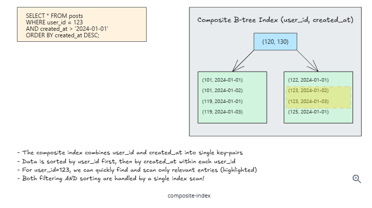

# Index Optimization Patterns

So far, we've explored the main types of indexes you'll encounter in system design interviews: B-trees for general-purpose querying, hash indexes for exact matches, geospatial indexes for location data, and inverted indexes for text search. Each type solves a specific class of problem, with trade-offs in storage, performance, and flexibility.

Experienced engineers spend significant time analyzing their application's read and write patterns, looking for ways to reduce the processing overhead of common queries. They identify performance bottlenecks by examining query plans and database metrics, then strategically improve performance using appropriate indexing strategies. This often requires looking beyond just picking the right type of index - it's about understanding your access patterns and crafting an indexing approach that efficiently supports them.

---

## Composite Indexes

Composite indexes are the most common optimization pattern you'll encounter in practice. Instead of creating separate indexes for each column, we create a single index that combines multiple columns in a specific order. This matches how we typically query data in real applications.

### The Problem They Solve

Consider a typical social media feed query:

```sql
SELECT * FROM posts 
WHERE user_id = 123 
AND created_at > '2024-01-01'
ORDER BY created_at DESC;
```

You could create two separate indexes:

```sql
CREATE INDEX idx_user ON posts(user_id);
CREATE INDEX idx_time ON posts(created_at);
```

But this isn't optimal. The database would need to:

1. Use one index to find all posts by user 123
2. Use another index to find all posts after January 1st
3. Intersect these results
4. Sort the final result set by created_at

This is expensive and slow.

### How Composite Indexes Work

Instead, a composite index gives us everything we need in one shot:

```sql
CREATE INDEX idx_user_time ON posts(user_id, created_at);
```

When we create a composite index, we're really creating a B-tree where each node's key is a concatenation of our indexed columns. For our `(user_id, created_at)` index, each key in the B-tree is effectively a tuple of both values. The B-tree maintains these keys in sorted order based on user_id first, then created_at. Conceptually, the keys might look like:

```
(1, 2024-01-01)
(1, 2024-01-02)
(1, 2024-01-03)
(2, 2024-01-01)
(2, 2024-01-02)
(3, 2024-01-01)
```

Now when we execute our query, the database can traverse the B-tree to find the first entry for user_id=123, then scan sequentially through the index entries for that user until it finds entries beyond our date range. Because the entries are already sorted by created_at within each user_id group, we get both our filtering and sorting for free.

This structure is particularly efficient because we're using the B-tree's natural ordering to handle multiple conditions in a single index traversal. We've effectively turned our two-dimensional query (user and time) into a one-dimensional scan through ordered index entries.



### The Order Matters

The order of columns in a composite index is crucial. Our index on `(user_id, created_at)` is great for queries that filter on user_id first, but it's not helpful for queries that only filter on created_at. This follows from how B-trees work - we can only use the index efficiently for prefixes of our column list.

This is why you'll often hear database experts say "order columns from most selective to least selective." But there's more nuance in practice. Sometimes query patterns trump selectivity - if you frequently sort by a particular column, including it in your composite index (even if it's not highly selective) can eliminate expensive sort operations.

#### Common Interview Scenarios

Consider common interview scenarios like:

- **Order history lookups:** `(customer_id, order_date)`
- **Event processing:** `(status, priority, created_at)`
- **Activity feeds:** `(user_id, type, timestamp)`

---

## Covering Indexes

A covering index is one that includes all the columns needed by your query - not just the columns you're filtering or sorting on. Think about showing a social media feed with post timestamps and like counts. With a regular index on `(user_id, created_at)`, the database first finds matching posts in the index, then has to fetch each post's full data page just to get the like count. That's a lot of extra disk reads just to display a number.

By including the likes column directly in our index, we can skip those expensive page lookups entirely. The database can return everything we need straight from the index itself.

### Example: Covering Index

```sql
CREATE TABLE posts (
    id SERIAL PRIMARY KEY,
    user_id INT,
    title TEXT,
    content TEXT,
    likes INT,
    created_at TIMESTAMP
);

-- Regular index
CREATE INDEX idx_user_time ON posts(user_id, created_at);

-- Covering index includes likes column
CREATE INDEX idx_user_time_likes ON posts(user_id, created_at) INCLUDE (likes);
```

With the covering index, PostgreSQL can return results purely from the index data - no need to look up each post in the main table. This is especially powerful for queries that only need a small subset of columns from large tables.

### Trade-Offs

The trade-off is, of course, size - covering indexes are larger because they store extra columns. But for frequently-run queries that only need a few columns, the performance boost from avoiding table lookups often justifies the storage cost. This is particularly true in social feeds, leaderboards, and other read-heavy features where query speed is critical.

### Practical Reality in 2026

The reality in 2026 is that covering indexes are more of a niche optimization than a go-to solution. Modern database query optimizers have become quite smart at executing queries efficiently with regular indexes. While covering indexes can provide significant performance gains in specific scenarios - like read-heavy tables with limited columns - they come with real costs in terms of maintenance overhead and storage space.

In an interview, you may be wise to focus on simpler indexing strategies and, if reaching for covering indexes, be sure you have a good reason for why it's necessary. If you're not sure if they make sense in a given scenario, it's often better to err on the side of simplicity.

---

## Wrapping Up


Indexes matter. Not just in interviews, but in production systems. Knowing how to use them effectively is a key skill for any developer and is knowledge that is regularly tested in interviews.

### Most Important Principles

Most important is knowing when you need an index, and on what columns. This should be a natural instinct when you're designing a new schema. Consider the query patterns you're likely to run, and whether you'll be filtering or sorting on certain columns.

### Choosing Index Types

From here, expect that you may be asked what type of index you would use for a given scenario. When in doubt, go with B-trees. They're the swiss army knife of indexes, handling both exact matches and range queries efficiently, and they're what most databases use by default for good reason.

### The Main Exceptions

The two main exceptions are when you're dealing with spatial data, or full-text search.

**For spatial data:** If you're dealing with latitude and longitude, and need to efficiently search for nearby points, you'll want to opt for a geospatial index. If you only want to know one option, learn geohashing. Better still if you can explain how it works and weigh the tradeoffs between it and tree-based approaches.

**For full-text search:** When it comes to full-text search, you'll need an inverted index to search large amounts of text efficiently. While it's unlikely you'll face detailed questions about how they work, you should have a basic understanding of the reverse mapping from keywords to documents.

### Ready for Interviews

With these tools in your toolbelt, you'll be well prepared for the overwhelming majority of indexing questions that may come your way.
