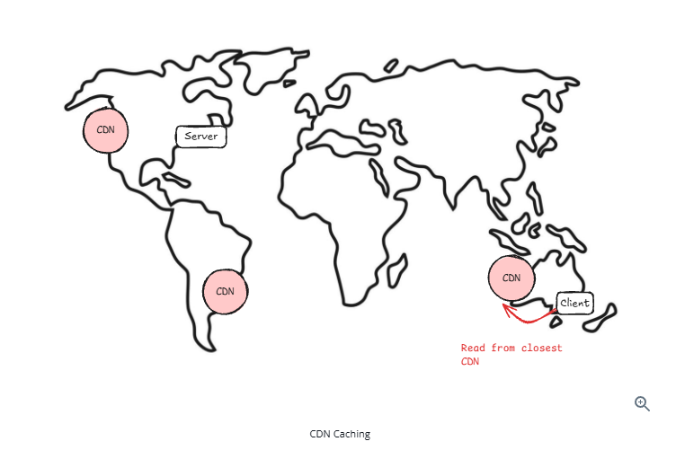
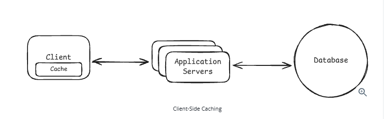
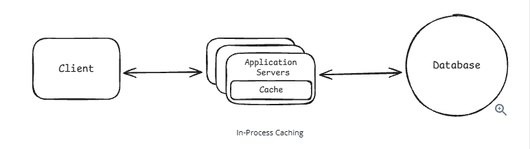

# Where to Cache

In system design interviews, caching comes up almost every time you need to handle high read traffic. Your database becomes the bottleneck, latency starts creeping up, and the interviewer is waiting for you to say the word: cache.

Reading a user profile from Postgres may take 50 milliseconds, but reading from an in-memory cache like Redis takes just 1 millisecond. That's a 50x improvement in latency. Databases store data on disk, and every query pays the cost of disk access. Memory sits much closer to the CPU and avoids that entirely.

Caches are essential for scalable systems. They reduce load on the database and cut latency dramatically. But they also create new challenges around invalidation and failure handling.

This breakdown covers the basics of caching, when and where to use it, common pitfalls, and how to talk about caching clearly in interviews.

---

## Where to Cache

When most engineers hear caching, they immediately think of Redis or Memcached sitting between the application and the database. It is the most common type of cache and the one interviewers care about the most.

But caching shows up in multiple layers of a system. Browsers cache. CDNs cache. Applications cache. Even databases have built-in caching layers.

Let's look at the main places you can cache data, why each one exists, and when it makes sense to use it.

---

## External Caching

An external cache is a standalone cache service that your application talks to over the network. This is what most people think of when they hear caching. You store frequently accessed data in something like Redis or Memcached so you do not have to hit the database every time.

External caches scale well because every application server can share the same cache. They also support eviction policies like LRU and expiration via TTL so your memory footprint stays controlled.

In system design interviews, external caching with Redis is the default answer when discussing caching strategies. Interviewers expect you to mention it for any high-traffic system. Start here, then layer on other caching types such as CDN or client-side caching only if the problem calls for them.

---

## CDN (Content Delivery Network)

A CDN is a geographically distributed network of servers that caches content close to users. Instead of every request traveling to your origin server, a CDN stores copies of your content at edge servers around the world.

Modern CDNs like Cloudflare, Fastly, and Akamai can cache much more than static files. They can also cache public API responses, HTML pages, and even run edge logic to personalize content or enforce security rules before requests reach your servers. But the most common and most impactful use of a CDN is still media delivery.

### How CDN Caching Works

A user requests an image from your app.
The request goes to the nearest CDN edge server.
If the image is cached there, it is returned immediately.
If not, the CDN fetches it from your origin server, stores it, and returns it.
Future users in that region get the image instantly from the CDN.

### Why CDN Matters

Without a CDN, every image request travels to your origin. If your server is in Virginia and the user is in India, that adds 250–300 ms of latency per request. With a CDN, the same image is served from a nearby edge server in 20–40 ms. That is a massive performance difference.

Even though modern CDNs can cache API responses and dynamic content, in system design interviews the safest time to introduce a CDN is when your system serves static media at scale. Start with that reason first, then expand only if the problem calls for more.

---

## Client-Side Caching

Client-side caching stores data close to the requester to avoid unnecessary network calls. This usually means the user's device, like a browser (HTTP cache, localStorage) or mobile app using local memory or on-device storage.

But it can also mean caching within a client library. For example, Redis clients cache cluster metadata like which nodes are in the cluster and which slots are assigned to them. That way, the client can route requests directly to the right node without querying the cluster on every operation.

### Characteristics

For user-facing caching, you have limited control from the backend. Data can go stale and invalidation is harder. The Strava app keeps your run data on the device while you are offline and syncs it later. A browser reusing a previously downloaded image from disk is also caching.

---

## In-Process Caching

Most candidates, and engineers, overlook the fact that servers run on machines with a lot of memory. Each hardware generation ships more of it. You can use that memory to cache data directly inside the application process instead of always calling out to Redis or the database.

The idea is simple: if your service keeps requesting the same small pieces of data again and again, store them in a local cache inside the process. Reads from local memory are even faster than reads from Redis because they avoid any network call.

### Good Use Cases

This light-weight form of caching makes sense for small pieces of data that are requested frequently like:

- Configuration values
- Feature flags
- Small reference datasets
- Hot keys
- Rate limiting counters
- Precomputed values

### Trade-Offs

In-process caching is blazing fast, but it comes with obvious limitations. Each instance of your application has its own cache, so cached data is not shared across servers. If one instance updates or invalidates a cached value, the others will not know.

Use in-process caching for small, frequently accessed values that rarely change. It is great for speed but not a replacement for Redis. In system design interviews, mention this only as an optimization layer after you have already introduced an external cache.
