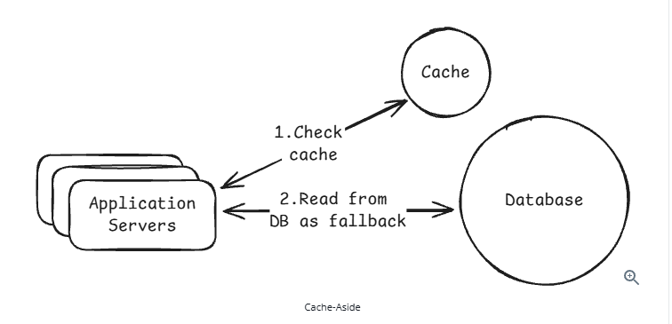
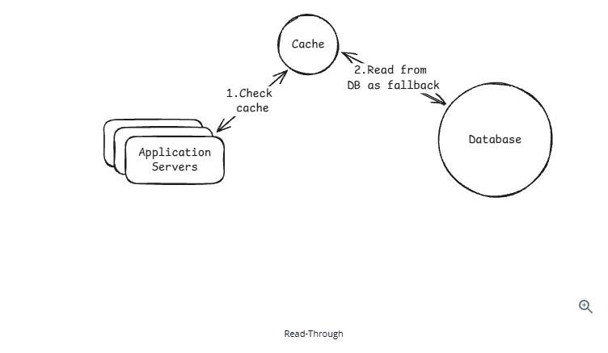
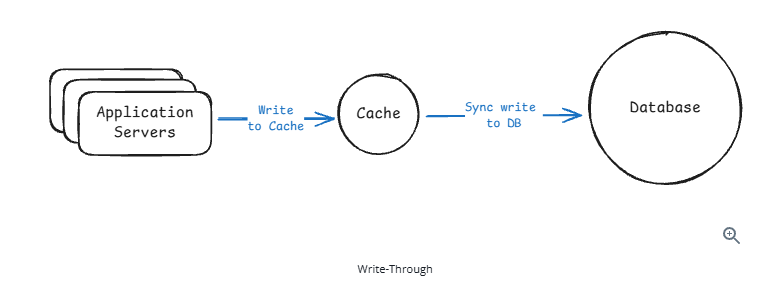
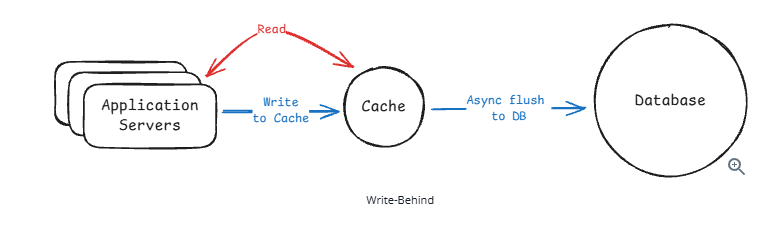

# Cache Architectures

Not all caching works the same way. How you read from and write to the cache changes performance, consistency, and complexity. These are the four core cache patterns you should know for system design interviews.

---

## 1. Cache-Aside (Lazy Loading)

In the cache-aside pattern, the application is responsible for reading from and writing to the cache. When the application needs data, it first checks the cache. If the data is not there (a cache miss), it loads the data from the database, stores it in the cache, and then returns it.

Cache-aside only caches data when needed, which keeps the cache lean. The downside is that a cache miss causes extra latency.

**If you only remember one caching pattern for interviews, make it cache-aside.**

---

## 2. Read-Through

With read-through caching, the cache acts as a smart proxy. Your application never talks to the database directly. On a cache miss, the cache itself fetches from the database, stores the data, and returns it.

This is the read equivalent of write-through. In both patterns, the cache acts as an intermediary that handles database operations. Read-through manages reads, write-through manages writes. Systems often combine both patterns.

### Complexity and Limitations

This centralizes caching logic but adds complexity and usually requires a specialized caching library or service. It is less common in practice than cache-aside.

CDNs are a form of read-through cache. When a CDN gets a cache miss, it fetches from your origin server, caches the result, and returns it. But for application-level caching with Redis, cache-aside is far more common.

Generally speaking, there are very few reasons to propose this pattern in system design interviews unless you're discussing CDNs or similar infrastructure.

---

## 3. Write-Through

With write-through caching, the application writes only to the cache. The cache then synchronously writes to the database before returning to the application. The write operation does not complete until both the cache and database are updated.

In practice, this requires a cache implementation that supports write-through, like a caching library with a data store plugin. When you write to the cache, the library handles calling your database write logic before acknowledging the write. Redis itself does not natively support write-through, so you need application code or a framework to implement this pattern.

### Trade-Offs

The tradeoff is slower writes because the application must wait for both the cache update and the database write to complete. Write-through can also pollute the cache with data that may never be read again.

Write-through still suffers from the dual-write problem. If the cache update succeeds but the database write fails, or vice versa, the systems can end up inconsistent. You need retry logic, error handling, or eventually accept that perfect consistency is difficult without distributed transactions.

In system design interviews, write-through is less common than cache-aside because it requires specialized caching infrastructure and still has consistency edge cases.

**Use this when reads must always return fresh data and your system can tolerate slightly slower writes.**

---

## 4. Write-Behind (Write-Back)

With write-behind caching, the application writes only to the cache. The cache batches and writes the data to the database asynchronously in the background.

### When to Use

This makes writes very fast, but introduces risk. If the cache crashes before flushing, you can lose data. This is best for workloads where occasional data loss is acceptable.

**Use this when you need high write throughput and eventual consistency is acceptable. Common in analytics and metrics pipelines.**
