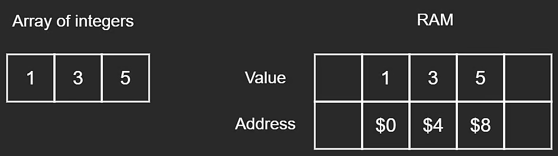
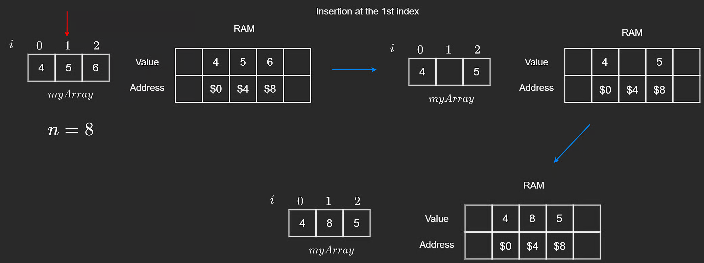

# Static Arrays

In statically typed languages like **Java**, **C++**, and **C#**, arrays must have a fixed **size** and **type** when initialized. These are called **static arrays**.

They are called _static_ because their size cannot change after declaration. Once the array is full, it cannot store additional elements.

Some dynamically typed languages (such as Python and JavaScript) do not expose static arrays directly. They use alternatives, which are discussed in the next lesson.

Let's cover key array operations and the time complexity of each.

## 1) Reading From an Array

To read an element, we access it by index.

```javascript
// initialize myArray
let myArray = [1, 3, 5];

// access an arbitrary element, where i is the index of the desired value
myArray[i];
```



Accessing one array element is constant time because each index maps directly to a RAM address.

- Time complexity: **$O(1)$**

### Important Clarification About $O(1)$

There is a common confusion that **$O(1)$ always means fast**. Not necessarily.

An operation could do 1000 steps and still be $O(1)$ if that number does **not grow** with input size. Big-O measures growth, not absolute runtime.

## 2) Traversing an Array

To read all values, we traverse from start to end.

```javascript
for (let i = 0; i < myArray.length; i++) {
  console.log(myArray[i]);
}

// OR

let i = 0;
while (i < myArray.length) {
  console.log(myArray[i]);
  i++;
}
```

The last element is always at index **$n - 1$**, where $n$ is array size.

If size is 3, the last valid index is 2.

Traversing an array of size $n$ takes:

- Time complexity: **$O(n)$**

The number of operations grows linearly with array size (10 elements -> about 10 visits, 100 elements -> about 100 visits, etc.).

## 3) Deleting From an Array

### Deleting From the End

In statically typed languages, array slots are typically initialized with default values (like `0`, `null`, etc.).

When removing the last element, we usually perform a **soft delete**:

- overwrite with a default/sentinel value (`0`, `null`, `-1`, etc.), and
- decrement logical length by 1.

```javascript
// Remove from the last position in the array if the array
// is not empty (i.e. length is non-zero).
removeEnd(arr, length) {
    if (length > 0) {
        // Overwrite last element with some default value.
        // We would also consider the length to be decreased by 1.
        arr[length - 1] = 0;
        length--;
    }
}
```


In `[4, 5, 6]`, value `6` is overwritten by `0` or `-1` to mark it removed, and length becomes one less.

### Deleting at an I-th Index

If we delete at a random index `i`, we cannot just replace with `0`, because that would break contiguity in the middle.

Deleting from the end preserves contiguity. Deleting from the middle requires shifting.

Better approach:

1. Given deletion index `i`.
2. Iterate from `i + 1` to end.
3. Shift each element one position left.
4. Optionally set last slot to `0`/`null` and decrement length.

```javascript
// Remove value at index i before shifting elements to the left.
// Assuming i is a valid index.
removeMiddle(arr, i, length) {
    // Shift starting from i + 1 to end.
    for (let index = i + 1; index < length; index++) {
        arr[index - 1] = arr[index];
    }
    // No need to 'remove' arr[i], since we already shifted
}
```


Worst case: deleting the first element requires shifting nearly all elements.

- Time complexity: **$O(n)$**

## 4) Insertion

### Inserting at the End

To insert at the end, place the new value at index `length` (next free slot).

```javascript
// Insert n into arr at the next open position.
// Length is the number of 'real' values in arr, and capacity
// is the size (aka memory allocated for the fixed size array).
insertEnd(arr, n, length, capacity) {
    if (length < capacity) {
        arr[length] = n;
    }
}
```

This writes one value:

- Time complexity: **$O(1)$**

**Note:** `length` is current element count, while `capacity` is maximum storable elements.

### Inserting at the I-th Index

Inserting at arbitrary index `i` is more involved because insertion may happen in the middle.

Example: array `[4, 5, 6]`, insert at `i = 1` (or `i = 0`).

We cannot overwrite existing values, so we shift values one step right, starting from the end down to `i`.

```javascript
// Insert n into index i after shifting elements to the right.
// Assuming i is a valid index and arr is not full.
insertMiddle(arr, i, n, length) {
    // Shift starting from the end to i.
    for (let index = length - 1; index > i - 1; index--) {
        arr[index + 1] = arr[index];
    }
    // Insert at i
    arr[i] = n;
}
```

The image below shows inserting `8` at index `1` in `[4, 5, 6]`. If there is no extra capacity, last element `6` is lost.



This demonstrates why shifting must happen **before** insertion to avoid overwriting.

## Static Array Time Complexity Summary


---

## NeetCode Practice (Static Arrays)

Use the problems below in pattern progression order: **single pass -> two pointers (in-place) -> suffix maximum (right-to-left)**.

### 1) Max Consecutive Ones

- Difficulty: **Easy**
- Pattern: **Single pass + running counter**
- Core idea: Track the current streak of `1`s. Reset on `0`. Keep the best streak seen so far.

**Problem statement (summary):**
Given a binary array `nums`, return the maximum number of consecutive `1`s.

**Example:**

- Input: `nums = [1,1,0,1,1,1]`
- Output: `3`

**Complexity:**

- Time: **$O(n)$**
- Space: **$O(1)$**

**Intuition:**
Update the running streak on every element. If the value is `1`, increment the streak; otherwise, reset it to `0`. After each step, update the best answer seen so far.

**Algorithm:**

1. Initialize `res = 0` and `cnt = 0`.
2. Traverse `nums` from left to right.
3. If current value is `1`, do `cnt++`; else set `cnt = 0`.
4. Update `res = Math.max(res, cnt)`.
5. Return `res`.

**TypeScript solution:**

```typescript
class Solution {
  findMaxConsecutiveOnes(nums: number[]): number {
    let res = 0;
    let cnt = 0;

    for (const num of nums) {
      cnt = num === 1 ? cnt + 1 : 0;
      res = Math.max(res, cnt);
    }

    return res;
  }
}
```

### 2) Remove Element (Two Pointers, In-Place)

- Difficulty: **Easy**
- Pattern: **Two pointers + in-place overwrite**
- Core idea: Keep a valid range `[0, n)`. When `nums[i] === val`, replace it with the last valid element (`nums[n - 1]`) and shrink `n`. Only advance `i` when current value is kept.

**Problem statement (summary):**
Given an integer array `nums` and integer `val`, remove all occurrences of `val` in-place. Return `k`, the number of elements not equal to `val`.

**Example:**

- Input: `nums = [3,2,2,3]`, `val = 3`
- Output: `k = 2`, `nums = [2,2,_,_]`

**Complexity:**

- Time: **$O(n)$**
- Space: **$O(1)$**

**Intuition:**
When a value equals `val`, replace it with the last value in the current valid range and shrink the range. This avoids unnecessary shifting and keeps the operation in-place.

**Algorithm:**

1. Initialize `i = 0` and `n = nums.length`.
2. While `i < n`:
3. If `nums[i] === val`, set `nums[i] = nums[n - 1]`, then decrement `n`.
4. Otherwise increment `i`.
5. Return `n` (count of kept elements).

**TypeScript solution:**

```typescript
class Solution {
  removeElement(nums: number[], val: number): number {
    let i = 0;
    let n = nums.length;

    while (i < n) {
      if (nums[i] === val) {
        nums[i] = nums[n - 1];
        n--;
      } else {
        i++;
      }
    }

    return n;
  }
}
```

### 3) Replace Elements with Greatest Element on Right Side

- Difficulty: **Easy**
- Pattern: **Suffix maximum (right-to-left traversal)**
- Core idea: Traverse from right to left while maintaining `rightMax`. At each index, write current `rightMax`, then update it with the current value.

**Problem statement (summary):**
Given an array `arr`, replace every element with the greatest element among elements to its right, and replace the last element with `-1`.

**Example:**

- Input: `arr = [2,4,5,3,1,2]`
- Output: `[5,5,3,2,2,-1]`

**Complexity:**

- Time: **$O(n)$**
- Space: **$O(1)$** auxiliary space (output array not counted)

**Intuition:**
Scan from right to left while tracking `rightMax`. For each index, the current `rightMax` is exactly the greatest value to that element's right.

**Algorithm:**

1. Create `ans` with same length as `arr`.
2. Set `rightMax = -1`.
3. Traverse indices from `n - 1` down to `0`.
4. Set `ans[i] = rightMax`.
5. Update `rightMax = Math.max(rightMax, arr[i])`.
6. Return `ans`.

**TypeScript solution:**

```typescript
class Solution {
  replaceElements(arr: number[]): number[] {
    const n = arr.length;
    const ans = new Array<number>(n);
    let rightMax = -1;

    for (let i = n - 1; i >= 0; i--) {
      ans[i] = rightMax;
      rightMax = Math.max(rightMax, arr[i]);
    }

    return ans;
  }
}
```

### Quick Study Tip

When reviewing static arrays, ask this first:

1. Can I solve it in one pass?
2. If not, can two pointers help me do it in-place?
3. If not, should I scan from right to left with a suffix value?

### Optional Follow-up

If you want additional practice, rewrite each of the three solutions to:

1. Use different variable names and still explain the same invariant.
2. Add one tricky edge case test input.
3. State the invariant in one interview-ready sentence.
