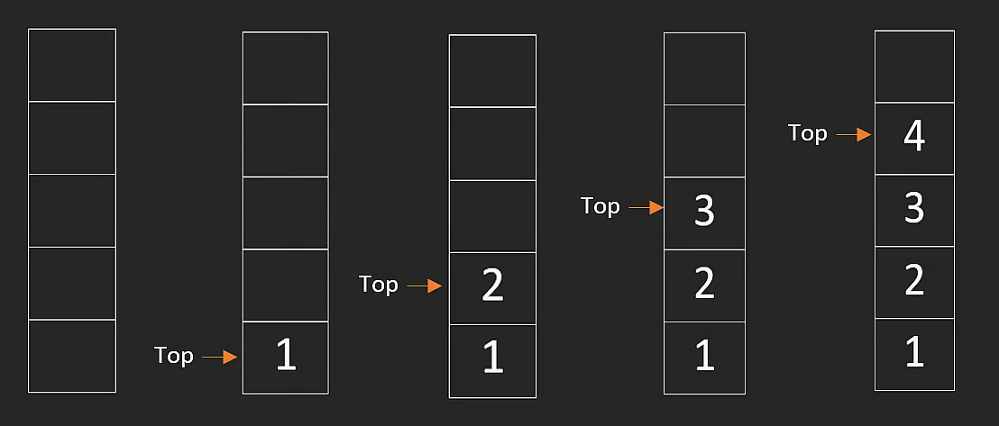
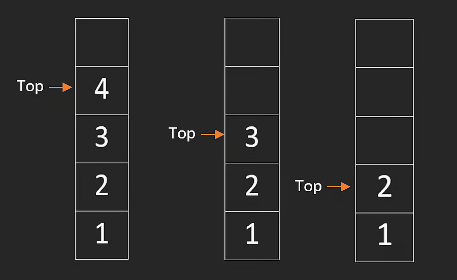
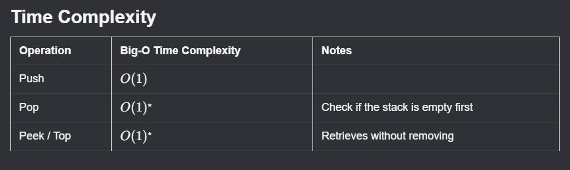

# Stacks

A stack is a data structure that supports a subset of dynamic-array operations.

You can only add and remove elements from one end, called the top. In practice, stacks follow **LIFO (Last In, First Out)** behavior: the last element inserted is the first one removed.

An intuitive analogy is a stack of plates. You can only place a plate on top or take one from top.

Core stack operations are:

- push (insert at top)
- pop (remove from top)
- peek (read top without removing)

## Push

Push inserts an element at the top of the stack. With a dynamic array, this is append-at-end and is typically **$O(1)$**.

```javascript
push(n) {
    this.stack.push(n);
}
```



In many languages, stacks are implemented directly with dynamic arrays.

## Pop

Pop removes and returns the top element. With a dynamic array, this is remove-last and is typically **$O(1)$**.

```javascript
pop() {
    return this.stack.pop();
}
```



## Peek

Peek returns the current top element without removing it.

```javascript
peek() {
    return this.stack[this.stack.length - 1];
}
```

This operation is also **$O(1)$**.

## Stack Time Complexity Summary



---

## NeetCode Practice (Stacks)

### 1) Baseball Game

- Difficulty: **Easy**
- Pattern: **Simulation with stack**
- Core idea: Use a stack to keep valid scores. Process each operation and maintain a running sum.

**Problem statement (summary):**
Given a list of operations, process baseball scoring rules:

- Integer `x`: add score `x`
- `+`: add sum of previous two valid scores
- `D`: add double previous valid score
- `C`: remove previous valid score

Return total score after all operations.

**Example:**

- Input: `ops = ["1","2","+","C","5","D"]`
- Output: `18`

**Intuition:**
The operations only depend on recent valid scores, so a stack is ideal. Keeping a running total avoids an extra pass at the end.

**Algorithm:**

1. Initialize empty stack and `res = 0`.
2. For each operation:
3. If `+`, sum top two scores, push result, add to `res`.
4. If `D`, double top score, push result, add to `res`.
5. If `C`, pop top score and subtract from `res`.
6. Otherwise parse number, push it, add to `res`.
7. Return `res`.

**TypeScript solution:**

```typescript
class Solution {
  calPoints(operations: string[]): number {
    const stack: number[] = [];
    let res = 0;

    for (const op of operations) {
      if (op === "+") {
        const top = stack.pop() as number;
        const newTop = top + stack[stack.length - 1];
        stack.push(top);
        stack.push(newTop);
        res += newTop;
      } else if (op === "D") {
        const doubled = 2 * stack[stack.length - 1];
        stack.push(doubled);
        res += doubled;
      } else if (op === "C") {
        res -= stack.pop() as number;
      } else {
        const score = Number(op);
        stack.push(score);
        res += score;
      }
    }

    return res;
  }
}
```

**Complexity:**

- Time: **$O(n)$**
- Space: **$O(n)$**

### 2) Valid Parentheses

- Difficulty: **Easy**
- Pattern: **Matching pairs with stack**
- Core idea: Push opening brackets. On closing bracket, it must match the most recent opening bracket.

**Problem statement (summary):**
Given a string containing only `()[]{}`, return `true` if all brackets are correctly matched and nested.

**Examples:**

- Input: `s = "[]"` -> Output: `true`
- Input: `s = "([{}])"` -> Output: `true`
- Input: `s = "[(])"` -> Output: `false`

**Intuition:**
Valid nesting requires last-opened to be first-closed, which is exactly stack behavior.

**Algorithm:**

1. Create stack for opening brackets.
2. Create map from closing to opening bracket.
3. Iterate characters in `s`.
4. If opening bracket, push it.
5. If closing bracket, check top matches mapped opener.
6. If not matched, return `false`; otherwise pop.
7. At end, return whether stack is empty.

**TypeScript solution:**

```typescript
class Solution {
  isValid(s: string): boolean {
    const stack: string[] = [];
    const closeToOpen: Record<string, string> = {
      ")": "(",
      "]": "[",
      "}": "{",
    };

    for (const c of s) {
      if (c in closeToOpen) {
        if (stack.length > 0 && stack[stack.length - 1] === closeToOpen[c]) {
          stack.pop();
        } else {
          return false;
        }
      } else {
        stack.push(c);
      }
    }

    return stack.length === 0;
  }
}
```

**Complexity:**

- Time: **$O(n)$**
- Space: **$O(n)$**

### 3) Min Stack

- Difficulty: **Medium**
- Pattern: **Stack with min tracking**
- Core idea: Store encoded differences in one stack and maintain current minimum in a variable.

**Problem statement (summary):**
Design a stack supporting:

- `push(val)`
- `pop()`
- `top()`
- `getMin()`

All operations must be **$O(1)$**.

**Example:**

- Input: `["MinStack", "push", 1, "push", 2, "push", 0, "getMin", "pop", "top", "getMin"]`
- Output: `[null, null, null, null, 0, null, 2, 1]`

**Constraints:**

- $-2^{31} \le val \le 2^{31} - 1$
- `pop`, `top`, and `getMin` are called only on non-empty stack

**Intuition:**
Store `val - min` instead of raw values. Negative encoded values signal that a new minimum was introduced. On pop, a negative value lets us restore the previous minimum in constant time.

**Algorithm:**

1. Track `stack` (encoded values) and `min` (current minimum).
2. On first push, store `0` and set `min = val`.
3. On next pushes, store `val - min`; if `val < min`, update `min`.
4. On pop, if encoded value is negative, restore old minimum.
5. On top, decode using current `min`.
6. On getMin, return current `min`.

**TypeScript solution:**

```typescript
class MinStack {
  private min: number;
  private stack: number[];

  constructor() {
    this.min = Infinity;
    this.stack = [];
  }

  push(val: number): void {
    if (this.stack.length === 0) {
      this.stack.push(0);
      this.min = val;
    } else {
      this.stack.push(val - this.min);
      if (val < this.min) {
        this.min = val;
      }
    }
  }

  pop(): void {
    if (this.stack.length === 0) {
      return;
    }

    const encoded = this.stack.pop() as number;
    if (encoded < 0) {
      this.min -= encoded;
    }
  }

  top(): number {
    const encoded = this.stack[this.stack.length - 1];
    return encoded > 0 ? encoded + this.min : this.min;
  }

  getMin(): number {
    return this.min;
  }
}
```

**Complexity:**

- Time: **$O(1)$** for all operations
- Space: **$O(n)$**
