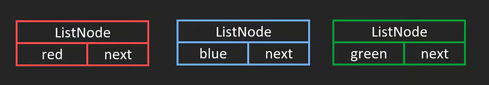
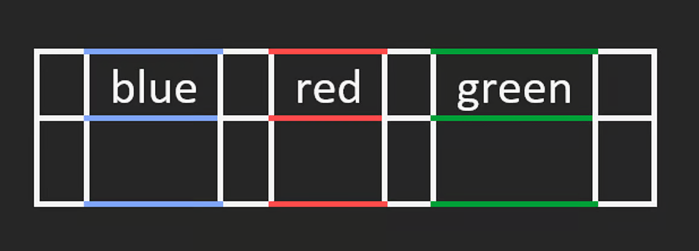
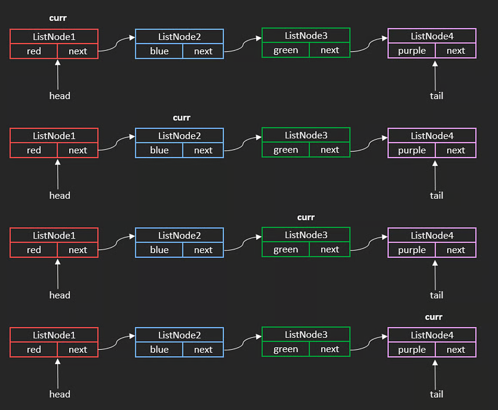
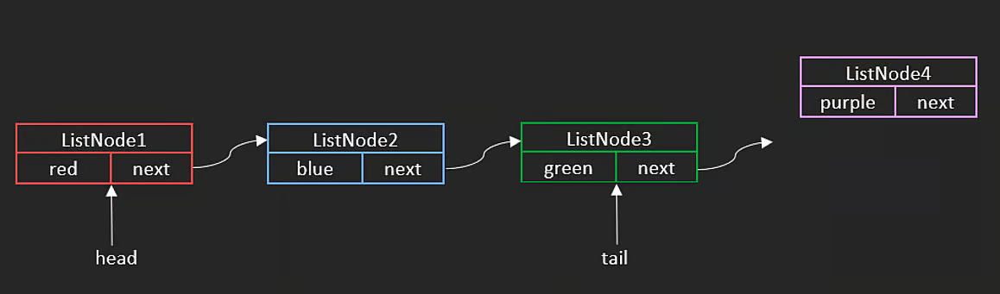
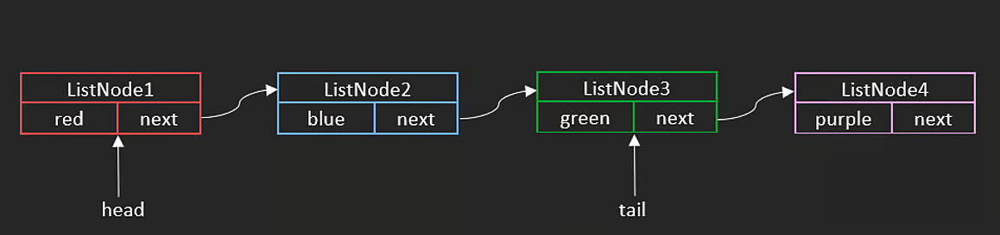
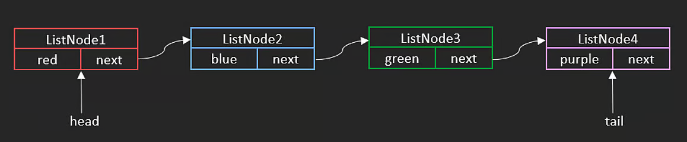
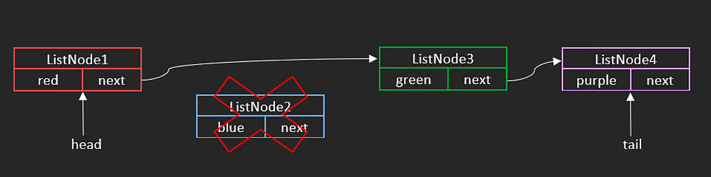
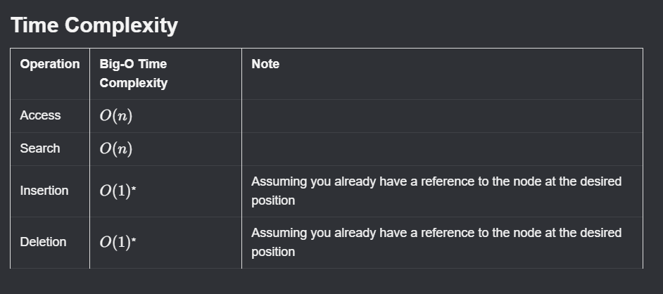

# Singly Linked Lists

A linked list stores elements in an ordered sequence, similar to an array. The key difference is that elements are **not** stored contiguously in memory.

Instead, a linked list is made up of objects called **ListNodes**, each with two attributes:

- `value` — the data stored in the node (a number, string, etc.)
- `next` — a reference to the next node in the list

## Creating a Linked List

We start by defining the `ListNode` class:

```javascript
class ListNode {
    constructor(value) {
        this.value = value;
        this.next = null;
    }
}
```

By chaining nodes together via `next`, we build a list. Suppose we have three nodes: `ListNode1`, `ListNode2`, `ListNode3`.



In this example, values are strings — red, blue, green.

When nodes are instantiated, they are likely **not** stored contiguously in memory (unlike arrays). This is fine — the `next` pointer connects them regardless of location.



To connect the nodes:

```javascript
ListNode1.next = ListNode2;
ListNode2.next = ListNode3;
ListNode3.next = null; // last node always points to null
```

## Traversal

To traverse from start to end, use a `while` loop:

```javascript
let cur = ListNode1;
while (cur) {
    cur = cur.next;
}
```

1. Start at the `head` of the list.
2. Track position in `cur`.
3. Loop until `cur` becomes `null`.
4. Each iteration: advance via `cur = cur.next`.

- Time complexity: **$O(n)$**



## Circular Linked List

If the last node's `next` points back to the first node instead of `null`, the result is a **circular linked list**.

Iterating through one without a cycle-detection mechanism would cause an *infinite loop*.

## Operations

A linked list tracks two pointers: **head** (first node) and **tail** (last node). If there is only one node, both point to the same node.

### Appending

Appending to the tail is **$O(1)$** — we only update one pointer.

> **Key advantage over arrays:** no shifting of elements is needed, since nodes do not have to be contiguous in memory.

> **Note:** This $O(1)$ assumes we already hold a reference to the insertion point. If we have to traverse to find it first, the operation takes $O(n)$.

**Steps to append `ListNode4`:**

**1.** Connect the current tail to the new node.



```javascript
tail.next = ListNode4;
```

**2.** Update the tail pointer.



```javascript
tail = ListNode4;
```



### Deleting

Deleting a node (given a direct reference) is **$O(1)$** — we only update one pointer.

> **Note:** If we have to traverse to find the deletion point first, the operation takes $O(n)$.

To delete `ListNode2`, skip over it by relinking `head.next` to `head.next.next`:

```javascript
head.next = head.next.next;
```



`ListNode1` now points directly to `ListNode3`. In garbage-collected languages, `ListNode2`'s memory is freed automatically. In languages like C, you must free it manually.

## Singly Linked List Time Complexity Summary



---

## NeetCode Practice (Singly Linked Lists)

### 1) Reverse Linked List

- Difficulty: **Easy**
- Pattern: **Pointer reversal**
- Core idea: Flip every `next` pointer to face backward. Two approaches: iterative (preferred for space) or recursive.

**Problem statement (summary):**
Given the head of a singly linked list, reverse the list and return the new head.

**Example:**

- Input: `head = [0,1,2,3]`
- Output: `[3,2,1,0]`

---

#### Approach 1: Iterative

**Intuition:**
Walk left-to-right, flipping each `next` pointer backward at every step. Three pointers track the current node, the previous node, and the saved-next so the chain is not lost.

**Algorithm:**

1. Set `prev = null`, `curr = head`.
2. While `curr` exists:
3. Save `temp = curr.next`.
4. Flip: `curr.next = prev`.
5. Advance: `prev = curr`, `curr = temp`.
6. Return `prev` (new head).

**TypeScript solution:**

```typescript
interface ListNode {
    val: number;
    next: ListNode | null;
}

class Solution {
    reverseList(head: ListNode | null): ListNode | null {
        let prev: ListNode | null = null;
        let curr: ListNode | null = head;

        while (curr) {
            const temp = curr.next;
            curr.next = prev;
            prev = curr;
            curr = temp;
        }

        return prev;
    }
}
```

**Complexity:**

- Time: **$O(n)$**
- Space: **$O(1)$**

---

#### Approach 2: Recursive

**Intuition:**
Recurse all the way to the last node — it becomes the new head. On the way back up the call stack, reverse one link per frame, then break the original forward link to avoid cycles.

```
reverseList(0)
  -> reverseList(1)
    -> reverseList(2)
      -> reverseList(3)   // base case: returns node 3 as newHead
    // unwind: 3 -> 2
  // unwind: 2 -> 1
// unwind: 1 -> 0
```

**Algorithm:**

1. Base case: if `head` is `null`, return `null`.
2. Recurse on `head.next`; save the returned new head.
3. Reverse current link: `head.next.next = head`.
4. Break forward link: `head.next = null`.
5. Return the new head (original last node).

**TypeScript solution:**

```typescript
class Solution {
    reverseList(head: ListNode | null): ListNode | null {
        if (!head) return null;

        let newHead: ListNode = head;

        if (head.next) {
            // Recurse; newHead ends up as the original last node.
            newHead = this.reverseList(head.next) as ListNode;

            // Reverse the current link (e.g. 2 -> 3 becomes 3 -> 2).
            head.next.next = head;
        }

        // Break the original forward link to avoid a cycle.
        head.next = null;

        return newHead;
    }
}
```

**Complexity:**

- Time: **$O(n)$**
- Space: **$O(n)$** — recursive call stack

Merge Two Sorted Linked Lists
Easy
Topics
Company Tags
Hints
You are given the heads of two sorted linked lists list1 and list2.

Merge the two lists into one sorted linked list and return the head of the new sorted linked list.

The new list should be made up of nodes from list1 and list2.

Input: list1 = [1,2,4], list2 = [1,3,5]

Output: [1,1,2,3,4,5]

1. Recursion
Intuition
Merging two sorted linked lists recursively works by always choosing the smaller head node of the two lists.
Whichever list has the smaller value should appear first in the merged list.
So we:

Pick the smaller node.
Recursively merge the rest of the lists.
Attach the result to the chosen node.
Algorithm
If one list is empty, return the other list — nothing left to merge.
Compare the head values of list1 and list2:
If list1.val <= list2.val:
Set list1.next to the merged result of the remaining nodes.
Return list1 as the current head.
Otherwise:
Set list2.next to the merged result of the remaining nodes.
Return list2 as the current head.
The recursion continues until both lists are fully merged.

mergeTwoLists(list1: ListNode | null, list2: ListNode | null): ListNode {
        /*
        Input: list1 = [1,2,4], list2 = [1,3,5]

        RECURSION
        */

        if (!list1) {
            return list2
        }

        if (!list2) {
            return list1
        }

        if (list1.val <= list2.val) {
            list1.next = this.mergeTwoLists(list1.next, list2)
            return list1;
        } else {
            list2.next = this.mergeTwoLists(list1, list2.next)
            return list2;
        }
}

Time complexity: O(n+m)
Space complexity: O(n+m)

2. Iteration
Intuition
To merge two sorted linked lists iteratively, we build the result step-by-step.
We keep a pointer (node) to the current end of the merged list, and at each step we choose the smaller head node from list1 or list2.

Because the lists are already sorted, whichever head is smaller must come next in the merged list.
We attach that node, move the pointer forward, and continue until one list is empty.
Finally, we attach the remaining nodes from the non-empty list.

Using a dummy node makes handling the head of the merged list simple and clean.

Algorithm
Create a dummy node and a node pointer pointing to it.
While both lists have nodes:
Compare list1.val and list2.val.
Attach the smaller node to node.next.
Move forward in the chosen list.
Move node to node.next.
When one list becomes empty:
Attach the remaining nodes of the other list to node.next.
Return dummy.next, which is the head of the merged list.

mergeTwoLists(list1: ListNode | null, list2: ListNode | null): ListNode {

        const dummy = { val: 0, next: null };
        let node = dummy;

        while (list1 && list2) {
            if (list1.val < list2.val) {
                node.next = list1;
                list1 = list1.next;
            } else {
                node.next = list2;
                list2 = list2.next;
            }
            node = node.next;
        }

        if (list1) {
            node.next = list1;
        } else {
            node.next = list2;
        }

        return dummy.next;
    }

Time complexity: O(n+m)
Space complexity: O(1) because we are not using any additional data structures that scale with input size.


