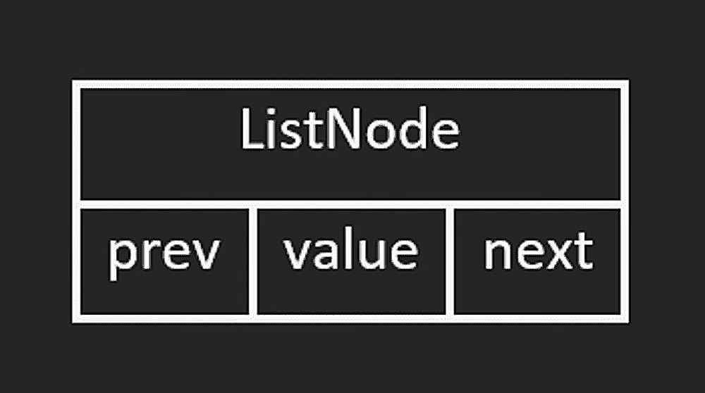
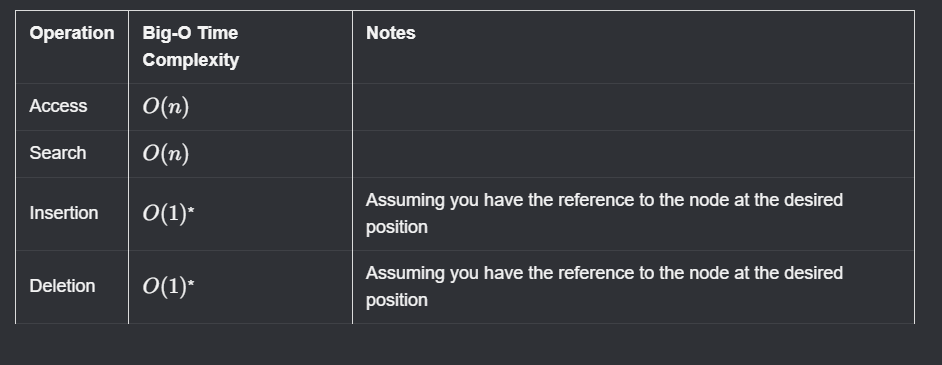

# Doubly Linked Lists

After learning singly linked lists, the next variation is the **doubly linked list**.

Each node has two pointers:

- `next`: points to the next node
- `prev`: points to the previous node

If `prev` is `null`, that indicates we are at the head of the list.



## Insertion at the End

Like singly linked lists, inserting at the tail is **$O(1)$** when we already track `tail`.

The difference is that we also update the `prev` pointer of the new node.

Example with `ListNode1 -> ListNode2 -> ListNode3`, inserting `ListNode4` at the end:

```javascript
tail.next = ListNode4;
ListNode4.prev = tail;
tail = tail.next;
```

## Deletion at the End

Deleting at the tail is also **$O(1)$**.

Steps:

1. Get reference to the node before tail (`tail.prev`).
2. Set its `next` pointer to `null`.
3. Move `tail` to that previous node.
4. Optionally clear the old tail's `prev`.

```javascript
ListNode2 = tail.prev;
ListNode2.next = null;
tail = ListNode2;
```

Because both insertion and deletion at one end are $O(1)$, a linked list can theoretically implement stack behavior as well (though arrays are often more common in practice).

## Access Pattern

As with singly linked lists, random access is not possible.

In the worst case, reaching a specific node requires traversing up to `n` nodes:

- Access by index/value search: **$O(n)$**

The advantage over singly linked lists is that traversal can happen in both directions.

## Time Complexity Summary


