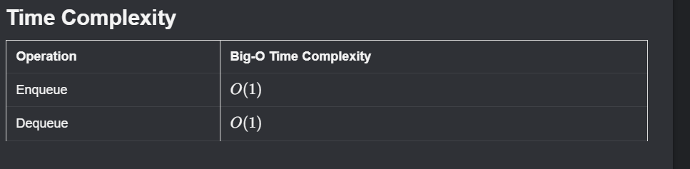

# Queues

A **queue** is a data structure with **FIFO (First In, First Out)** behavior.

It is similar to stacks in being linear, but different in removal order:

- Stack: Last In, First Out
- Queue: First In, First Out

A real-world example is a line at a bank: the first person in line is the first person served.

## Implementation and Core Operations

The easiest queue implementation is with a linked list.

You can also implement it with a dynamic array, but to match linked-list efficiency you generally need a **circular array** and extra index management.

Core queue operations:

- `enqueue`: add at the end (tail)
- `dequeue`: remove from the front (head)

## Enqueue

`enqueue` inserts a value at the end of the queue. With a singly linked list and maintained head/tail references, this is **$O(1)$**.

```javascript
enqueue(val) {
    const newNode = new ListNode(val);

    if (this.right != null) {
        // Queue is not empty
        this.right.next = newNode;
        this.right = this.right.next;
    } else {
        // Queue is empty
        this.left = newNode;
        this.right = newNode;
    }
}
```

## Dequeue

`dequeue` removes and returns the value from the front of the queue.

```javascript
dequeue() {
    if (this.left == null) {
        // Queue is empty
        return;
    }

    // Remove left node and return value
    const val = this.left.val;
    this.left = this.left.next;

    if (!this.left) {
        this.right = null;
    }

    return val;
}
```

As with stacks, it is good practice to handle empty-structure checks before removals.

## Deque Variation

A **deque** (pronounced "deck") is a double-ended queue.

It allows insertion/removal from both head and tail in **$O(1)$**.

## Common Use Case

Queues are fundamental for **breadth-first search (BFS)** in trees and graphs.

## Time Complexity Summary


