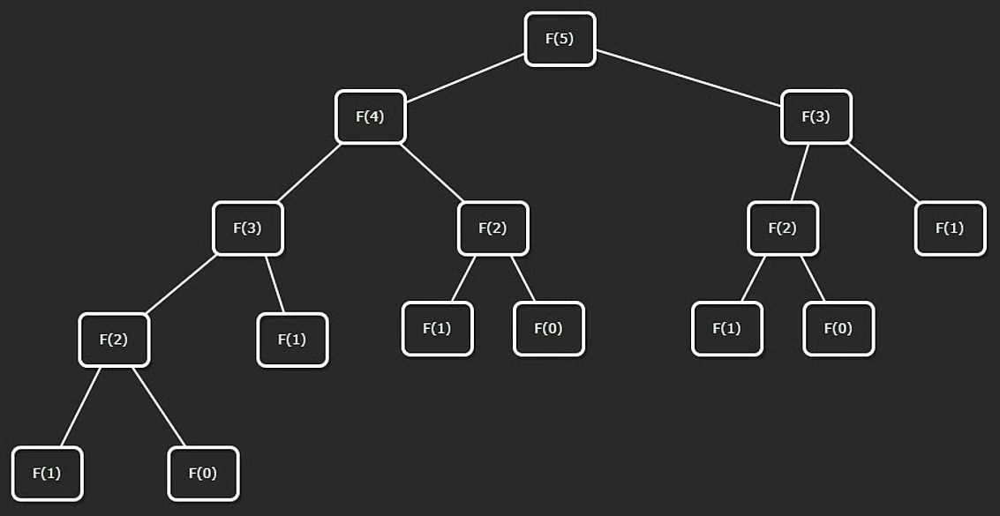

# Recursion (Two Branch)

A common form of recursion is **multi-branch recursion**.

In this lesson, we use the Fibonacci sequence as a classic two-branch example.

## Fibonacci Sequence

The Fibonacci sequence starts as:

`0, 1, 1, 2, 3, 5, 8, 13, 21, 34, ...`

Each value is the sum of the previous two values.

Formally:

- $F(0)=0$
- $F(1)=1$
- $F(n)=F(n-1)+F(n-2)$

Base cases are $F(0)$ and $F(1)$.
Recursive case is $F(n)=F(n-1)+F(n-2)$.

Recurrence relation:

$$
fib(n) = fib(n-1) + fib(n-2)
$$



```javascript
// Recursive implementation to calculate the n-th Fibonacci number
function fibonacci(n) {
  // Base case
  if (n <= 1) {
    return n;
  }

  // Recursive case
  return fibonacci(n - 1) + fibonacci(n - 2);
}
```

## Walkthrough: `fibonacci(5)`

Start with:

- `fibonacci(5) = fibonacci(4) + fibonacci(3)`

Each branch recursively expands until base cases (`0` or `1`) are reached.

Then values are combined while returning back up:

- `fibonacci(4) = 3`
- `fibonacci(3) = 2`
- `fibonacci(5) = 3 + 2 = 5`

## Complexity of Naive Recursion

At each level, calls can branch by about 2x.

An upper-bound node count follows a geometric sum:

$$
1 + 2 + 4 + 8 + \dots + 2^n
$$

So naive recursive Fibonacci has exponential time:

- Time: **$O(2^n)$**
- Space: **$O(n)$** recursion depth

---

## NeetCode Practice (Recursion to DP)

### 1) Climbing Stairs

- Difficulty: **Easy**
- Pattern: **Recursion -> Dynamic Programming**
- Core idea: From step `i`, you can move to `i + 1` or `i + 2`, which creates a Fibonacci-like recurrence.

**Problem statement (summary):**
Given `n` steps, and moves of 1 or 2 steps, return the number of distinct ways to reach the top.

**Example:**

- Input: `n = 2`
- Output: `2`
- Explanation: `1 + 1`, `2`

### Approach 1: Top-Down DP (Memoization)

**Intuition:**
Pure recursion repeats the same subproblems many times. Memoization stores each result once and reuses it.

**Algorithm:**

1. Create `cache` initialized to `-1`.
2. Define `dfs(i)`:
3. If `i == n`, return `1`.
4. If `i > n`, return `0`.
5. If cached, return cache value.
6. Compute `dfs(i + 1) + dfs(i + 2)`, store, return.
7. Return `dfs(0)`.

```typescript
class Solution {
  climbStairs(n: number): number {
    const cache = new Int32Array(n).fill(-1);

    const dfs = (i: number): number => {
      if (i >= n) {
        return i === n ? 1 : 0;
      }

      if (cache[i] !== -1) {
        return cache[i];
      }

      cache[i] = dfs(i + 1) + dfs(i + 2);
      return cache[i];
    };

    return dfs(0);
  }
}
```

**Complexity:**

- Time: **$O(n)$**
- Space: **$O(n)$**

### Approach 2: Bottom-Up DP

**Intuition:**
Ways to reach step `i` come from `i - 1` and `i - 2`, so:

$$
dp[i] = dp[i-1] + dp[i-2]
$$

**Algorithm:**

1. If `n <= 2`, return `n`.
2. Build `dp` array of size `n + 1`.
3. Set `dp[1] = 1`, `dp[2] = 2`.
4. Fill from `3` to `n`.
5. Return `dp[n]`.

```typescript
class Solution {
  climbStairs(n: number): number {
    if (n <= 2) {
      return n;
    }

    const dp = new Array<number>(n + 1).fill(0);
    dp[1] = 1;
    dp[2] = 2;

    for (let i = 3; i <= n; i++) {
      dp[i] = dp[i - 1] + dp[i - 2];
    }

    return dp[n];
  }
}
```

**Complexity:**

- Time: **$O(n)$**
- Space: **$O(n)$**

### Approach 3: DP (Space Optimized)

**Intuition:**
Only the previous two states are needed, so we can replace the full DP array with two variables.

**Algorithm:**

1. Initialize `one = 1`, `two = 1`.
2. Repeat `n - 1` times:
3. `newWays = one + two`
4. Shift: `two = one`, `one = newWays`
5. Return `one`.

```typescript
class Solution {
  climbStairs(n: number): number {
    let one = 1;
    let two = 1;

    for (let i = 0; i < n - 1; i++) {
      const temp = one;
      one = one + two;
      two = temp;
    }

    return one;
  }
}
```

**Complexity:**

- Time: **$O(n)$**
- Space: **$O(1)$**


