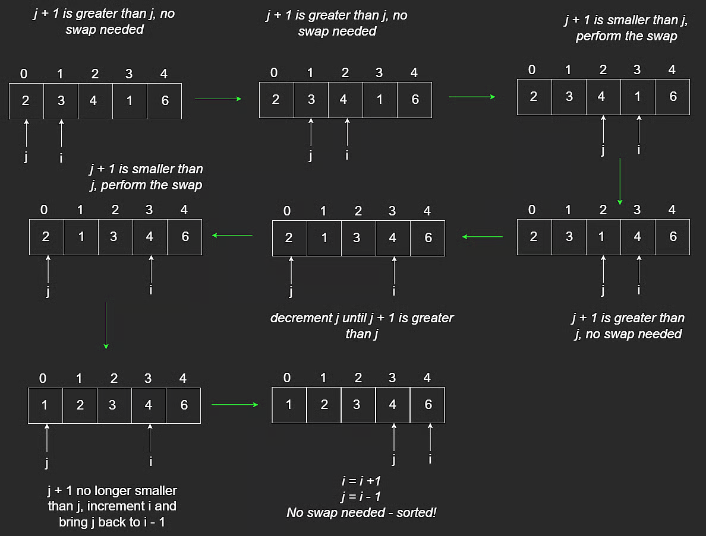

# Insertion Sort

Insertion sort is a classic sorting algorithm used across many data structures.

It is simple and easy to understand, but not the most efficient choice for large datasets.

## Concept

Given `[2,3,4,1,6]`, the goal is to produce `[1,2,3,4,6]`.

Insertion sort builds a sorted prefix one element at a time.

Key idea:

- A subarray of size `1` is already sorted.
- Treat the first element as the initial sorted portion.
- Insert each next element into its correct position inside that sorted portion.

Two-pointer view:

- `i`: points to the element being inserted.
- `j`: starts at `i - 1` and moves left.

We keep swapping left while the current element is smaller than the previous element.

```javascript
function insertionSort(arr) {
  for (let i = 1; i < arr.length; i++) {
    let j = i - 1;

    while (j >= 0 && arr[j + 1] < arr[j]) {
      const tmp = arr[j + 1];
      arr[j + 1] = arr[j];
      arr[j] = tmp;
      j--;
    }
  }

  return arr;
}
```



Insertion sort works on any comparable data type, not just integers.

## Stability

A sorting algorithm is stable if equal values preserve relative order.

Example: `[7,3,7]`.

After sorting, the `7` that originally appeared first still appears before the second `7`.

Insertion sort is stable.

## Time and Space Complexity

### Time

- Best case (already sorted): **$O(n)$**
- Average case: **$O(n^2)$**
- Worst case (reverse sorted, like `[5,4,3,2,1]`): **$O(n^2)$**

### Space

- **$O(1)$** (in-place)

---

## NeetCode Practice (Sorting)

### 1) Insertion Sort (Intermediate States)

- Difficulty: **Easy**
- Pattern: **Stable in-place insertion + snapshots**
- Core idea: Perform insertion sort, and after each outer-loop insertion, save a copy of the current array state.

**Problem statement (summary):**
Given a list of key-value pairs, sort by key using insertion sort and return all intermediate array states.

If two pairs have equal keys, maintain their relative order.

**Input constraints:**

- `0 <= pairs.length <= 100`
- each pair has integer key and string value

**Example:**

- Input: `pairs = [(5, "apple"), (2, "banana"), (9, "cherry")]`
- Output:

```text
[
  [(5, "apple"), (2, "banana"), (9, "cherry")],
  [(2, "banana"), (5, "apple"), (9, "cherry")],
  [(2, "banana"), (5, "apple"), (9, "cherry")]
]
```

There should be exactly `pairs.length` states.

**Algorithm:**

1. Initialize result list `res`.
2. For each index `i`, move `pairs[i]` left while previous key is larger.
3. After finishing insertion for this `i`, push a shallow copy of `pairs` into `res`.
4. Return `res`.

**TypeScript solution:**

```typescript
// class Pair {
//     constructor(public key: number, public value: string) {}
// }

class Solution {
  insertionSort(pairs: Pair[]): Pair[][] {
    const n = pairs.length;
    const res: Pair[][] = [];

    for (let i = 0; i < n; i++) {
      let j = i - 1;

      while (j >= 0 && pairs[j].key > pairs[j + 1].key) {
        [pairs[j], pairs[j + 1]] = [pairs[j + 1], pairs[j]];
        j -= 1;
      }

      res.push([...pairs]);
    }

    return res;
  }
}
```

**Complexity:**

- Time: **$O(n^2)$** in the worst case
- Space: **$O(n^2)$** for storing all snapshot states in `res`
