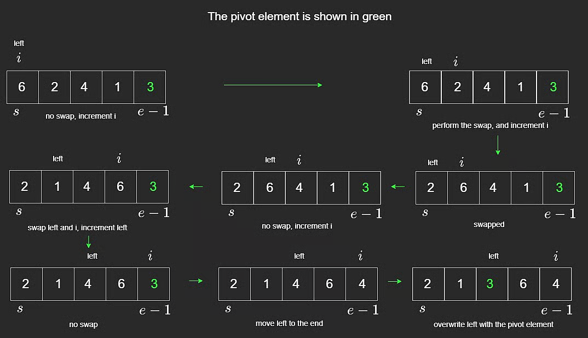

# Quick Sort

Quick sort is another divide-and-conquer sorting algorithm, similar in spirit to merge sort.

Its main idea is to choose a **pivot**, partition the array around that pivot, and then recursively sort the left and right partitions.

## Pivot Selection

Common pivot strategies include:

- first element
- last element
- median-of-three
- random pivot

Ideally, the pivot splits the array into two roughly equal halves.

For simplicity, this lesson uses the **last element** as the pivot.

## Core Idea

After choosing a pivot, partition the array so that:

- values less than or equal to the pivot go on the left
- values greater than the pivot go on the right

Then recursively quick sort both sides.

Unlike merge sort, there is no merge step afterward. The partitioning itself does the key rearrangement work.

Quick sort can be seen as the opposite of merge sort:

- Merge sort: easy split, more involved merge
- Quick sort: more involved partition, no merge

Randomized quicksort reduces the chance of hitting the worst-case split and gives **expected** $O(n \log n)$ time, although worst-case still remains **$O(n^2)$**.

## Partition Step



The array is rearranged so values smaller than the pivot are on the left side, and the pivot lands in its final sorted position.

This happens in-place, without allocating new arrays for each partition.

```javascript
function quickSort(arr, s, e) {
  if (e - s + 1 <= 1) {
    return arr;
  }

  const pivot = arr[e];
  let left = s;

  // Partition: elements smaller than pivot on left side
  for (let i = s; i < e; i++) {
    if (arr[i] < pivot) {
      const tmp = arr[left];
      arr[left] = arr[i];
      arr[i] = tmp;
      left++;
    }
  }

  // Move pivot in-between left and right sides
  arr[e] = arr[left];
  arr[left] = pivot;

  quickSort(arr, s, left - 1);
  quickSort(arr, left + 1, e);

  return arr;
}
```

## Time and Space Complexity

### Time

- Best case: **$O(n \log n)$**
- Average case: **$O(n \log n)$**
- Worst case: **$O(n^2)$**

Why:

- Partitioning each level costs `O(n)`.
- Best/average case gives about `log n` levels.
- Worst case happens when pivot choices are consistently poor, producing partitions of size `n - 1` and `0`.

### Space

- Best/average recursion depth: **$O(\log n)$**
- Worst-case recursion depth: **$O(n)$**

## Stability

Quick sort is **not stable** because it swaps non-adjacent elements.

Example: `[7,3,7,4,5]`

The two `7`s may reverse relative order after partitioning.

---

## NeetCode Practice (Sorting)

### 1) K Closest Points to Origin

- Difficulty: **Medium**
- Pattern: **Sorting by custom key**
- Core idea: Sort points by squared distance from origin, then return the first `k`.

**Problem statement (summary):**
Given points on a 2D plane and integer `k`, return the `k` closest points to `(0, 0)`.

The Euclidean distance is:

$$
\sqrt{(x_1-x_2)^2 + (y_1-y_2)^2}
$$

But for comparison, we can use squared distance instead:

$$
d^2 = x^2 + y^2
$$

**Example:**

- Input: `points = [[0,2],[2,2]], k = 1`
- Output: `[[0,2]]`

### Approach 1: Sorting

**Intuition:**
Square root is monotonic, so sorting by squared distance gives the same ordering as sorting by actual distance.

**Algorithm:**

1. For each point `(x, y)`, compute `x^2 + y^2`.
2. Sort all points by that value.
3. Return the first `k` points.

```typescript
class Solution {
  /**
   * @param {number[][]} points
   * @param {number} k
   * @return {number[][]}
   */
  kClosest(points, k) {
    points.sort((a, b) => a[0] ** 2 + a[1] ** 2 - (b[0] ** 2 + b[1] ** 2));
    return points.slice(0, k);
  }
}
```

**Complexity:**

- Time: **$O(n \log n)$**
- Space: depends on sort implementation, often **$O(\log n)$** or more
