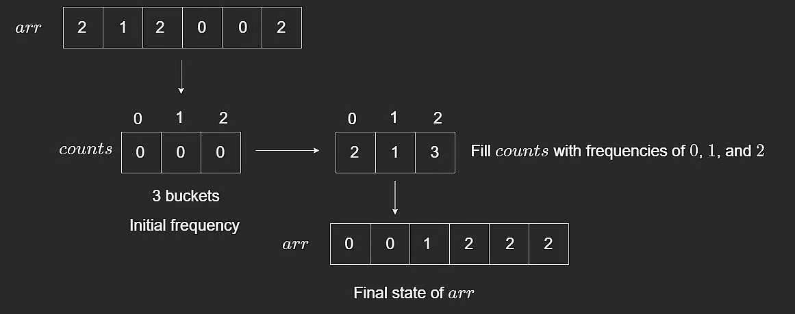

# Bucket Sort

Bucket sort is the last sorting algorithm in this section and an important one to know.

It is not as universally used as merge sort or quick sort, but it works very well when the values fall inside a **small known range**.

## Core Idea

Suppose we have an array of size `6` containing only values in the range `0` to `2`.

Example:

- input: `[2,1,2,0,0,2]`

We create a bucket for each possible value:

- bucket for `0`
- bucket for `1`
- bucket for `2`

In this lesson, a bucket is just an index in a frequency array.

Once the counts are known, we overwrite the original array in sorted order.

```javascript
function bucketSort(arr) {
  // Assuming arr only contains 0, 1, or 2
  const counts = [0, 0, 0];

  // Count occurrences
  for (let i = 0; i < arr.length; i++) {
    counts[arr[i]] += 1;
  }

  // Rebuild array from bucket counts
  let i = 0;
  for (let n = 0; n < counts.length; n++) {
    for (let j = 0; j < counts[n]; j++) {
      arr[i] = n;
      i++;
    }
  }

  return arr;
}
```

## How the Pointers Work

In the second phase:

- `i` = next write position in original array
- `n` = current bucket/value being written
- `j` = how many times current value has been placed so far

Example:

- `counts = [2,1,3]`
- original `arr = [2,1,2,0,0,2]`

When `n = 0`, we write `0` two times.
When `n = 1`, we write `1` one time.
When `n = 2`, we write `2` three times.

Final result:

- `[0,0,1,2,2,2]`



## Time Complexity

At first glance, the nested loops may look like **$O(n^2)$**, but that is not the right analysis.

Why:

- First loop counts all elements: `O(n)`
- Second phase writes each original element exactly once total

So total time is linear in the size of the input plus the bucket range.

For this fixed small-range example, we treat it as:

- Time: **$O(n)$**

This is a good reminder that nested loops do not always mean quadratic time.

## Stability

This implementation is **not stable**.

Because the array is overwritten from frequency counts rather than preserving original element order, relative order among equal items is not kept.

## Closing Notes

Bucket sort is powerful when the dataset lies in a specific bounded range.

For general-purpose algorithm problems, merge sort and quick sort are usually safer defaults.

---

## NeetCode Practice (Sorting)

### 1) Sort Colors

- Difficulty: **Medium**
- Pattern: **Counting sort / bucket frequency**
- Core idea: Count how many `0`s, `1`s, and `2`s appear, then overwrite the array in color order.

**Problem statement (summary):**
You are given an array `nums` where:

- `0` = red
- `1` = white
- `2` = blue

Sort the array in-place so colors are grouped as `0, 1, 2`.

Built-in sort functions are not allowed.

**Example:**

- Input: `nums = [1,0,1,2]`
- Output: `[0,1,1,2]`

### Approach 1: Counting Sort

**Intuition:**
There are only three distinct values, so it is efficient to count each one and then reconstruct the array.

**Algorithm:**

1. Count occurrences of `0`, `1`, and `2`.
2. Overwrite array with all `0`s first.
3. Then write all `1`s.
4. Then write all `2`s.

```typescript
class Solution {
  /**
   * @param {number[]} nums
   * @return {void} Do not return anything, modify nums in-place instead.
   */
  sortColors(nums) {
    const bucket = new Array(3).fill(0);

    for (let i = 0; i < nums.length; i++) {
      const num = nums[i];
      bucket[num]++;
    }

    let j = 0;

    for (let i = 0; i < bucket.length; i++) {
      while (bucket[i] > 0) {
        nums[j] = i;
        j++;
        bucket[i]--;
      }
    }
  }
}
```

**Complexity:**

- Time: **$O(n)$**
- Space: **$O(1)$** since bucket size is fixed at 3
