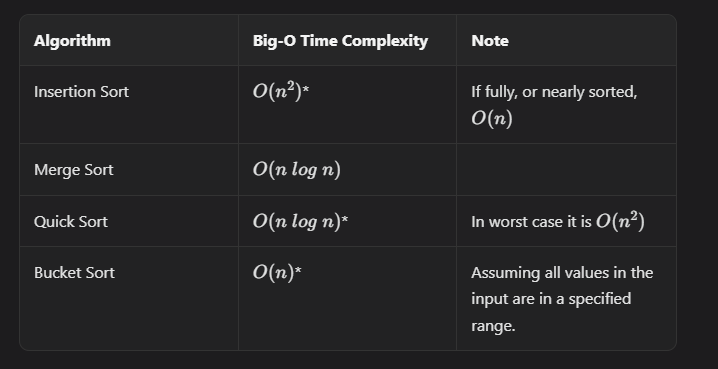

# Sorting Time Complexity Cheat Sheet

Use this chart as a quick reference for comparing the sorting algorithms covered in this module.

It is especially useful when deciding between:

- simpler algorithms like insertion sort
- divide-and-conquer algorithms like merge sort and quick sort
- range-based algorithms like bucket sort

## Visual Summary

## How to Use It

When choosing a sorting approach, ask:

1. Is the array small or nearly sorted?
2. Do I need guaranteed $O(n \log n)$ performance?
3. Is the value range small enough for counting or bucket-style sorting?
4. Do I care whether the algorithm is stable?
