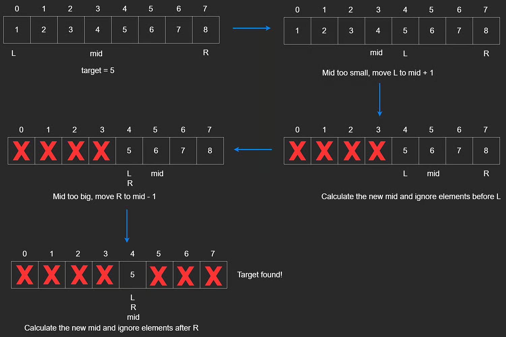
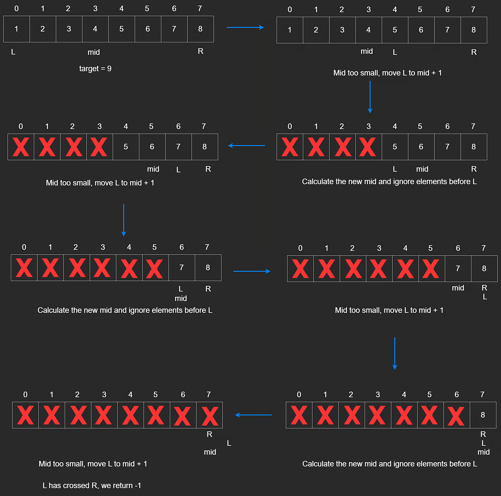

# Binary Search (Search an Array)

Binary search is an efficient way to find a target in a **sorted array**.

It works by repeatedly checking the middle element and discarding half of the search space each time.

Think of searching for a word in a dictionary: open near the middle, decide left or right, and repeat.

## Core Idea

At each step:

- compare `mid` with the target
- if target is larger, search the right half
- if target is smaller, search the left half
- if equal, return the index

Two common binary-search problem types:

- Search Array: find a target in a sorted array
- Search Range: search over a numeric range using a helper or predicate

## Example Walkthrough

Array: `[1,2,3,4,5,6,7,8]`

Target: `5`



Step-by-step:

1. Start with the full array.
2. Check middle index.
3. Since `5 > 4`, move right.
4. Check the new middle.
5. Since `5 < 6`, move left.
6. The target is found.

## Implementation

Use two pointers:

- `L` / `left` / `low`
- `R` / `right` / `high`

Midpoint formula:

$$
mid = L + \frac{R - L}{2}
$$

This is preferred over `(L + R) / 2` because it avoids overflow in languages with fixed-size integers.

```javascript
const arr = [1, 3, 3, 4, 5, 6, 7, 8];

function binarySearch(arr, target) {
  let L = 0;
  let R = arr.length - 1;

  while (L <= R) {
    let mid = Math.floor((L + R) / 2);

    if (target > arr[mid]) {
      L = mid + 1;
    } else if (target < arr[mid]) {
      R = mid - 1;
    } else {
      return mid;
    }
  }

  return -1;
}
```

## Target Not Found

If the target does not exist, the search space eventually becomes empty.

At that point, `L > R`.



## Time and Space Complexity

Binary search halves the search space each time.

If `n` is the array size, then the number of halvings is about:

$$
1 = \frac{n}{2^x}
$$

Solving gives:

$$
x = \log_2(n)
$$

So:

- Time: **$O(\log n)$**
- Space: **$O(1)$**

---

## NeetCode Practice (Binary Search)

### 1) Binary Search

- Difficulty: **Easy**
- Pattern: **Iterative binary search**
- Core idea: Shrink the search range until the target is found or the pointers cross.

**Problem statement (summary):**
Given a sorted array of distinct integers `nums` and a target, return the index of `target` or `-1`.

**Example:**

- Input: `nums = [-1,0,2,4,6,8], target = 4`
- Output: `3`

**Algorithm:**

1. Set `l = 0` and `r = nums.length - 1`.
2. While `l <= r`:
3. Compute middle `m`.
4. If `nums[m] == target`, return `m`.
5. If `nums[m] < target`, search right half.
6. If `nums[m] > target`, search left half.
7. If not found, return `-1`.

```typescript
class Solution {
  search(nums: number[], target: number): number {
    let l = 0;
    let r = nums.length - 1;

    while (l <= r) {
      const m = l + Math.floor((r - l) / 2);

      if (nums[m] > target) {
        r = m - 1;
      } else if (nums[m] < target) {
        l = m + 1;
      } else {
        return m;
      }
    }

    return -1;
  }
}
```

**Complexity:**

- Time: **$O(\log n)$**
- Space: **$O(1)$**

### 2) Search Range

- Difficulty: **Medium**
- Pattern: **Lower bound binary search**
- Core idea: Find the first index where a value is greater than or equal to the target.

**Problem statement (summary):**
Find the first occurrence of a target in a sorted array, or return `-1` if it does not exist.

**Intuition:**
Instead of searching for equality directly, search for the leftmost index where the target could appear.

This naturally handles duplicates and avoids overshooting.

**Algorithm:**

1. Set `l = 0`, `r = nums.length`.
2. While `l < r`:
3. Compute `m`.
4. If `nums[m] >= target`, move left: `r = m`.
5. Otherwise move right: `l = m + 1`.
6. After the loop, check whether `nums[l] === target`.
7. Return the index or `-1`.

```typescript
class Solution {
  search(nums: number[], target: number): number {
    let l = 0;
    let r = nums.length;

    while (l < r) {
      const m = l + Math.floor((r - l) / 2);

      if (nums[m] >= target) {
        r = m;
      } else {
        l = m + 1;
      }
    }

    return l < nums.length && nums[l] === target ? l : -1;
  }
}
```

**Complexity:**

- Time: **$O(\log n)$**
- Space: **$O(1)$**

### 3) Search a 2D Matrix

- Difficulty: **Medium**
- Pattern: **Binary search on flattened indices**
- Core idea: Treat the matrix like one sorted array and map indices back to row/column coordinates.

**Problem statement (summary):**
Given an `m x n` matrix where each row is sorted and the first value of each row is greater than the last value of the previous row, determine whether `target` exists.

**Example:**

- Input: `matrix = [[1,2,4,8],[10,11,12,13],[14,20,30,40]], target = 10`
- Output: `true`

**Intuition:**
Because the matrix is globally sorted row by row, it behaves like one big sorted array.

Index mapping:

- `row = mid / columns`
- `col = mid % columns`

**Algorithm:**

1. Set `left = 0`, `right = rows * columns - 1`.
2. While `left <= right`:
3. Compute `mid`.
4. Convert `mid` to `row` and `col`.
5. Compare matrix value to target.
6. Move left or right accordingly.
7. Return `false` if no match is found.

```typescript
class Solution {
  searchMatrix(matrix: number[][], target: number): boolean {
    const rows = matrix.length;
    const columns = matrix[0].length;

    let left = 0;
    let right = rows * columns - 1;

    while (left <= right) {
      const mid = Math.floor((left + right) / 2);
      const col = mid % columns;
      const row = Math.floor(mid / columns);

      if (matrix[row][col] > target) {
        right = mid - 1;
      } else if (matrix[row][col] < target) {
        left = mid + 1;
      } else {
        return true;
      }
    }

    return false;
  }
}
```

**Complexity:**

- Time: **$O(\log(mn))$**
- Space: **$O(1)$**
