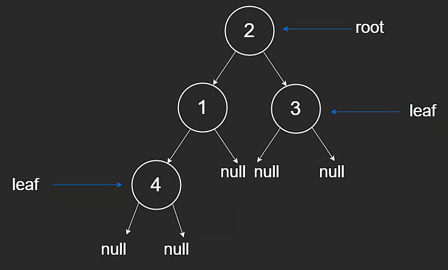

# Binary Trees

## Concept

Similar to linked lists, binary trees are data structures built from nodes and pointers.

In a linked list, nodes form a straight line with `next` (and sometimes `prev`).

In a binary tree, each node has at most two child pointers:

- `left`
- `right`

The first node is called the **root**.

```javascript
class TreeNode {
  constructor(val) {
    this.val = val;
    this.left = null;
    this.right = null;
  }
}
```

Node categories:

- **Leaf node**: no children
- **Non-leaf node**: at least one child

Unlike linked lists, tree edges conceptually point downward from parent to child, and cycles are not allowed.

## Tree Terminology

### Root Node

The root is the top-most node and has no parent. Every node in the tree is reachable from the root.

### Leaf Nodes

Leaf nodes have no children. The bottom-most level is all leaves, but leaves can also appear earlier in uneven trees.



## Height

Tree height is measured from the root down to the lowest leaf.

Two common conventions:

- count nodes in the path
- count edges in the path

For a path with `n` nodes, edge count is `n - 1`.

Example from the diagram:

- height by nodes: `3`
- height by edges: `2`

General fact for trees:

- number of edges = `n - 1` where `n` is number of nodes

## Depth

Depth of a node is measured from that node upward to the root.

As you move down the tree, depth increases.

Like height, depth may be measured by nodes or edges depending on convention.

## Ancestor and Descendant

### Ancestor

A node connected to nodes below it in the tree is an ancestor of those nodes.

The root is an ancestor of every node.

### Descendant

A descendant of a node is:

- its child, or
- child of one of its descendants recursively
