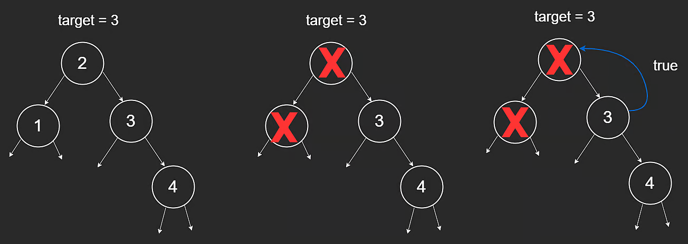

# Binary Search Trees

## Binary Trees vs Binary Search Trees

A **Binary Search Tree (BST)** is a binary tree with an added sorted property:

- every value in the left subtree is smaller than the current node
- every value in the right subtree is greater than the current node

This property is recursive and applies at every node.

It is conceptually similar to a sorted array, but with tree structure.

## Why BSTs

BSTs are useful because they can support:

- search in $O(\log n)$ on balanced trees
- insertion in $O(\log n)$ on balanced trees
- deletion in $O(\log n)$ on balanced trees

Sorted arrays can search in $O(\log n)$, but insertion and deletion are typically $O(n)$ due to shifting.

## BST Search

Because trees are recursive structures, recursion is a natural traversal method.

Example tree: `[2,1,3,null,null,null,4]`

Target: `3`

Search logic:

- if target is greater than current value, go right
- if target is smaller, go left
- if equal, return `true`



```javascript
function search(root, target) {
  if (root == null) {
    return false;
  }

  if (target > root.val) {
    return search(root.right, target);
  } else if (target < root.val) {
    return search(root.left, target);
  } else {
    return true;
  }
}
```

### How It Works

1. If node is `null`, target does not exist in that subtree.
2. If target is greater, recurse right.
3. If target is smaller, recurse left.
4. If equal, return `true`.

Base cases:

- `root == null` -> `false`
- `root.val == target` -> `true`

## Time Complexity

Let `h` be tree height.

- Search cost is proportional to height: **$O(h)$**

So:

- Balanced BST: **$O(\log n)$**
- Skewed BST (worst case): **$O(n)$**

A balanced tree means left and right subtree heights are close (difference at most 1).
