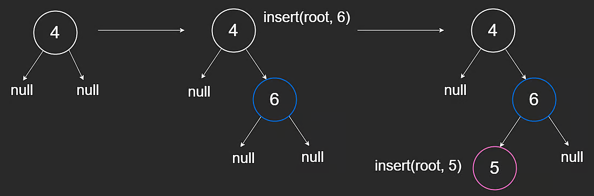
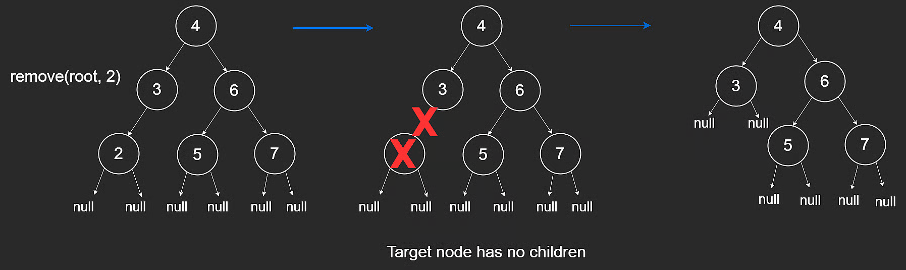
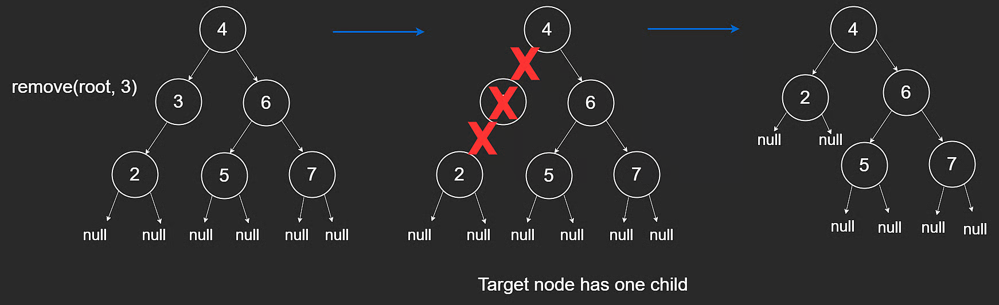
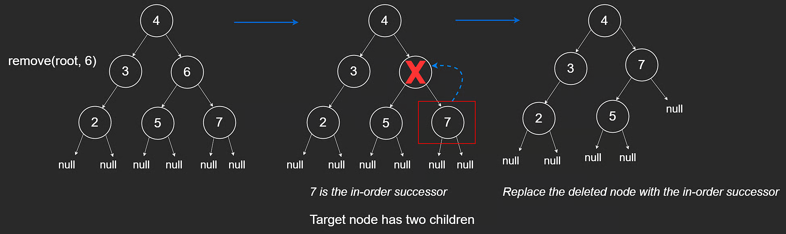
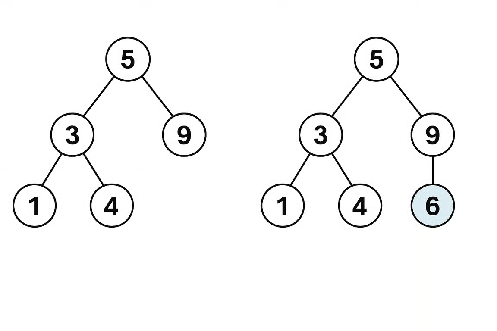
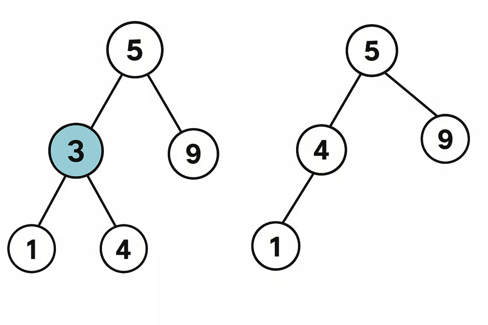

# Insertion and Removal in a Binary Search Tree

One major advantage of BSTs over sorted arrays is efficient insertion and deletion.

On a balanced tree, these operations are typically $O(\log n)$.

## Insertion

To insert a value:

1. Traverse the tree to find where it should go.
2. Add it as a leaf while preserving BST order.

Example from root `[4]`, inserting `6`:

- `[4,null,6]`
- `[6,4,null]`

Both satisfy BST rules, but adding as a leaf is the standard process.

If we start with `[4,null,6]` and insert `5`, we get `[4,null,6,5,null]`.

```javascript
// Insert a new node and return the root of the BST.
function insert(root, val) {
  if (root == null) {
    return new TreeNode(val);
  }

  if (val > root.val) {
    root.right = insert(root.right, val);
  } else if (val < root.val) {
    root.left = insert(root.left, val);
  }

  return root;
}
```

Why this works:

- null spot means insertion point
- recursive return values reconnect to `root.left` or `root.right`
- tree structure remains valid



## Removal

Deletion depends on number of children in target node.

### Case 1: 0 or 1 Child

- No child: remove node directly.
- One child: connect parent to that child.

Examples:





### Case 2: 2 Children

Replace target with its **in-order successor**:

- the left-most node in target's right subtree
- equivalently, the smallest value greater than target



```javascript
// Return the minimum value node of the BST.
function minValueNode(root) {
  let curr = root;
  while (curr != null && curr.left != null) {
    curr = curr.left;
  }
  return curr;
}

// Remove a node and return the root of the BST.
function remove(root, val) {
  if (root == null) {
    return null;
  }

  if (val > root.val) {
    root.right = remove(root.right, val);
  } else if (val < root.val) {
    root.left = remove(root.left, val);
  } else {
    if (root.left == null) {
      return root.right;
    } else if (root.right == null) {
      return root.left;
    } else {
      const minNode = minValueNode(root.right);
      root.val = minNode.val;
      root.right = remove(root.right, minNode.val);
    }
  }

  return root;
}
```

## Time and Space Complexity

Let `h` be tree height.

- Insertion time: **$O(h)$**
- Removal time: **$O(h)$**

So:

- Balanced BST: **$O(\log n)$**
- Worst-case skewed BST: **$O(n)$**

Recursive space:

- Balanced: **$O(\log n)$**
- Worst-case: **$O(n)$**

---

## NeetCode Practice (BST)

### 1) Insert into a Binary Search Tree

- Difficulty: **Medium**
- Pattern: **BST insertion (recursion and iteration)**
- Core idea: Follow BST ordering until you hit a null child, then place the new node there.

**Problem statement (summary):**
Given a BST root and a value `val`, insert `val` into the BST and return the root.

Multiple valid resulting trees may exist as long as BST property holds.

**Example:**



- Input: `root = [5,3,9,1,4], val = 6`
- Output: `[5,3,9,1,4,6]`

#### Approach 1: Recursion

**Intuition:**
Use BST comparisons to recurse left or right. Null means insertion point.

**Algorithm:**

1. If root is null, return new node.
2. If `val > root.val`, recurse right.
3. Else recurse left.
4. Return root.

```typescript
/**
 * Definition for a binary tree node.
 * class TreeNode {
 *     constructor(val = 0, left = null, right = null) {
 *         this.val = val;
 *         this.left = left;
 *         this.right = right;
 *     }
 * }
 */
class Solution {
  insertIntoBST(root: TreeNode | null, val: number): TreeNode {
    if (!root) {
      return new TreeNode(val);
    }

    if (val > root.val) {
      root.right = this.insertIntoBST(root.right, val);
    } else {
      root.left = this.insertIntoBST(root.left, val);
    }

    return root;
  }
}
```

**Complexity:**

- Time: **$O(h)$**
- Space: **$O(h)$** recursion stack

#### Approach 2: Iteration

**Intuition:**
Same decision process as recursion, but with a loop.

**Algorithm:**

1. If root is null, return new node.
2. Traverse with `curr`.
3. Move left/right by comparison.
4. Insert once the desired child pointer is null.

```typescript
/**
 * Definition for a binary tree node.
 * class TreeNode {
 *     constructor(val = 0, left = null, right = null) {
 *         this.val = val;
 *         this.left = left;
 *         this.right = right;
 *     }
 * }
 */
class Solution {
  insertIntoBST(root: TreeNode | null, val: number): TreeNode {
    if (!root) {
      return new TreeNode(val);
    }

    let curr: TreeNode = root;

    while (true) {
      if (curr.val < val) {
        if (!curr.right) {
          curr.right = new TreeNode(val);
          return root;
        }
        curr = curr.right;
      } else {
        if (!curr.left) {
          curr.left = new TreeNode(val);
          return root;
        }
        curr = curr.left;
      }
    }
  }
}
```

**Complexity:**

- Time: **$O(h)$**
- Space: **$O(1)$** extra space

### 2) Delete Node in a BST

- Difficulty: **Medium**
- Pattern: **BST deletion with structural cases**
- Core idea: Find node, then handle 0-child, 1-child, or 2-child cases.

**Problem statement (summary):**
Given BST root and key, delete node with `key` if present and return updated root.

**Example:**



- Input: `root = [5,3,9,1,4], key = 3`
- Output: `[5,4,9,1]`

#### Approach 1: Recursion

**Intuition:**
Recursively search for target. For two-child case, use left-most node of right subtree as replacement anchor.

**Algorithm:**

1. Recurse to find key.
2. If found and one side is null, return the other side.
3. If both sides exist, find successor in right subtree.
4. Attach deleted node's left subtree to successor's left.
5. Return right subtree as replacement root.

```typescript
class Solution {
  deleteNode(root: TreeNode | null, key: number): TreeNode | null {
    if (!root) return root;

    if (root.val > key) {
      root.left = this.deleteNode(root.left, key);
    } else if (root.val < key) {
      root.right = this.deleteNode(root.right, key);
    } else {
      if (!root.right) {
        return root.left;
      }

      if (!root.left) {
        return root.right;
      }

      let curr = root.right;
      while (curr.left) {
        curr = curr.left;
      }

      curr.left = root.left;
      return root.right;
    }

    return root;
  }
}
```

**Complexity:**

- Time: **$O(h)$**
- Space: **$O(h)$** recursion stack

#### Approach 2: Iteration

**Intuition:**
Find node and parent with a loop, then update pointers directly.

**Algorithm:**

1. Locate node and parent.
2. If 0 or 1 child, replace node with child.
3. If 2 children, locate inorder successor and its parent.
4. Rewire successor and attach to deleted node position.

```typescript
/**
 * Definition for a binary tree node.
 * class TreeNode {
 *     constructor(val = 0, left = null, right = null) {
 *         this.val = val;
 *         this.left = left;
 *         this.right = right;
 *     }
 * }
 */
class Solution {
  deleteNode(root: TreeNode | null, key: number): TreeNode | null {
    if (!root) return root;

    let parent: TreeNode | null = null;
    let cur: TreeNode | null = root;

    while (cur && cur.val !== key) {
      parent = cur;
      if (key > cur.val) {
        cur = cur.right;
      } else {
        cur = cur.left;
      }
    }

    if (!cur) return root;

    if (!cur.left || !cur.right) {
      const child = cur.left || cur.right;
      if (!parent) return child;
      if (parent.left === cur) {
        parent.left = child;
      } else {
        parent.right = child;
      }
    } else {
      let par: TreeNode | null = null;
      const delNode = cur;
      cur = cur.right;

      while (cur.left) {
        par = cur;
        cur = cur.left;
      }

      if (par) {
        par.left = cur.right;
        cur.right = delNode.right;
      }
      cur.left = delNode.left;

      if (!parent) return cur;

      if (parent.left === delNode) {
        parent.left = cur;
      } else {
        parent.right = cur;
      }
    }

    return root;
  }
}
```

**Complexity:**

- Time: **$O(h)$**
- Space: **$O(1)$** extra space

Where `h` is the tree height for both approaches.
