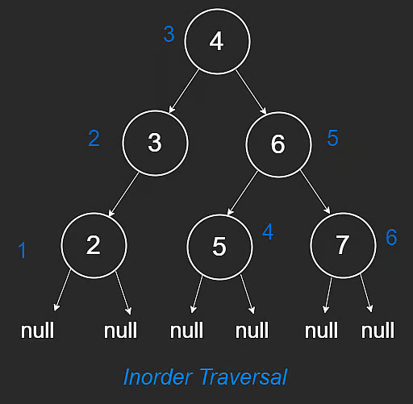

# Depth-First Search

Depth-First Search (DFS) is one of the most common interview algorithms.

It is used for both trees and graphs. This lesson focuses on trees.

## Concept

To traverse an entire tree, we must visit every node.

DFS goes as deep as possible along one path before backtracking.

For example:

1. Keep moving left until `null`.
2. Backtrack to parent.
3. Explore right subtree.

DFS is naturally implemented with recursion, but can also be implemented iteratively with a stack.

## DFS Traversal Orders

There are three standard traversal orders:

- Inorder
- Preorder
- Postorder

### Inorder Traversal

Order: **left -> node -> right**

```javascript
function inorder(root) {
  if (root == null) {
    return;
  }
  inorder(root.left);
  console.log(root.val);
  inorder(root.right);
}
```

Example order in diagram: `[2,3,4,5,6,7]`

Important:

- Inorder is sorted **only if** the tree is a BST.



### Preorder Traversal

Order: **node -> left -> right**

```javascript
function preorder(root) {
  if (root == null) {
    return;
  }
  console.log(root.val);
  preorder(root.left);
  preorder(root.right);
}
```

Example order in diagram: `[4,3,2,6,5,7]`


### Postorder Traversal

Order: **left -> right -> node**

```javascript
function postorder(root) {
  if (root == null) {
    return;
  }
  postorder(root.left);
  postorder(root.right);
  console.log(root.val);
}
```

Example order in diagram: `[2,3,5,7,6,4]`


## Time and Space Complexity

The following applies to all three traversals.

### Time

Every node is visited once.

- Time: **$O(n)$**

where `n` is number of nodes.

### Space

Recursive DFS uses call stack proportional to tree height `h`.

- Space: **$O(h)$**

So:

- balanced tree: **$O(\log n)$**
- skewed tree: **$O(n)$**

---

## NeetCode Practice (Trees)

### 1) Kth Smallest Integer in BST

- Difficulty: **Medium**
- Pattern: **Inorder DFS with stack (iterative)**
- Core idea: Inorder traversal of a BST visits nodes in sorted order, so the k-th visited node is the answer.

**Problem statement (summary):**
Given the root of a BST and integer `k` (1-indexed), return the k-th smallest value.

BST constraints:

- left subtree values are smaller than node value
- right subtree values are greater than node value
- both subtrees are BSTs

**Examples:**

- Input: `root = [2,1,3], k = 1`
- Output: `1`

- Input: `root = [4,3,5,2,null], k = 4`
- Output: `5`

### Approach 1: Iterative DFS (Optimal)

**Intuition:**
Use a stack to simulate recursive inorder traversal:

1. Push all left nodes.
2. Pop one node (next smallest).
3. Decrement `k`.
4. If `k == 0`, this node is the answer.
5. Move to right subtree and repeat.

This stops early at the k-th element instead of traversing all nodes.

**Algorithm:**

1. Initialize empty stack and `curr = root`.
2. While `stack` not empty or `curr` not null:
3. Push left chain.
4. Pop top node.
5. Decrement `k`; if zero, return node value.
6. Move `curr` to popped node's right child.

```typescript
/**
 * Definition for a binary tree node.
 * class TreeNode {
 *     constructor(val = 0, left = null, right = null) {
 *         this.val = val;
 *         this.left = left;
 *         this.right = right;
 *     }
 * }
 */

class Solution {
  /**
   * @param {TreeNode} root
   * @param {number} k
   * @return {number}
   */
  kthSmallest(root, k) {
    const stack = [];
    let curr = root;

    while (stack.length > 0 || curr !== null) {
      while (curr !== null) {
        stack.push(curr);
        curr = curr.left;
      }

      curr = stack.pop();
      k--;

      if (k === 0) {
        return curr.val;
      }

      curr = curr.right;
    }
  }
}
```

**Complexity:**

- Time: **$O(h + k)$** in the best stopping sense, up to **$O(n)$** worst case
- Space: **$O(h)$**

Where:

- `n` is number of nodes
- `h` is tree height

#### Approach 2: Recursive DFS

**Intuition:**
Inorder traversal of a BST visits nodes in sorted order. So instead of storing every value first, we can count nodes as we visit them and stop immediately when we reach the k-th one.

**Algorithm:**

1. Keep a countdown initialized to `k`.
2. Perform inorder traversal.
3. Traverse left subtree.
4. Decrement countdown when visiting current node.
5. If countdown becomes `0`, store the answer.
6. Traverse right subtree only if the answer is not already found.

```typescript
/**
 * Definition for a binary tree node.
 * class TreeNode {
 *     constructor(val = 0, left = null, right = null) {
 *         this.val = val;
 *         this.left = left;
 *         this.right = right;
 *     }
 * }
 */

class Solution {
  /**
   * @param {TreeNode} root
   * @param {number} k
   * @return {number}
   */
  kthSmallest(root, k) {
    const state = {
      count: k,
      result: 0,
    };

    this.dfs(root, state);
    return state.result;
  }

  dfs(node, state) {
    if (!node) {
      return;
    }

    this.dfs(node.left, state);

    if (state.count === 0) {
      return;
    }

    state.count--;

    if (state.count === 0) {
      state.result = node.val;
      return;
    }

    this.dfs(node.right, state);
  }
}
```

**Complexity:**

- Time: **$O(h + k)$** in the best stopping sense, up to **$O(n)$** worst case
- Space: **$O(h)$**

### 2) Balanced Binary Tree

- Difficulty: **Easy**
- Pattern: **Postorder DFS returning multiple values**
- Core idea: For each node, compute both whether the subtree is balanced and what its height is.

**Problem statement (summary):**
Given a binary tree, return `true` if it is height-balanced and `false` otherwise.

A tree is height-balanced if the heights of the left and right subtrees of every node differ by no more than `1`.

**Example:**

- Input: `root = [1,2,3,null,null,4]`
- Output: `true`

### Approach 1: DFS Returning `[balanced, height]`

**Intuition:**
We need height information from both subtrees before deciding whether the current node is balanced. That makes postorder DFS a natural fit.

Each DFS call returns two things:

1. whether the subtree is balanced
2. the subtree height

**Algorithm:**

1. If node is null, return balanced with height `0`.
2. Recursively compute left and right results.
3. Current subtree is balanced if:
4. left subtree is balanced,
5. right subtree is balanced,
6. height difference is at most `1`.
7. Height is `1 + max(leftHeight, rightHeight)`.
8. Return both values upward.

```typescript
/**
 * Definition for a binary tree node.
 * class TreeNode {
 *     constructor(val = 0, left = null, right = null) {
 *         this.val = val;
 *         this.left = left;
 *         this.right = right;
 *     }
 * }
 */

class Solution {
  /**
   * @param {TreeNode} root
   * @return {boolean}
   */
  isBalanced(root) {
    return this.dfs(root)[0] === 1;
  }

  dfs(root) {
    if (!root) {
      return [1, 0];
    }

    const left = this.dfs(root.left);
    const right = this.dfs(root.right);

    const balanced =
      left[0] === 1 && right[0] === 1 && Math.abs(left[1] - right[1]) <= 1;

    const height = 1 + Math.max(left[1], right[1]);

    return [balanced ? 1 : 0, height];
  }
}
```

**Complexity:**

- Time: **$O(n)$**
- Space: **$O(h)$**

### 3) Binary Tree Inorder Traversal

- Difficulty: **Easy**
- Pattern: **DFS traversal (recursive and iterative)**
- Core idea: Visit nodes in `left -> node -> right` order and collect values.

**Problem statement (summary):**
Given the root of a binary tree, return the inorder traversal of its node values.

**Example:**

- Input: `root = [1,2,3,4,5,6,7]`
- Output: `[4,2,5,1,6,3,7]`

#### Approach 1: Recursive DFS

**Intuition:**
Recursion naturally mirrors inorder traversal: process left subtree, then current node, then right subtree.

**Algorithm:**

1. Create result list.
2. Define recursive helper.
3. If node is null, return.
4. Traverse left.
5. Add current node value.
6. Traverse right.
7. Return result.

```typescript
/**
 * Definition for a binary tree node.
 * class TreeNode {
 *     constructor(val = 0, left = null, right = null) {
 *         this.val = val;
 *         this.left = left;
 *         this.right = right;
 *     }
 * }
 */
class Solution {
  /**
   * @param {TreeNode} root
   * @return {number[]}
   */
  inorderTraversal(root) {
    const res = [];

    const inorder = (node) => {
      if (!node) return;
      inorder(node.left);
      res.push(node.val);
      inorder(node.right);
    };

    inorder(root);
    return res;
  }
}
```

**Complexity:**

- Time: **$O(n)$**
- Space: **$O(h)$**

#### Approach 2: Iterative DFS

**Intuition:**
Use an explicit stack to simulate the recursive call stack while repeatedly walking left.

**Algorithm:**

1. Initialize result list and stack.
2. Set current pointer to root.
3. Push left chain onto stack.
4. Pop node, record value.
5. Move to right subtree.
6. Repeat until both current and stack are empty.

```typescript
/**
 * Definition for a binary tree node.
 * class TreeNode {
 *     constructor(val = 0, left = null, right = null) {
 *         this.val = val;
 *         this.left = left;
 *         this.right = right;
 *     }
 * }
 */
class Solution {
  /**
   * @param {TreeNode} root
   * @return {number[]}
   */
  inorderTraversal(root) {
    const res = [];
    const stack = [];
    let cur = root;

    while (cur || stack.length > 0) {
      while (cur) {
        stack.push(cur);
        cur = cur.left;
      }

      cur = stack.pop();
      res.push(cur.val);
      cur = cur.right;
    }

    return res;
  }
}
```

**Complexity:**

- Time: **$O(n)$**
- Space: **$O(h)$**
