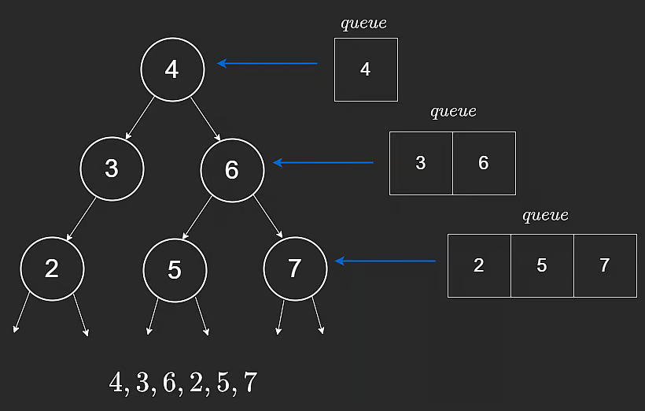

# Breadth-First Search

Breadth-First Search (BFS) is a level-by-level traversal strategy.

For trees, BFS is usually implemented iteratively with a queue.

## Concept

Unlike DFS (which goes deep first), BFS visits all nodes at one depth before moving deeper.

To do this efficiently, we need FIFO behavior:

- enqueue children at the tail
- dequeue current nodes from the head

A queue (or deque) provides this in $O(1)$ operations.

```javascript
function bfs(root) {
  const queue = [];

  if (root != null) {
    queue.push(root);
  }

  let level = 0;

  while (queue.length > 0) {
    console.log("level " + level + ": ");

    const levelLength = queue.length;
    for (let i = 0; i < levelLength; i++) {
      const curr = queue.shift();
      console.log(curr.val + " ");

      if (curr.left != null) {
        queue.push(curr.left);
      }
      if (curr.right != null) {
        queue.push(curr.right);
      }
    }

    level++;
    console.log();
  }
}
```

How it works:

1. Start by enqueuing root.
2. Process all nodes currently in queue (one full level).
3. Enqueue their children (next level).
4. Repeat until queue becomes empty.



## Time and Space Complexity

### Time

Each node is visited once.

- Time: **$O(n)$**

### Space

Queue may hold an entire level at once.

- Space: **$O(n)$** in worst case

---

## NeetCode Practice (Trees)

### 1) Binary Tree Level Order Traversal

- Difficulty: **Medium**
- Pattern: **BFS by levels**
- Core idea: For each level, process exactly `queue.length` nodes and collect their values together.

**Problem statement (summary):**
Given a binary tree root, return its level order traversal as a list of levels from left to right.

**Example:**

- Input: `root = [1,2,3,4,5,6,7]`
- Output: `[[1],[2,3],[4,5,6,7]]`

### Approach 1: Breadth-First Search

**Intuition:**
BFS naturally processes nodes in level order because nodes are visited in the same order they are enqueued.

**Algorithm:**

1. If root is null, return empty list.
2. Initialize queue with root.
3. While queue is not empty:
4. Let `qLen` be current queue size.
5. Pop exactly `qLen` nodes to form one level.
6. Append their children to queue.
7. Add level list to answer.

```typescript
/**
 * Definition for a binary tree node.
 * class TreeNode {
 *     constructor(val = 0, left = null, right = null) {
 *         this.val = val;
 *         this.left = left;
 *         this.right = right;
 *     }
 * }
 */

class Solution {
  /**
   * @param {TreeNode} root
   * @return {number[][]}
   */
  levelOrder(root) {
    if (!root) return [];

    const queue = [root];
    const result = [];

    while (queue.length > 0) {
      const levelLength = queue.length;
      const level = [];

      for (let i = 0; i < levelLength; i++) {
        const curr = queue.shift();
        level.push(curr.val);

        if (curr.left) queue.push(curr.left);
        if (curr.right) queue.push(curr.right);
      }

      result.push(level);
    }

    return result;
  }
}
```

**Complexity:**

- Time: **$O(n)$**
- Space: **$O(n)$**

### 2) Binary Tree Right Side View

- Difficulty: **Medium**
- Pattern: **BFS level sweep + last node capture**
- Core idea: In each level processed left-to-right, the last node is what you can see from the right side.

**Problem statement (summary):**
Given a binary tree root, return node values visible from the right side, top to bottom.

**Example:**

- Input: `root = [1,2,3,null,4,null,5]`
- Output: `[1,3,5]`

### Approach 1: Breadth-First Search

**Intuition:**
Process one level at a time and keep updating a variable to the current node. After finishing the level, that variable holds the rightmost node.

**Algorithm:**

1. If root is null, return empty list.
2. Initialize queue with root.
3. While queue not empty:
4. Process current level by size.
5. Track the last processed node as `rightSide`.
6. Enqueue children for next level.
7. Append `rightSide.val`.

```typescript
/**
 * Definition for a binary tree node.
 * class TreeNode {
 *     constructor(val = 0, left = null, right = null) {
 *         this.val = val;
 *         this.left = left;
 *         this.right = right;
 *     }
 * }
 */

class Solution {
  /**
   * @param {TreeNode} root
   * @return {number[]}
   */
  rightSideView(root) {
    if (!root) return [];

    const queue = [root];
    const result = [];

    while (queue.length > 0) {
      let rightSide = null;
      const levelLength = queue.length;

      for (let i = 0; i < levelLength; i++) {
        const curr = queue.shift();

        if (curr) {
          rightSide = curr;

          if (curr.left) queue.push(curr.left);
          if (curr.right) queue.push(curr.right);
        }
      }

      if (rightSide) {
        result.push(rightSide.val);
      }
    }

    return result;
  }
}
```

**Complexity:**

- Time: **$O(n)$**
- Space: **$O(n)$**
