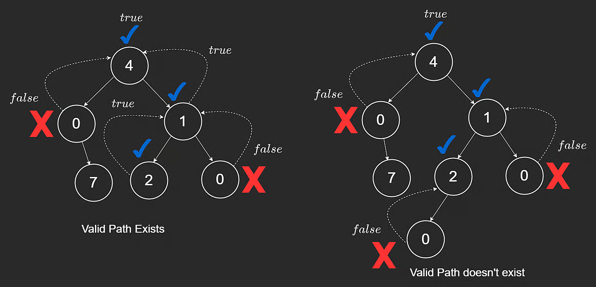
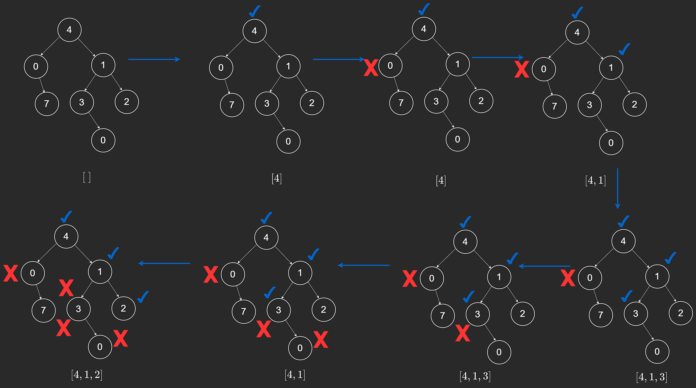

# Backtracking (Tree Maze)

Backtracking overlaps heavily with DFS. You try a path, and if it leads to a dead-end, you undo that choice and try another path.

Think of a maze: move forward until blocked, step back, then explore a different route.

## Motivation with a Tree Example

Given a binary tree, determine whether there exists a root-to-leaf path that never includes value `0`.

Key rules:

1. If node is null, path is invalid.
2. If node value is `0`, path is invalid.
3. If we reach a leaf without violating the rule, path is valid.
4. A valid path can exist in either left subtree or right subtree.

```javascript
class TreeNode {
  constructor(val) {
    this.val = val;
    this.left = null;
    this.right = null;
  }
}

function canReachLeaf(root) {
  if (root == null || root.val == 0) {
    return false;
  }
  if (root.left == null && root.right == null) {
    return true;
  }
  if (canReachLeaf(root.left)) {
    return true;
  }
  if (canReachLeaf(root.right)) {
    return true;
  }
  return false;
}
```

For tree `[4,0,1,null,7,2,0]`, a valid path exists through non-zero nodes only.



## Building the Actual Path

If we also want the path values, we carry a `path` list:

1. Add current node.
2. Recurse left or right.
3. If both fail, remove current node before returning.

That remove step is the core backtracking action.

```javascript
function leafPath(root, path) {
  if (root == null || root.val == 0) {
    return false;
  }

  path.push(root.val);

  if (root.left == null && root.right == null) {
    return true;
  }
  if (leafPath(root.left, path)) {
    return true;
  }
  if (leafPath(root.right, path)) {
    return true;
  }

  path.pop();
  return false;
}
```

For tree `[4,0,1,null,7,3,2,null,null,null,0]`, one valid path is `[4,1,2]`.



## Time and Space Complexity

### Time

Each node can be visited once in the worst case.

- Time: **O(n)**

### Space

Recursion depth and current path are both bounded by tree height.

- Space: **O(h)**

## Closing Notes

Backtracking is a general pattern, not only for trees. It appears often in subsets, permutations, and grid/maze search problems.

---

## NeetCode Practice (Backtracking / DFS)

### 1) Path Sum

- Difficulty: **Easy**
- Pattern: **DFS on root-to-leaf paths**
- Core idea: Track path total while descending; validate only at leaves.

**Problem statement (summary):**
Given `root` and integer `targetSum`, return `true` if any root-to-leaf path sums to `targetSum`.

**Example:**

- Input: `root = [1,2,3], targetSum = 3`
- Output: `true`
- Explanation: Valid path is `1 -> 2`.

### Approach 1: DFS with Running Sum

**Intuition:**
Accumulate sum while traversing. At leaf nodes, compare against target.

```typescript
/**
 * Definition for a binary tree node.
 * class TreeNode {
 *     constructor(val = 0, left = null, right = null) {
 *         this.val = val;
 *         this.left = left;
 *         this.right = right;
 *     }
 * }
 */
class Solution {
  /**
   * @param {TreeNode} root
   * @param {number} targetSum
   * @return {boolean}
   */
  hasPathSum(root, targetSum) {
    return this.dfs(root, targetSum, 0);
  }

  dfs(node, targetSum, sum) {
    if (!node) return false;

    sum += node.val;

    if (!node.left && !node.right) {
      return sum === targetSum;
    }

    return (
      this.dfs(node.left, targetSum, sum) ||
      this.dfs(node.right, targetSum, sum)
    );
  }
}
```

**Complexity:**

- Time: **O(n)**
- Space: **O(h)**

### Approach 2: DFS with Remaining Target

**Intuition:**
Subtract node values from target as you go. At a leaf, check if remainder is zero.

**Algorithm:**

1. If root is null, return false.
2. Subtract current node value from `targetSum`.
3. If leaf, return whether `targetSum` is now zero.
4. Recurse into left or right with updated target.

```typescript
/**
 * Definition for a binary tree node.
 * class TreeNode {
 *     constructor(val = 0, left = null, right = null) {
 *         this.val = val;
 *         this.left = left;
 *         this.right = right;
 *     }
 * }
 */
class Solution {
  /**
   * @param {TreeNode} root
   * @param {number} targetSum
   * @return {boolean}
   */
  hasPathSum(root, targetSum) {
    if (!root) return false;

    targetSum -= root.val;

    if (!root.left && !root.right) {
      return targetSum === 0;
    }

    return (
      this.hasPathSum(root.left, targetSum) ||
      this.hasPathSum(root.right, targetSum)
    );
  }
}
```

**Complexity:**

- Time: **O(n)**
- Space: **O(h)**

---

### 2) Subsets

- Difficulty: **Medium**
- Pattern: **Backtracking decision tree**
- Core idea: For each number, choose include or exclude.

**Problem statement (summary):**
Given an array `nums` of unique integers, return all possible subsets.

**Example:**

- Input: `nums = [1,2,3]`
- Output: `[[],[1],[2],[1,2],[3],[1,3],[2,3],[1,2,3]]`

### Approach 1: Include/Exclude Backtracking

**Intuition:**
Each index creates two branches: take the number or skip it. Reaching the end means one full subset is formed.

**Algorithm:**

1. Maintain `result` and current `subset`.
2. DFS on index `i`.
3. If `i == nums.length`, push a copy of subset.
4. Branch 1: include `nums[i]`, recurse, then backtrack.
5. Branch 2: exclude `nums[i]`, recurse.

```typescript
class Solution {
  /**
   * @param {number[]} nums
   * @return {number[][]}
   */
  subsets(nums) {
    const result = [];

    const dfs = (index, currentSubset) => {
      if (index === nums.length) {
        result.push([...currentSubset]);
        return;
      }

      currentSubset.push(nums[index]);
      dfs(index + 1, currentSubset);
      currentSubset.pop();

      dfs(index + 1, currentSubset);
    };

    dfs(0, []);
    return result;
  }
}
```

**Complexity:**

- Time: **O(n \* 2^n)**
- Space: **O(n)** recursion depth (excluding output)

### 3) Combination Sum

- Difficulty: **Medium**
- Pattern: **Backtracking with reuse choices**
- Core idea: At each number, choose take (stay at same index) or skip (move index).

**Problem statement (summary):**
Given distinct integers `nums` and target `target`, return all unique combinations where numbers can be reused and sum exactly to `target`.

**Example:**

- Input: `nums = [2,5,6,9], target = 9`
- Output: `[[2,2,5],[9]]`

### Approach 1: Backtracking (Take/Skip)

**Intuition:**
If you take current number, you stay at same index (reuse allowed). If you skip it, move to the next index.

```typescript
class Solution {
  /**
   * @param {number[]} nums
   * @param {number} target
   * @return {number[][]}
   */
  combinationSum(nums, target) {
    const result = [];

    const backtrack = (index, remaining, currentCombination) => {
      if (remaining === 0) {
        result.push([...currentCombination]);
        return;
      }

      if (remaining < 0 || index === nums.length) {
        return;
      }

      currentCombination.push(nums[index]);
      backtrack(index, remaining - nums[index], currentCombination);
      currentCombination.pop();

      backtrack(index + 1, remaining, currentCombination);
    };

    backtrack(0, target, []);
    return result;
  }
}
```

**Complexity:**

- Time: **Exponential in the worst case**
- Space: **O(target / min(nums))** recursion depth in the deepest valid chain
