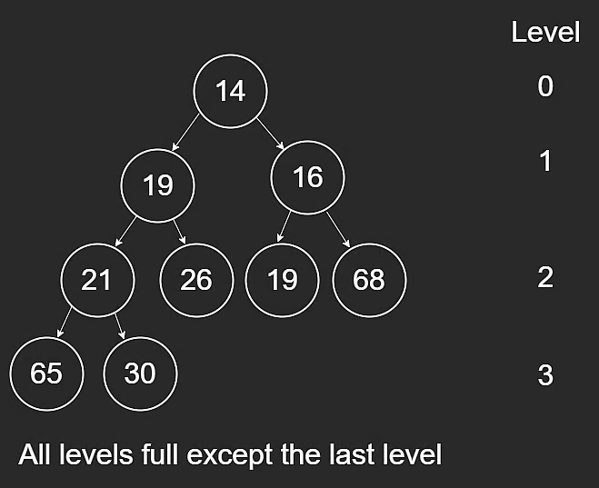
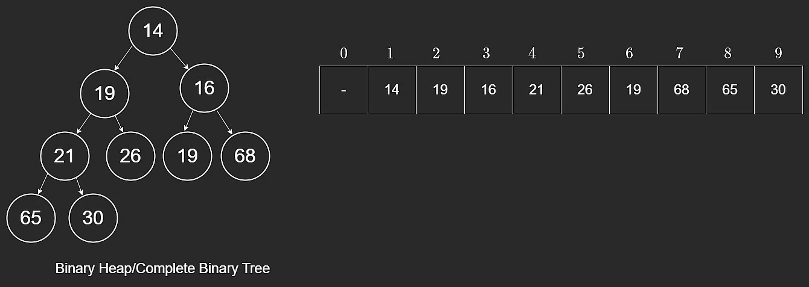
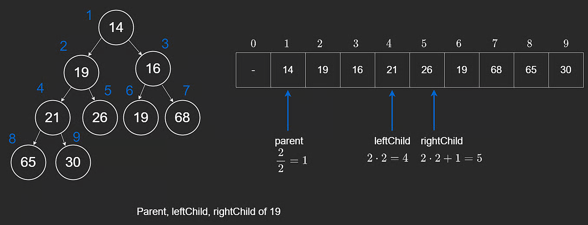

# Heap Properties

A heap is a specialized tree-based data structure used to implement a **priority queue**.

Unlike a normal queue (FIFO), a priority queue removes elements by priority.

## Two Types of Heaps

1. **Min Heap**: smallest value is at the root (highest removal priority).
2. **Max Heap**: largest value is at the root (highest removal priority).

This lesson focuses on min-heaps. Max-heaps use the same mechanics with reversed comparisons.

## Required Heap Properties

For a binary tree to be a heap, it must satisfy both properties below.

### 1) Structure Property (Complete Binary Tree)

Every level is full except possibly the last, and the last level is filled from left to right.

### 2) Order Property

For a min-heap, each node is less than or equal to its descendants.

If root value is `y`, all nodes in its subtrees must be `>= y`.

For a max-heap, comparisons are reversed.

Unlike binary search trees, heaps can contain duplicate values.



## Array-Based Implementation

Although we draw heaps as trees, they are usually stored in arrays.

Example heap:

`[14,19,16,21,26,19,68,65,30,null,null,null,null,null,null]`

With one-based indexing, we store elements from index `1` to `n` and ignore index `0`.



## Why One-Based Indexing?

For node index `i`:

- `leftChild = 2 * i`
- `rightChild = 2 * i + 1`
- `parent = floor(i / 2)`

These formulas are simple and valid because the tree is complete and stored contiguously.

If root were at index `0`, `2 * i` would fail for child lookups at the root.



## Minimal Heap Class Skeleton

```javascript
class Heap {
  constructor() {
    this.heap = [];
    this.heap.push(0); // dummy value for one-based indexing
  }
}
```
