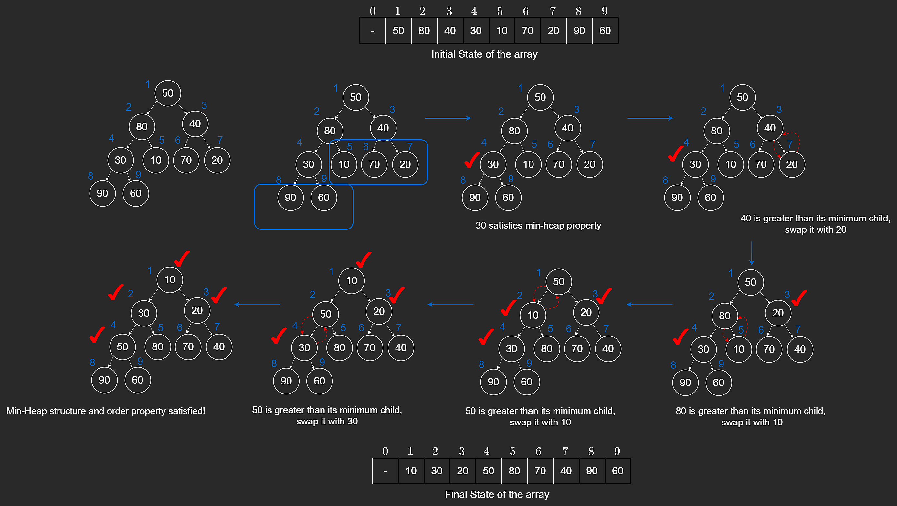

# Heapify

If we build a heap by inserting `n` elements one by one, total time is **O(n log n)**.

`heapify` builds a heap in **O(n)** time by fixing the tree bottom-up.

## Core Idea

To build a valid min-heap, we need:

1. structure property (complete tree) - handled naturally by array layout
2. order property (parent <= children) - enforced using percolate-down

Leaf nodes are already heaps, so we start from the last non-leaf node and move backward to the root.

## Implementation

```javascript
heapify(arr) {
    // Move 0th value to end so we can use one-based indexing.
    arr.push(arr[0]);

    this.heap = arr;

    // Start from the last non-leaf node.
    let cur = Math.floor((this.heap.length - 1) / 2);

    while (cur > 0) {
        let i = cur;

        // Percolate down
        while (2 * i < this.heap.length) {
            if (
                2 * i + 1 < this.heap.length &&
                this.heap[2 * i + 1] < this.heap[2 * i] &&
                this.heap[i] > this.heap[2 * i + 1]
            ) {
                // Swap with right child
                const tmp = this.heap[i];
                this.heap[i] = this.heap[2 * i + 1];
                this.heap[2 * i + 1] = tmp;
                i = 2 * i + 1;
            } else if (this.heap[i] > this.heap[2 * i]) {
                // Swap with left child
                const tmp = this.heap[i];
                this.heap[i] = this.heap[2 * i];
                this.heap[2 * i] = tmp;
                i = 2 * i;
            } else {
                break;
            }
        }

        cur--;
    }
}
```

Step-by-step:

1. Compute index of last non-leaf (`n / 2`).
2. Percolate-down that node.
3. Decrement index and repeat.
4. Stop after processing the root.



## Why Time Is O(n)

Intuitively:

- About half the nodes are leaves (no work).
- Nodes near the bottom move very little.
- Only a few nodes near the top can move many levels.

Summing this work yields **O(n)** total time.

We skip the formal proof here since interview settings usually focus on knowing and applying the result.


---

## NeetCode Practice (Heaps)

### 1) Last Stone Weight

- Difficulty: **Easy**
- Pattern: **Max-heap simulation**
- Core idea: Repeatedly remove the two heaviest stones, smash them, and reinsert the remainder if needed.

**Problem statement (summary):**
Given an array of stone weights, repeatedly smash the two heaviest stones until at most one remains.

**Example:**

- Input: `stones = [2,3,6,2,4]`
- Output: `1`

### Approach 1: Max Heap

**Intuition:**
We always need the two largest values, so a max-heap gives the right extraction order.

```typescript
/**
 * const { MaxPriorityQueue } = require('@datastructures-js/priority-queue');
 */

class Solution {
  /**
   * @param {number[]} stones
   * @return {number}
   */
  lastStoneWeight(stones) {
    const maxPQ = new MaxPriorityQueue();

    for (const stone of stones) {
      maxPQ.enqueue(stone);
    }

    while (maxPQ.size() > 1) {
      const stone1 = maxPQ.dequeue();
      const stone2 = maxPQ.dequeue();

      if (stone1 !== stone2) {
        maxPQ.enqueue(stone1 - stone2);
      }
    }

    return maxPQ.size() === 1 ? maxPQ.dequeue() : 0;
  }
}
```

**Complexity:**

- Time: **O(n log n)**
- Space: **O(n)**

### 2) K Closest Points to Origin

- Difficulty: **Medium**
- Pattern: **Distance-based heap selection**
- Core idea: Use squared distance as the heap priority.

**Problem statement (summary):**
Return the `k` points closest to `(0, 0)`.

**Example:**

- Input: `points = [[0,2],[2,2]], k = 1`
- Output: `[[0,2]]`

### Approach 1: Min Heap of All Points

**Intuition:**
Insert every point using squared distance, then pop `k` times.

```typescript
/**
 * const { MinPriorityQueue } = require('@datastructures-js/priority-queue');
 */

class Solution {
  /**
   * @param {number[][]} points
   * @param {number} k
   * @return {number[][]}
   */
  kClosest(points, k) {
    const minHeap = new MinPriorityQueue((point) => point[0]);

    for (const [x, y] of points) {
      const order = x ** 2 + y ** 2;
      minHeap.enqueue([order, x, y]);
    }

    const res = [];

    for (let i = 0; i < k; i++) {
      const [, x, y] = minHeap.dequeue();
      res.push([x, y]);
    }

    return res;
  }
}
```

**Complexity:**

- Time: **O(n + k log n)** when heapify is available, otherwise **O(n log n + k log n)**
- Space: **O(n)**

### Approach 2: Max Heap of Size k

**Intuition:**
Keep only the `k` closest points seen so far. The farthest among them sits at the top.

```typescript
/**
 * const { PriorityQueue } = require('@datastructures-js/priority-queue');
 */

class Solution {
  /**
   * @param {number[][]} points
   * @param {number} k
   * @return {number[][]}
   */
  kClosest(points, k) {
    const maxHeap = new PriorityQueue((a, b) => b[0] - a[0]);

    for (const [x, y] of points) {
      const dist = x ** 2 + y ** 2;
      maxHeap.push([dist, x, y]);
      if (maxHeap.size() > k) {
        maxHeap.pop();
      }
    }

    const res = [];
    while (maxHeap.size() > 0) {
      const tmp = maxHeap.pop();
      res.push([tmp[1], tmp[2]]);
    }

    return res;
  }
}
```

**Complexity:**

- Time: **O(n log k)**
- Space: **O(k)**

### 3) Kth Largest Element in an Array

- Difficulty: **Medium**
- Pattern: **Fixed-size min-heap**
- Core idea: Keep only the `k` largest numbers seen so far.

**Problem statement (summary):**
Given an unsorted array `nums`, return the `k`th largest element.

**Example:**

- Input: `nums = [2,3,1,5,4], k = 2`
- Output: `4`

### Approach 1: Min Heap of Size k

**Intuition:**
If the heap stores the `k` largest values, the root is the `k`th largest.

```typescript
class Solution {
  /**
   * @param {number[]} nums
   * @param {number} k
   * @return {number}
   */
  findKthLargest(nums, k) {
    const minHeap = new MinPriorityQueue();

    for (const num of nums) {
      minHeap.push(num);
      if (minHeap.size() > k) {
        minHeap.pop();
      }
    }

    return minHeap.front();
  }
}
```

**Complexity:**

- Time: **O(n log k)**
- Space: **O(k)**

Last Stone Weight
Easy
Topics
Company Tags
Hints
You are given an array of integers stones where stones[i] represents the weight of the ith stone.

We want to run a simulation on the stones as follows:

At each step we choose the two heaviest stones, with weight x and y and smash them togethers
If x == y, both stones are destroyed
If x < y, the stone of weight x is destroyed, and the stone of weight y has new weight y - x.
Continue the simulation until there is no more than one stone remaining.

Return the weight of the last remaining stone or return 0 if none remain.

Example 1:

Input: stones = [2,3,6,2,4]

Output: 1

1. Heap
   Intuition
   We always need to repeatedly remove the two heaviest stones.
   A max-heap is perfect for this because it lets us efficiently extract the largest values.

Most languages provide min-heaps, so a common trick is to store negative values.
This makes the smallest (most negative) value represent the largest stone.

Process:

Convert all stones to negative and build a heap.
Repeatedly pop the two smallest (i.e., the two heaviest stones).
Smash them:
If equal → both are destroyed.
If different → push the negative of their difference back into the heap.
When one or zero stones remain, return the remaining weight or 0.

/\*\*

- const { MaxPriorityQueue } = require('@datastructures-js/priority-queue');
  \*/

class Solution {
/\*\*
_ @param {number[]} stones
_ @return {number}
\*/
lastStoneWeight(stones) {
const maxPQ = new MaxPriorityQueue();

        for (const stone of stones) {
            maxPQ.enqueue(stone);
        }

        while (maxPQ.size() > 1) {
            const stone1 = maxPQ.dequeue();
            const stone2 = maxPQ.dequeue();

            if (stone1 !== stone2) {
                maxPQ.enqueue(stone1 - stone2);
            }
        }

        return maxPQ.size() === 1 ? maxPQ.dequeue() : 0;
    }

}

Time & Space Complexity
Time complexity: O(nlogn)
Space complexity: O(n)

K Closest Points to Origin
Medium
Topics
Company Tags
Hints
You are given an 2-D array points where points[i] = [xi, yi] represents the coordinates of a point on an X-Y axis plane. You are also given an integer k.

Return the k closest points to the origin (0, 0).

The distance between two points is defined as the Euclidean distance (sqrt((x1 - x2)^2 + (y1 - y2)^2)).

You may return the answer in any order. The answer is guaranteed to be unique(except for the order in which the points are returned.)

Example 1:

Input: points = [[0,2],[2,2]], k = 1

Output: [[0,2]]

2. Min-Heap
   Intuition
   A min-heap always gives you the smallest element first.
   If we insert every point into a min-heap, using its squared distance from the origin as the priority, then:

The closest point will be at the top.
The next closest will be removed next, and so on.
So if we remove from the heap k times, we get exactly the k closest points.

This works because the heap always keeps the smallest distances at the front.

Algorithm
For each point (x, y):
Compute squared distance x^2 + y^2.
Store (distance, x, y) as a heap entry.
Build a min-heap from all entries.
This can be done with one heapify operation, or by pushing entries one at a time.
Repeat k times:
Remove the smallest element from the heap.
Add its (x, y) coordinates to the result.
Return the result list of k closest points.

/\*\*

- const { MinPriorityQueue } = require('@datastructures-js/priority-queue');
  \*/

class Solution {
/\*\*
_ @param {number[][]} points
_ @param {number} k
_ @return {number[][]}
_/
kClosest(points, k) {
const minHeap = new MinPriorityQueue((point) => point[0]);

        for (const [x, y] of points) {
            const order = x ** 2 + y ** 2;
            minHeap.enqueue([order, x, y]);
        }

        const res = [];

        for (let i = 0; i < k; i++) {
            const [_, x, y] = minHeap.dequeue();
            res.push([x, y]);
        }

        return res;
    }

}

Time & Space Complexity
Time complexity: O(n+k∗logn) when building the heap with heapify, or O(n∗logn+k∗logn) when inserting each point with a heap push.
Space complexity: O(n)
Where n is the length of the array points.

3. Max Heap
   Intuition
   We want the k closest points, not all points sorted.

Use a max-heap of size k:

The heap always keeps the k closest points found so far.
The point with the largest distance among these k sits at the top.
When a new point is closer than the farthest in the heap, we remove the farthest and insert the new one.
This way, the heap never grows beyond size k, and it always contains the k best candidates.

Algorithm
Create an empty max-heap.
For each point:
Compute its squared distance from origin: d = x^2 + y^2.
Insert (d, point) into the heap.
If heap size exceeds k:
Remove the element with the maximum distance.
After processing all points:
The heap contains exactly the k closest points.
Return all points stored in the heap.

/\*\*

- const { PriorityQueue } = require('@datastructures-js/priority-queue');
  \*/

class Solution {
/\*\*
_ @param {number[][]} points
_ @param {number} k
_ @return {number[][]}
_/
kClosest(points, k) {
const maxHeap = new PriorityQueue((a, b) => b[0] - a[0]);

        for (const [x, y] of points) {
            const dist = x ** 2 + y ** 2;
            maxHeap.push([dist, x, y]);
            if (maxHeap.size() > k) {
                maxHeap.pop();
            }
        }

        const res = [];
        while (maxHeap.size() > 0) {
            let tmp = maxHeap.pop();
            res.push([tmp[1], tmp[2]]);
        }
        return res;
    }

}

Time & Space Complexity
Time complexity: O(n∗logk)
Space complexity: O(k)
Where n is the length of the array points.

Kth Largest Element in an Array
Medium
Topics
Company Tags
Hints
Given an unsorted array of integers nums and an integer k, return the kth largest element in the array.

By kth largest element, we mean the kth largest element in the sorted order, not the kth distinct element.

Follow-up: Can you solve it without sorting?

Example 1:

Input: nums = [2,3,1,5,4], k = 2

Output: 4

2. Min-Heap
   Intuition
   Instead of sorting the whole array, we only need to keep track of the k largest elements seen so far.

A min-heap is perfect for this:

A min-heap always keeps the smallest element at the top.
If we maintain a heap of size k, then:
the heap will always contain the k largest elements seen so far.
the root of the heap (the smallest among these k) will be the k-th largest element.
Process:

Add elements into the heap.
If the heap grows larger than k, remove the smallest element.
At the end, the root of the heap is exactly the k-th largest element.
This avoids sorting the entire array and keeps memory small.

class Solution {
/\*\*
_ @param {number[]} nums
_ @param {number} k
_ @return {number}
_/
findKthLargest(nums, k) {
const minHeap = new MinPriorityQueue();
for (let num of nums) {
minHeap.push(num);
if (minHeap.size() > k) {
minHeap.pop();
}
}
return minHeap.front();
}
}
