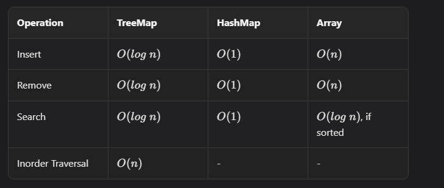
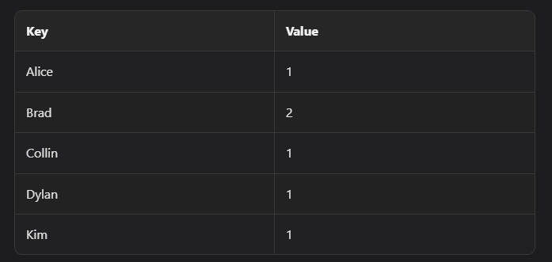

# Hash Usage

This lesson focuses on when and how to use hash-based structures in interviews.

## HashSet vs HashMap

- `HashSet`: stores keys only
- `HashMap`: stores key-value pairs

When prompts include words like `unique`, `count`, or `frequency`, hashing is often the best first option.

## Motivation

Compared with tree-based structures:

- Hashing gives average-case O(1) lookup/insert/delete.
- Tree maps give O(log n) but keep keys sorted.



Hash maps are not ordered. If you need ordered traversal, you must sort keys first (O(n log n)) or use a tree map directly.

## Frequency Counting Example

Input names:

`["alice", "brad", "collin", "brad", "dylan", "kim"]`



```typescript
const names = ["alice", "brad", "collin", "brad", "dylan", "kim"];
const countMap = new Map();

for (let i = 0; i < names.length; i++) {
  if (!countMap.has(names[i])) {
    countMap.set(names[i], 1);
  } else {
    countMap.set(names[i], countMap.get(names[i]) + 1);
  }
}
```

## Time and Space Complexity

- Time: **O(n)** average with hashing; **O(n log n)** with tree map inserts
- Space: **O(n)** where `n` is number of unique keys

---

## NeetCode Practice (Hashing)

### 1) Contains Duplicate

- Difficulty: **Easy**
- Pattern: **Seen set**
- Core idea: Keep a set of visited values and stop on first repeat.

**Example:**

- Input: `nums = [1, 2, 3, 3]`
- Output: `true`

### Approach 1: Hash Set Scan

```typescript
class Solution {
  /**
   * @param {number[]} nums
   * @return {boolean}
   */
  hasDuplicate(nums) {
    const seen = new Set();

    for (const num of nums) {
      if (seen.has(num)) return true;
      seen.add(num);
    }

    return false;
  }
}
```

### Approach 2: Set Size Shortcut

```typescript
class Solution {
  /**
   * @param {number[]} nums
   * @return {boolean}
   */
  hasDuplicate(nums) {
    return new Set(nums).size < nums.length;
  }
}
```

### 2) Two Sum

- Difficulty: **Easy**
- Pattern: **One-pass hash map**
- Core idea: For each value, look for its complement before storing current value.

**Example:**

- Input: `nums = [3,4,5,6], target = 7`
- Output: `[0,1]`

### Approach 1: One-Pass Hash Map

```typescript
class Solution {
  /**
   * @param {number[]} nums
   * @param {number} target
   * @return {number[]}
   */
  twoSum(nums, target) {
    const indexByValue = new Map();

    for (let i = 0; i < nums.length; i++) {
      const diff = target - nums[i];
      if (indexByValue.has(diff)) {
        return [indexByValue.get(diff), i];
      }
      indexByValue.set(nums[i], i);
    }

    return [];
  }
}
```

### 3) Valid Anagram

- Difficulty: **Easy**
- Pattern: **Character frequency map**
- Core idea: Count characters in one string, decrement with the other.

**Example:**

- Input: `s = "racecar", t = "carrace"`
- Output: `true`

### Approach 1: Single Hash Map Count

```typescript
class Solution {
  /**
   * @param {string} s
   * @param {string} t
   * @return {boolean}
   */
  isAnagram(s, t) {
    if (s.length !== t.length) return false;

    const freq = new Map();

    for (let i = 0; i < s.length; i++) {
      const c = s[i];
      freq.set(c, (freq.get(c) || 0) + 1);
    }

    for (let i = 0; i < t.length; i++) {
      const c = t[i];
      if (!freq.has(c)) return false;

      freq.set(c, freq.get(c) - 1);
      if (freq.get(c) === 0) {
        freq.delete(c);
      }
    }

    return freq.size === 0;
  }
}
```

### 4) LRU Cache

- Difficulty: **Medium**
- Pattern: **Ordered map + capacity eviction**
- Core idea: Move accessed keys to the end, evict least recent from the front.

**Example:**

- Input: `["LRUCache", [2], "put", [1, 10], "get", [1], "put", [2, 20], "put", [3, 30], "get", [2], "get", [1]]`
- Output: `[null, null, 10, null, null, 20, -1]`

### Approach 1: Built-In Ordered Map

```typescript
class LRUCache {
  /**
   * @param {number} capacity
   */
  constructor(capacity) {
    this.cache = new Map();
    this.capacity = capacity;
  }

  /**
   * @param {number} key
   * @return {number}
   */
  get(key) {
    if (!this.cache.has(key)) return -1;

    const value = this.cache.get(key);
    this.cache.delete(key);
    this.cache.set(key, value);
    return value;
  }

  /**
   * @param {number} key
   * @param {number} value
   * @return {void}
   */
  put(key, value) {
    if (this.cache.has(key)) {
      this.cache.delete(key);
    } else if (this.cache.size === this.capacity) {
      const oldestKey = this.cache.keys().next().value;
      this.cache.delete(oldestKey);
    }

    this.cache.set(key, value);
  }
}
```
