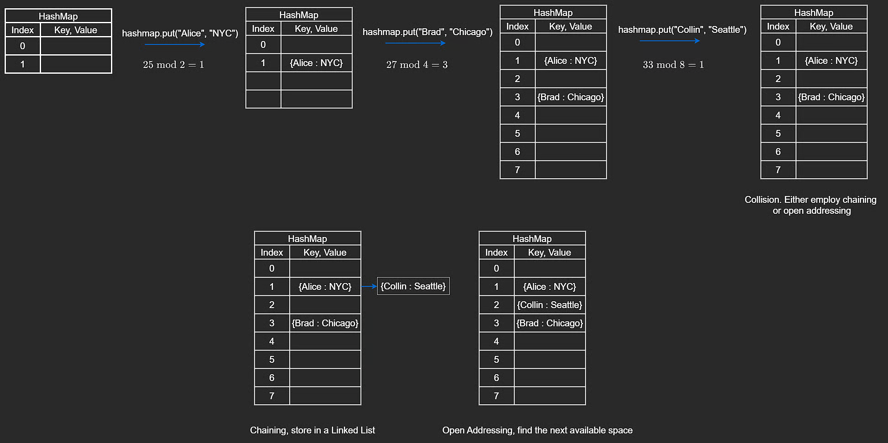
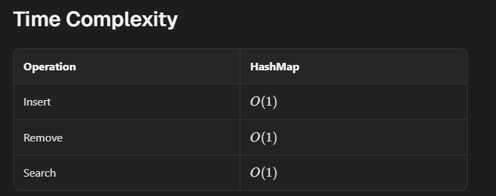

# Hash Implementation

In interviews, you are usually not asked to implement a hash map from scratch, but understanding the mechanics helps with algorithm design and systems design.

## Big Picture

Hash maps are typically implemented on top of arrays.

Example inserts:

```javascript
hashmap["Alice"] = "NYC";
hashmap["Brad"] = "Chicago";
hashmap["Collin"] = "Seattle";
```

To get average-case O(1), we map keys to integer indices with a hash function.

## Insertion and Hashing

For key `"Alice"`:

1. Convert characters to ASCII codes.
2. Sum them.
3. Compress into array bounds with modulo.

Formula:

`index = sum(ASCII codes) % capacity`

If sum is `25` and capacity is `2`, then index is `1`.

The same key always hashes the same way.

## Resizing and Rehashing

### Resizing

As load grows, collisions increase.

Common strategy:

- track number of filled entries
- when map reaches threshold (often 50% in this lesson), double capacity

### Rehashing

After resize, every existing key must be inserted again into the new array because `index % capacity` changed.

## Collisions

Collisions are inevitable: two different keys can map to same index.

Two common strategies:

1. **Chaining**: each slot stores a list of entries
2. **Open Addressing**: probe next slots until an empty one is found

Chaining is typically simpler and more robust. Open addressing can be memory efficient with low collision rates.



Using a prime capacity often improves key distribution.

## Code Implementation (Open Addressing)

### Pair Type

```javascript
class Pair {
  constructor(key, val) {
    this.key = key;
    this.val = val;
  }
}
```

### HashMap Skeleton

```javascript
class HashMap {
  constructor() {
    this.size = 0;
    this.capacity = 2;
    this.map = new Array(this.capacity).fill(null);
  }
}
```

### Hash Function

```javascript
hash(key) {
    let index = 0;
    for (let i = 0; i < key.length; i++) {
        index += key.charCodeAt(i);
    }
    return index % this.capacity;
}
```

### Get

```javascript
get(key) {
    let index = this.hash(key);

    while (this.map[index] != null) {
        if (this.map[index].key == key) {
            return this.map[index].val;
        }
        index += 1;
        index = index % this.capacity;
    }

    return null;
}
```

### Put

```javascript
put(key, val) {
    let index = this.hash(key);

    while (true) {
        if (this.map[index] == null) {
            this.map[index] = new Pair(key, val);
            this.size += 1;

            if (this.size >= this.capacity / 2) {
                this.rehash();
            }
            return;
        } else if (this.map[index].key == key) {
            this.map[index].val = val;
            return;
        }

        index += 1;
        index = index % this.capacity;
    }
}
```

### Remove

```javascript
remove(key) {
    if (this.get(key) == null) {
        return;
    }

    let index = this.hash(key);

    while (true) {
        if (this.map[index].key == key) {
            // This simple open-addressing remove creates a hole,
            // which can break future searches in probe chains.
            this.map[index] = null;
            this.size -= 1;
            return;
        }

        index += 1;
        index = index % this.capacity;
    }
}
```

### Rehash

```javascript
rehash() {
    this.capacity = 2 * this.capacity;
    const newMap = new Array(this.capacity).fill(null);
    const oldMap = this.map;
    this.map = newMap;
    this.size = 0;

    for (let i = 0; i < oldMap.length; i++) {
        if (oldMap[i]) {
            this.put(oldMap[i].key, oldMap[i].val);
        }
    }
}
```

### Print

```javascript
print() {
    for (let i = 0; i < this.map.length; i++) {
        if (this.map[i]) {
            console.log(this.map[i].key + " " + this.map[i].val);
        }
    }
}
```



## Complexity

- Average-case get/put/remove: **O(1)**
- Worst-case (high collisions): **O(n)**

These averages depend on a good hash function and reasonable load factor.
