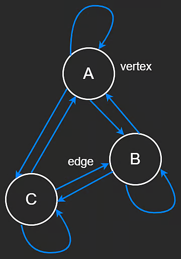
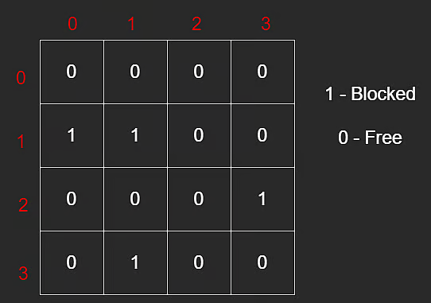
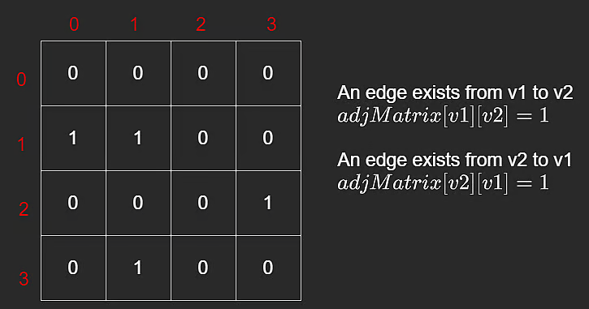
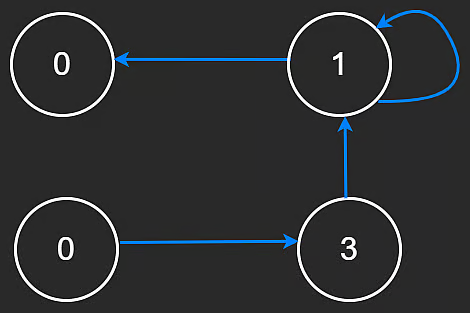

# Introduction to Graphs

We have already seen special graph cases in this course (like linked lists and trees).

A graph is a data structure made of:

- vertices (nodes)
- edges (connections between vertices)

Unlike trees, graphs have fewer structural restrictions. A vertex can have any number of neighbors, including none.

## Graph Terminology

- `V`: number of vertices
- `E`: number of edges

If duplicate edges are not allowed, then in a dense directed setting with self-loops:

$$
E \le V^2
$$

When a graph reaches the maximum possible number of edges for its definition, it is called a complete graph.

## Directed vs Undirected

- **Directed graph**: edges have direction (for example, `u -> v`)
- **Undirected graph**: edges have no direction (`u -- v`)

Linked lists and trees are directed, since references point in specific directions (`next`, `left`, `right`, etc.).



## Common Graph Formats in Interviews

Graphs are abstract, so they can be represented with different concrete data structures.

Most common formats:

1. Matrix (2D grid interpretation)
2. Adjacency Matrix
3. Adjacency List

## 1) Matrix

A matrix is a 2D array with rows and columns.

```javascript
// Matrix (2D Grid)
const grid = [
  [0, 0, 0, 0],
  [1, 1, 0, 0],
  [0, 0, 0, 1],
  [0, 1, 0, 0],
];
```

In grid problems, cells can be treated as graph vertices, and movement rules (up/down/left/right) define edges.

This creates connected components over allowed cells.



Space complexity:

- **O(n \* m)** where `n` is rows and `m` is columns

## 2) Adjacency Matrix

In an adjacency matrix, rows and columns are vertices.

```javascript
// Adjacency matrix
const adjMatrix = [
  [0, 0, 0, 0],
  [1, 1, 0, 0],
  [0, 0, 0, 1],
  [0, 1, 0, 0],
];
```

Interpretation:

- `adjMatrix[v1][v2] = 1` means edge from `v1` to `v2` exists
- `adjMatrix[v1][v2] = 0` means it does not exist

For directed graphs, `adjMatrix[v1][v2]` and `adjMatrix[v2][v1]` are independent.

```javascript
// Edge exists from v1 to v2
adjMatrix[v1][v2] = 1;

// No edge from v1 to v2
adjMatrix[v1][v2] = 0;
```



Space complexity:

- **O(V^2)**

This can be wasteful when the graph is sparse (few edges).

## 3) Adjacency List

This is usually the most common interview representation.

Each vertex stores only its actual neighbors.

```javascript
class GraphNode {
  constructor(val) {
    this.val = val;
    this.neighbors = [];
  }
}
```

Compared with adjacency matrix, this is often much more space efficient for sparse graphs.



Space complexity:

- **O(V + E)**

## Closing Note

In interviews, adjacency lists are generally the default mental model for graph traversal (BFS/DFS), while matrices appear often in grid-based problems.
