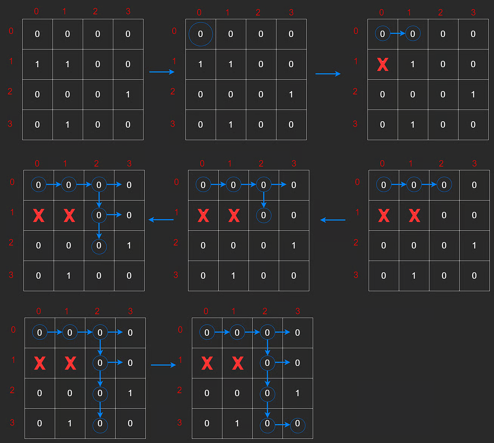
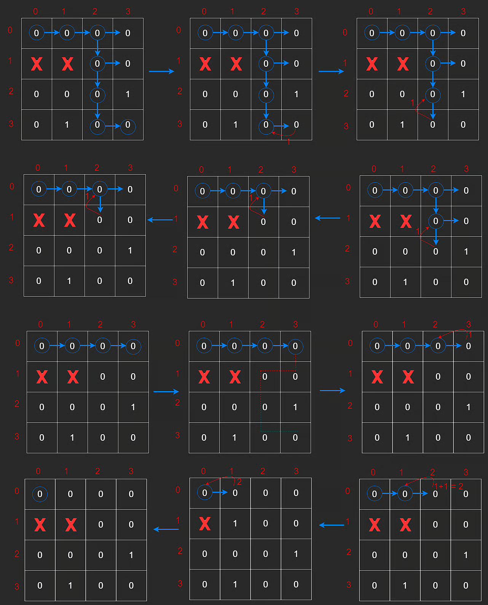

# Matrix DFS

To traverse a matrix, we can use Depth First Search (DFS), similar to tree traversal.

In this lesson, movement is restricted to four directions:

- up
- down
- left
- right

## Motivation Example: Count Unique Paths

Count the number of unique paths from top-left to bottom-right, moving only through `0` cells and never visiting the same cell twice in one path.

```javascript
const matrix = [
  [0, 0, 0, 0],
  [1, 1, 0, 0],
  [0, 0, 0, 1],
  [0, 1, 0, 0],
];
```

This is DFS + backtracking.

### Base Cases

#### 1) Invalid Path

Return `0` if:

- row/column is out of bounds
- cell is blocked (`1`)
- cell is already visited in the current path

#### 2) Valid Path Found

Return `1` when we reach the destination cell `(ROWS - 1, COLS - 1)`.

## Implementation

Use a visited matrix (or hash set) to avoid revisiting cells in the current path.

```javascript
// Count paths (backtracking)
function dfs(grid, r, c, visit) {
  const ROWS = grid.length;
  const COLS = grid[0].length;

  if (
    Math.min(r, c) < 0 ||
    r === ROWS ||
    c === COLS ||
    visit[r][c] === 1 ||
    grid[r][c] === 1
  ) {
    return 0;
  }

  if (r === ROWS - 1 && c === COLS - 1) {
    return 1;
  }

  visit[r][c] = 1;

  let count = 0;
  count += dfs(grid, r + 1, c, visit);
  count += dfs(grid, r - 1, c, visit);
  count += dfs(grid, r, c + 1, visit);
  count += dfs(grid, r, c - 1, visit);

  visit[r][c] = 0;
  return count;
}
```

Visualization:

1. Find first valid path



2. Backtrack and explore another path



For this grid, the result is `2` unique paths.

## Complexity

Worst-case branching is up to 4 directions per cell over paths of length up to `n * m`:

- Time: **O(4^(n \* m))** in path-counting DFS with backtracking
- Space: **O(n \* m)** for recursion stack + visited state

---

## NeetCode Practice (Matrix DFS)

### 1) Flood Fill

- Difficulty: **Easy**
- Pattern: **DFS region expansion**
- Core idea: Expand from start cell across 4-direction neighbors with matching original color.

**Example:**

- Input: `image = [[1,1,1],[1,1,0],[1,0,1]], sr = 1, sc = 1, color = 2`
- Output: `[[2,2,2],[2,2,0],[2,0,1]]`

### Approach 1: Depth First Search

```typescript
class Solution {
  /**
   * @param {number[][]} image
   * @param {number} sr
   * @param {number} sc
   * @param {number} color
   * @return {number[][]}
   */
  floodFill(image, sr, sc, color) {
    const origin = image[sr][sc];
    if (origin === color) return image;

    this.dfs(image, sr, sc, color, origin);
    return image;
  }

  dfs(image, r, c, color, origin) {
    const ROWS = image.length;
    const COLS = image[0].length;

    if (r < 0 || r >= ROWS || c < 0 || c >= COLS || image[r][c] !== origin) {
      return;
    }

    image[r][c] = color;

    this.dfs(image, r + 1, c, color, origin);
    this.dfs(image, r - 1, c, color, origin);
    this.dfs(image, r, c + 1, color, origin);
    this.dfs(image, r, c - 1, color, origin);
  }
}
```

**Complexity:**

- Time: **O(n \* m)**
- Space: **O(n \* m)** worst-case recursion

### 2) Number of Islands

- Difficulty: **Medium**
- Pattern: **Component counting via DFS**
- Core idea: Each DFS that starts from unvisited land consumes one full island.

**Example:**

- Input:

```text
grid = [
    ["0","1","1","1","0"],
    ["0","1","0","1","0"],
    ["1","1","0","0","0"],
    ["0","0","0","0","0"]
]
```

- Output: `1`

### Approach 1: Depth First Search

```typescript
class Solution {
  /**
   * @param {character[][]} grid
   * @return {number}
   */
  numIslands(grid) {
    const directions = [
      [1, 0],
      [-1, 0],
      [0, 1],
      [0, -1],
    ];

    const ROWS = grid.length;
    const COLS = grid[0].length;
    let islands = 0;

    const dfs = (r, c) => {
      if (r < 0 || c < 0 || r >= ROWS || c >= COLS || grid[r][c] === "0") {
        return;
      }

      grid[r][c] = "0";

      for (const [dr, dc] of directions) {
        dfs(r + dr, c + dc);
      }
    };

    for (let r = 0; r < ROWS; r++) {
      for (let c = 0; c < COLS; c++) {
        if (grid[r][c] === "1") {
          dfs(r, c);
          islands++;
        }
      }
    }

    return islands;
  }
}
```

**Complexity:**

- Time: **O(n \* m)**
- Space: **O(n \* m)** worst-case recursion

### 3) Max Area of Island

- Difficulty: **Medium**
- Pattern: **DFS area aggregation**
- Core idea: DFS returns area contribution from each connected land component.

**Example:**

- Input:

```text
grid = [
    [0,1,1,0,1],
    [1,0,1,0,1],
    [0,1,1,0,1],
    [0,1,0,0,1]
]
```

- Output: `6`

### Approach 1: Depth First Search

```typescript
class Solution {
  /**
   * @param {number[][]} grid
   * @return {number}
   */
  maxAreaOfIsland(grid) {
    const directions = [
      [0, 1],
      [0, -1],
      [1, 0],
      [-1, 0],
    ];

    const ROWS = grid.length;
    const COLS = grid[0].length;

    let maxSize = 0;

    const dfs = (r, c) => {
      if (r < 0 || c < 0 || r >= ROWS || c >= COLS || grid[r][c] === 0) {
        return 0;
      }

      grid[r][c] = 0;
      let size = 1;

      for (const [dr, dc] of directions) {
        size += dfs(r + dr, c + dc);
      }

      return size;
    };

    for (let r = 0; r < ROWS; r++) {
      for (let c = 0; c < COLS; c++) {
        if (grid[r][c] === 1) {
          maxSize = Math.max(maxSize, dfs(r, c));
        }
      }
    }

    return maxSize;
  }
}
```

**Complexity:**

- Time: **O(n \* m)**
- Space: **O(n \* m)** worst-case recursion
