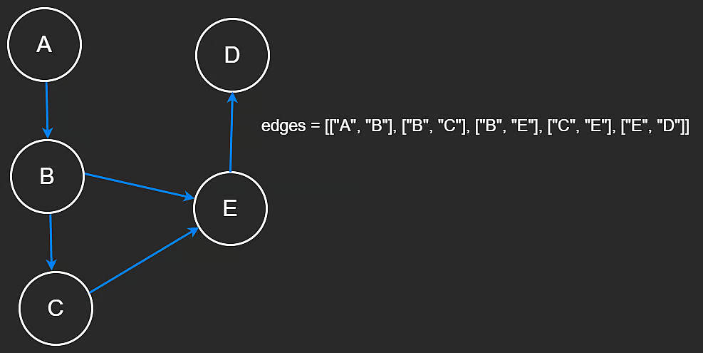

# Adjacency List

An adjacency list is one of the easiest graph representations to traverse. It gives direct access to every neighbor of a vertex and avoids out-of-bounds checks that are common in matrix-based graph representations.

Suppose we are given a list of directed edges and need to build an adjacency list.

The code below shows how to do that. We can use a hash map where the key is a vertex and the value is a list of that vertex's neighbors. A hash map works here because we assume all keys are unique.

```js
// GraphNode used for adjacency list
class GraphNode {
  constructor(val) {
    this.val = val;
    this.neighbors = [];
  }
}

// Or use a HashMap
let adjList = new Map();

// Given directed edges, build an adjacency list
let edges = [
  ["A", "B"],
  ["B", "C"],
  ["B", "E"],
  ["C", "E"],
  ["E", "D"],
];

adjList.set("A", []);
adjList.set("B", []);

for (let edge of edges) {
  let src = edge[0];
  let dst = edge[1];

  // If the current source does not exist, add it to the hashmap
  if (!adjList.has(src)) {
    adjList.set(src, []);
  }

  // If the current destination does not exist, add it to the hashmap
  if (!adjList.has(dst)) {
    adjList.set(dst, []);
  }

  // Retrieve the key (source) and add the destination to its list of neighbors
  adjList.get(src).push(dst);
}

console.log(adjList);
```



## DFS on an adjacency list

Let us say we want to count the number of paths from a source to a destination.

In the code below, we have an adjacency list, a source, and a target. Similar to matrix traversal, we use a hash set called `visit` to keep track of the vertices we have already visited.

We recursively run DFS on the list until we reach the target node, at which point we return `1`. Once we find a path, we backtrack by removing nodes from the set and return the count.

```js
function dfs(node, target, adjList, visit) {
  if (visit.has(node)) {
    return 0;
  }

  if (node === target) {
    return 1;
  }

  let count = 0;
  visit.add(node);

  for (let neighbor of adjList.get(node) || []) {
    count += dfs(neighbor, target, adjList, visit);
  }

  visit.delete(node);
  return count;
}
```

### Time complexity

This backtracking is exponential. In the worst case, each node is connected to every other node in the graph. Recall that the maximum number of edges in a simple directed graph is bounded by $V^2$, where $V$ is the number of vertices. If we imagine a decision tree of possible routes, the search can grow exponentially with the number of vertices.

In the worst case, the time complexity is roughly $O(N^V)$.

## BFS on an adjacency list

Running BFS is similar to what we have seen before. Suppose our goal is to find the shortest path from a node to a target. By shortest path, we mean reaching the destination by visiting the fewest vertices possible.

Our code is very similar to matrix BFS, except in this case we do not need to worry about out-of-bounds checks. We increase the length at each level until we find the target vertex.

```js
// Shortest path from node to target.
function bfs(node, target, adjList) {
  let length = 0;
  let visit = new Set();
  let q = [];

  visit.add(node);
  q.push(node);

  while (q.length !== 0) {
    let queueLength = q.length;

    for (let i = 0; i < queueLength; i++) {
      let curr = q.shift();

      if (curr === target) {
        return length;
      }

      for (let neighbor of adjList.get(curr) || []) {
        if (!visit.has(neighbor)) {
          visit.add(neighbor);
          q.push(neighbor);
        }
      }
    }

    length++;
  }

  return length;
}
```

### Time complexity

We learned before that the number of edges in a graph is upper bounded by $V^2$. However, in this case we do not have self-loops and we do not have the maximal number of edges. Therefore, we can say that the time complexity is $O(V + E)$, where $V$ is the number of vertices and $E$ is the number of edges. This is because, in the worst case, BFS visits every vertex and traverses every edge.

## Closing notes

That is all we are going to cover on graphs. You might not believe it, but this is only scratching the surface and covering the basics. After all, there is a whole field of study called graph theory. Graphs can become much more complicated, and there are many more algorithms specific to graphs. You can find these in the Advanced Algorithms course.

---

# Clone Graph

**Difficulty:** Medium

**Topics:** Graphs, BFS

**Company Tags:** None

Given a node in a connected undirected graph, return a deep copy of the graph.

Each node in the graph contains an integer value and a list of its neighbors.

```js
class Node {
  constructor(val, neighbors = []) {
    this.val = val;
    this.neighbors = neighbors;
  }
}
```

The graph is shown in the test cases as an adjacency list. An adjacency list is a mapping of nodes to lists, used to represent a finite graph. Each list describes the set of neighbors of a node in the graph.

For simplicity, node values are numbered from `1` to `n`, where `n` is the total number of nodes in the graph. The index of each node within the adjacency list is the same as the node's value (1-indexed).

The input node will always be the first node in the graph and have value `1`.

## Example 1

Input:

```js
const adjList = [[2], [1, 3], [2]];
```

Output:

```js
[[2], [1, 3], [2]];
```

## Breadth First Search

### Intuition

The graph can have cycles, so while cloning we must avoid creating duplicate nodes or looping forever.

Using BFS, we explore the graph level by level and keep a map from original nodes to their clones.

- When a node is first seen, create its clone and store it in the map.
- For every neighbor, ensure its clone exists, then connect the cloned nodes.
- The map guarantees each node is cloned only once.

### Algorithm

1. If the input node is `null`, return `null`.
2. Create a map to store `original node -> cloned node`.
3. Initialize a queue with the starting node and create its clone.
4. While the queue is not empty:
   - Pop a node.
   - For each neighbor:
     - If the neighbor is not cloned yet, clone it and add it to the queue.
     - Add the cloned neighbor to the current node's neighbor list.
5. Return the clone of the starting node.

```js
/**
 * // Definition for a Node.
 * class Node {
 *     constructor(val = 0, neighbors = []) {
 *       this.val = val;
 *       this.neighbors = neighbors;
 *     }
 * }
 */

class Solution {
  /**
   * @param {Node} node
   * @return {Node}
   */
  cloneGraph(node) {
    if (!node) return null;

    // Map original node → cloned node
    const oldToNew = new Map();

    // BFS queue
    const queue = [];

    // Clone starting node and add it to the map
    oldToNew.set(node, new Node(node.val));
    queue.push(node);

    while (queue.length > 0) {
      // Get the next original node
      const cur = queue.shift();

      for (const neigh of cur.neighbors) {
        // Clone neighbor if we haven't seen it
        if (!oldToNew.has(neigh)) {
          oldToNew.set(neigh, new Node(neigh.val));
          queue.push(neigh);
        }

        // Connect the cloned nodes
        oldToNew.get(cur).neighbors.push(oldToNew.get(neigh));
      }
    }

    // Return the clone of the starting node
    return oldToNew.get(node);
  }
}
```

---

# Course Schedule

**Difficulty:** Medium

**Topics:** Graphs, DFS, Topological Sort

**Company Tags:** None

You are given an array `prerequisites`, where `prerequisites[i] = [a, b]` indicates that you must take course `b` first if you want to take course `a`.

The pair `[0, 1]` indicates that you must take course `1` before taking course `0`.

There are a total of `numCourses` courses, labeled from `0` to `numCourses - 1`.

Return `true` if it is possible to finish all courses; otherwise, return `false`.

## Example 1

Input:

```js
const numCourses = 2;
const prerequisites = [[0, 1]];
```

Output:

```js
true;
```

Explanation: First take course `1` (no prerequisites), then take course `0`.

## Cycle Detection (DFS)

### Intuition

Each course is a node, and each prerequisite is a directed edge.

You can finish all courses only if there is no cycle in this directed graph.

A cycle means:

- Course `A` needs `B`
- `B` needs `C`
- `C` needs `A`

So you are stuck forever.

We use DFS with cycle detection.

- While doing DFS, keep track of courses in the current recursion path.
- If we visit a course already in the current path, a cycle is found.
- If a course has no prerequisites left, it is safe.

### Algorithm

1. Build a graph where each course points to its prerequisites.
2. Use a `visiting` set to track the current DFS path.
3. For each course:
   - Run DFS.
   - If the course is already in `visiting`, return `false`.
   - Recursively DFS its prerequisites.
   - After successfully processing a course, clear its prerequisite list and mark it as done.
4. If all courses are processed without cycles, return `true`.

```js
class Solution {
    /**
     * @param {number} numCourses
     * @param {number[][]} prerequisites
     * @return {boolean}
     */
    canFinish(numCourses, prerequisites) {
        // Map each course → its prerequisites
        const preMap = new Map();

        for (let i = 0; i < numCourses; i++) {
            preMap.set(i, []);
        }

        for (let [crs, pre] of prerequisites) {
            preMap.get(crs).push(pre);
        }

        // Courses in the current DFS path
        const visiting = new Set();

        const dfs = (crs) => {
            // Course already in current path → cycle
            if (visiting.has(crs)) {
                return false;
            }

            // No prerequisites → can finish
            if (preMap.get(crs).length === 0) {
                return true;
            }

            // Start exploring this course
            visiting.add(crs);

            for (let pre of preMap.get(crs)) {
                if (!dfs(pre)) {
                    return false;
                }
            }

            // Done exploring this course
            visiting.delete(crs);

            // Mark as already processed
            preMap.set(crs, []);

            return true;
        };

        for (let c = 0; c < numCourses; c++) {
            if (!dfs(c)) {
                return false;
            }
        }

        return true;
    }
}
```
