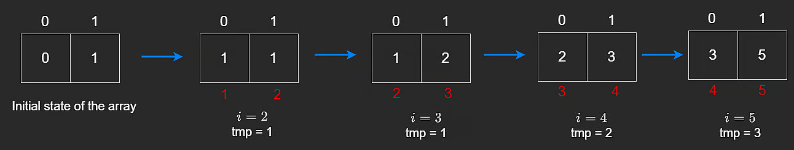

One Dimensional Dynamic Programming
Dynamic Programming (DP) is generally considered one of the most difficult topics in computer science. But that is because people tend to overcomplicate it. In this chapter, we will break down dynamic programming into simpler terms and show you how to solve problems using it.

That said, some dynamic programming problems are extremely difficult, but the general concept behind it is not.

What is dynamic programming?
Simply put, it is an optimized version of recursion.

It takes a big problem and solves it by breaking it down into smaller problems. The reason we say it is optimized recursion is because it is often more optimal when it comes to time and space.

Let's go back to the fibonacci sequence which we discussed earlier in the course. We calculated the nth fibonacci number by using the formula: F(n) = F(n − 1) + F(n − 2) with the following code:

// Brute Force
function bruteForce(n) {
    if (n <= 1) {
        return n;
    }
    return bruteForce(n - 1) + bruteForce(n - 2);
}

We also established the time complexity of the above algorithm was O(2n) because at every level, bruteForce creates 2 more calls to bruteForce. With dynamic programming, we can reduce the time complexity from O(2n) to O(n).

Dynamic Programming vs. Recursion
If we look at the tree for bruteForce(5) below, we can see we calculate F(2) three times, which is extra work since we have already calculated the value of F(2). This does not seem like a big deal when the input is small but as the input grows, the amount of work done grows exponentially, which will become extremely slow if we have something like calculating fibonacci of 100.

DP tells us that we can avoid repeating this computation by a concept called memoization, which is a fancy word for caching.

The idea here is that once we perform a computation, we can store it in a cache so that we do not have to repeat it. For example, if we calculate F(3), we can store the result in a hash map or array, and then we can retrieve the result from the cache if we encounter the same computation again.

This, in essence is the idea behind top down dynamic programming - it is recursion with memoization. The key of our hash map will be the fibonacci number and the value will be its return value. This way, we can retrieve in O(1) time.

// Memoization
function memoization(n, cache) {
    if (n <= 1) {
        return n;
    }
    if (cache[n] != 0) {
        return cache[n];
    }
    cache[n] = memoization(n - 1, cache) + memoization(n - 2, cache);
    return cache[n];
}

Notice in the solution above that we have made a few key changes to the previous recursive solution:

We added a cache parameter to the function, which in this case is a hash map.
We added a base case to check if the value of n is in the cache. If it is, we return the value stored in the cache rather than making a recursive call.
After we compute the value of F(n), we store it in the cache so that we can retrieve it later if we need it.

Top Down Approach (Memoization)

The above is what is known as a top-down approach, and that is because we are traversing the tree from the root and going down all the way to our base cases, which is basically recursion anyways.

There is also a bottom-up approach, which computes the result of the base cases first and then works its way up. This is another approach we will be using to solve the fibonacci problem.

The time complexity of the above solution is O(n) because we are only ever calculating the fibonacci number once and storing it in the cache. The space complexity is also O(n) because we are storing the fibonacci number in the cache.

Bottom Up Approach (Tabulation)

We calculate the value of n by making use of n−1 and n−2. Let us now suppose that we have an array of size 5 which will help us calculate the 5th fibonacci number, where the value stored at the ith index of the array represents the fibonacci value of i. This would look like the following:

[0,1,1,2,3,5]

The time complexity for this is O(n) and the space complexity is O(n) as well. The real question here is if we even need to allocate space for an entire array. If we think about it, we are only ever using the previous two values to calculate the current value.

DP tells us that it is possible to get away with saving only the two previous values and then use them to calculate the next value(s) as long as we compute the values in order.

So, if we take an array of size 2, we can bring our space complexity down to O(1). By doing this, we can just store the fibonacci number at the 1st index in a temporary variable, calculate the next fibonacci number and overwrite the value the 1st index with the newly calculated fibonacci number, and finally overwrite the 0th index with our temporary variable.

Observe the following where the numbers above the array, in white, represent the index and the numbers in red represent the fibonacci numbers.

// Dynamic Programming
function dp(n) {
    if (n < 2) { 
        return n;
    }
    let dp = [0,1]
    let i = 2;
    while (i <= n) {
        let tmp = dp[1];
        dp[1] = dp[0] + dp[1];
        dp[0] = tmp;
        i++;
    }
    return dp[1];
}

