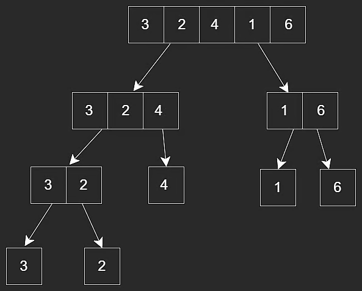
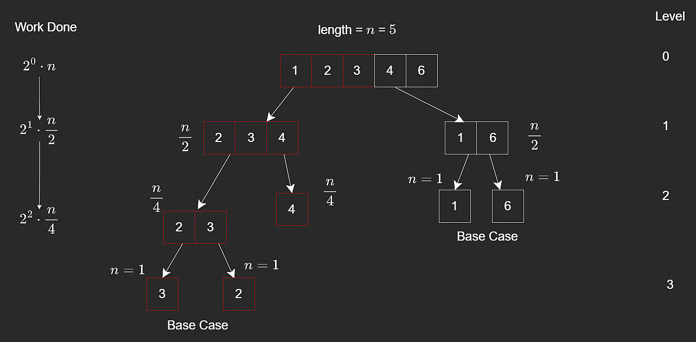

# Merge Sort

Merge sort is a very common sorting algorithm and is used in many standard libraries.

It follows a **divide-and-conquer** strategy:

1. Split the array into halves until subarrays have size `1`.
2. Recursively sort each half.
3. Merge sorted halves back together.

This is a two-branch recursive pattern, similar to Fibonacci recursion.

## Core Idea

Example input: `[3,2,4,1,6]`

Goal: sort in increasing (non-decreasing) order.



```javascript
function mergeSort(arr, l, r) {
  if (l < r) {
    // Find middle
    const m = Math.floor((l + r) / 2);

    mergeSort(arr, l, m); // sort left half
    mergeSort(arr, m + 1, r); // sort right half
    merge(arr, l, m, r); // merge sorted halves
  }

  return arr;
}
```

Base case: subarray length is `1` (already sorted).

Recursive case:

- sort left half
- sort right half
- merge results

Important execution detail:

- `merge()` runs only after both recursive `mergeSort()` calls return for the current subarray.

## Merge Function (Three Pointers)

During merge, we use three pointers:

- `i`: current index in left temporary array
- `j`: current index in right temporary array
- `k`: write index in original array

At each step:

- Compare left and right values
- Write smaller value to `arr[k]`
- Increment `k` and whichever side was chosen (`i` or `j`)

```javascript
// Merges two subarrays of arr[]
// First subarray is arr[l..m]
// Second subarray is arr[m+1..r]
function merge(arr, l, m, r) {
  const length1 = m - l + 1;
  const length2 = r - m;

  const L = new Array(length1);
  const R = new Array(length2);

  for (let i = 0; i < length1; i++) {
    L[i] = arr[l + i];
  }

  for (let j = 0; j < length2; j++) {
    R[j] = arr[m + 1 + j];
  }

  let i = 0;
  let j = 0;
  let k = l;

  while (i < length1 && j < length2) {
    if (L[i] <= R[j]) {
      arr[k] = L[i];
      i++;
    } else {
      arr[k] = R[j];
      j++;
    }
    k++;
  }

  while (i < length1) {
    arr[k] = L[i];
    i++;
    k++;
  }

  while (j < length2) {
    arr[k] = R[j];
    j++;
    k++;
  }
}
```

This merge step is a classic two-pointer technique and combines arrays in $O(n + m)$ for left length `n` and right length `m`.

## Time and Space Complexity

### Time

Merge sort runs in **$O(n \log n)$**.

Reasoning:

- Recursion tree height is about `log n`.
- Each level does `O(n)` work total during merges.
- Multiply: `O(n) * O(log n) = O(n log n)`.



### Space

- Temporary arrays in merge steps: `O(n)`
- Recursion call stack: `O(log n)`

Total: **$O(n + \log n) = O(n)$**.

## Stability

Merge sort is **stable**.

If duplicates exist in both halves, choosing left first on equality preserves original relative order:

```javascript
if (leftSubarray[i] <= rightSubarray[j]) {
  arr[k] = leftSubarray[i];
  i += 1;
}
```

## Merge Sort vs Insertion Sort

- Insertion sort: worst-case **$O(n^2)$**
- Merge sort: best/average/worst-case **$O(n \log n)$**

Merge sort is generally superior for larger arrays.

Insertion sort can still be preferable for small or nearly sorted arrays.

---

## NeetCode Practice (Sorting)

### 1) Merge Sorted Array

- Difficulty: **Easy**
- Pattern: **Two pointers / three pointers**
- Core idea: Merge two sorted arrays into `nums1` in-place.

**Problem statement (summary):**
You are given sorted arrays `nums1` and `nums2`, with counts `m` and `n`.

- First `m` elements of `nums1` are valid.
- Last `n` elements of `nums1` are placeholders (`0`).

Modify `nums1` in-place so it becomes the sorted merge of both arrays.

**Example:**

- Input: `nums1 = [10,20,20,40,0,0], m = 4, nums2 = [1,2], n = 2`
- Output: `[1,2,10,20,20,40]`

### Approach 1: Three Pointers With Extra Space

**Intuition:**
Copy valid portion of `nums1` first so front writes do not overwrite needed values.

**Algorithm:**

1. Copy first `m` elements of `nums1`.
2. Use `i` for copy, `j` for `nums2`, `idx` for write position in `nums1`.
3. Write smaller value each step.
4. Continue until `idx == m + n`.

```typescript
class Solution {
  merge(nums1: number[], m: number, nums2: number[], n: number): void {
    const nums1Copy = nums1.slice(0, m);
    let idx = 0;
    let i = 0;
    let j = 0;

    while (idx < m + n) {
      if (j >= n || (i < m && nums1Copy[i] <= nums2[j])) {
        nums1[idx++] = nums1Copy[i++];
      } else {
        nums1[idx++] = nums2[j++];
      }
    }
  }
}
```

**Complexity:**

- Time: **$O(m+n)$**
- Space: **$O(m)$**

### Approach 2: Three Pointers Without Extra Space (Version I)

**Intuition:**
Write from the back of `nums1` (where free space exists), so no needed value is overwritten.

**Algorithm:**

1. Set `last = m + n - 1`.
2. While `m > 0` and `n > 0`, place larger of `nums1[m - 1]` and `nums2[n - 1]` at `nums1[last]`.
3. Decrement corresponding pointer and `last`.
4. Copy any remaining `nums2` values.

```typescript
class Solution {
  merge(nums1: number[], m: number, nums2: number[], n: number): void {
    let last = m + n - 1;

    while (m > 0 && n > 0) {
      if (nums1[m - 1] > nums2[n - 1]) {
        nums1[last--] = nums1[m-- - 1];
      } else {
        nums1[last--] = nums2[n-- - 1];
      }
    }

    while (n > 0) {
      nums1[last--] = nums2[n-- - 1];
    }
  }
}
```

**Complexity:**

- Time: **$O(m+n)$**
- Space: **$O(1)$** extra space

### Approach 3: Three Pointers Without Extra Space (Version II)

**Intuition:**
Cleaner loop: continue only while `j >= 0`, because leftover `nums1` elements are already in correct place.

**Algorithm:**

1. Set `i = m - 1`, `j = n - 1`, `last = m + n - 1`.
2. While `j >= 0`, place max of `nums1[i]` and `nums2[j]` at `nums1[last]`.
3. Move pointers.

```typescript
class Solution {
  merge(nums1: number[], m: number, nums2: number[], n: number): void {
    let last = m + n - 1;
    let i = m - 1;
    let j = n - 1;

    while (j >= 0) {
      if (i >= 0 && nums1[i] > nums2[j]) {
        nums1[last--] = nums1[i--];
      } else {
        nums1[last--] = nums2[j--];
      }
    }
  }
}
```

**Complexity:**

- Time: **$O(m+n)$**
- Space: **$O(1)$** extra space

### Common Pitfalls

1. Merging from the front in-place
   This can overwrite values in `nums1` that are still needed.

2. Forgetting leftover `nums2` elements
   After the main loop, remaining values in `nums2` must be copied.
