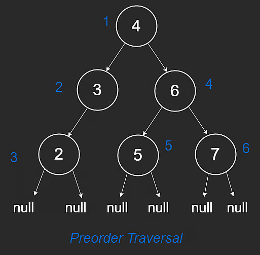
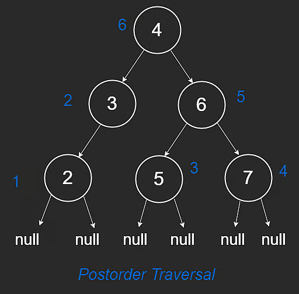

# Depth-First Search

Depth-First Search (DFS) is one of the most common interview algorithms.

It is used for both trees and graphs. This lesson focuses on trees.

## Concept

To traverse an entire tree, we must visit every node.

DFS goes as deep as possible along one path before backtracking.

For example:

1. Keep moving left until `null`.
2. Backtrack to parent.
3. Explore right subtree.

DFS is naturally implemented with recursion, but can also be implemented iteratively with a stack.

## DFS Traversal Orders

There are three standard traversal orders:

- Inorder
- Preorder
- Postorder

### Inorder Traversal

Order: **left -> node -> right**

```javascript
function inorder(root) {
  if (root == null) {
    return;
  }
  inorder(root.left);
  console.log(root.val);
  inorder(root.right);
}
```

Example order in diagram: `[2,3,4,5,6,7]`

Important:

- Inorder is sorted **only if** the tree is a BST.


### Preorder Traversal

Order: **node -> left -> right**

```javascript
function preorder(root) {
  if (root == null) {
    return;
  }
  console.log(root.val);
  preorder(root.left);
  preorder(root.right);
}
```

Example order in diagram: `[4,3,2,6,5,7]`



### Postorder Traversal

Order: **left -> right -> node**

```javascript
function postorder(root) {
  if (root == null) {
    return;
  }
  postorder(root.left);
  postorder(root.right);
  console.log(root.val);
}
```

Example order in diagram: `[2,3,5,7,6,4]`



## Time and Space Complexity

The following applies to all three traversals.

### Time

Every node is visited once.

- Time: **$O(n)$**

where `n` is number of nodes.

### Space

Recursive DFS uses call stack proportional to tree height `h`.

- Space: **$O(h)$**

So:

- balanced tree: **$O(\log n)$**
- skewed tree: **$O(n)$**

---

## NeetCode Practice (Trees)

### 1) Kth Smallest Integer in BST

- Difficulty: **Medium**
- Pattern: **Inorder DFS with stack (iterative)**
- Core idea: Inorder traversal of a BST visits nodes in sorted order, so the k-th visited node is the answer.

**Problem statement (summary):**
Given the root of a BST and integer `k` (1-indexed), return the k-th smallest value.

BST constraints:

- left subtree values are smaller than node value
- right subtree values are greater than node value
- both subtrees are BSTs

**Examples:**

- Input: `root = [2,1,3], k = 1`
- Output: `1`

- Input: `root = [4,3,5,2,null], k = 4`
- Output: `5`

### Approach 1: Iterative DFS (Optimal)

**Intuition:**
Use a stack to simulate recursive inorder traversal:

1. Push all left nodes.
2. Pop one node (next smallest).
3. Decrement `k`.
4. If `k == 0`, this node is the answer.
5. Move to right subtree and repeat.

This stops early at the k-th element instead of traversing all nodes.

**Algorithm:**

1. Initialize empty stack and `curr = root`.
2. While `stack` not empty or `curr` not null:
3. Push left chain.
4. Pop top node.
5. Decrement `k`; if zero, return node value.
6. Move `curr` to popped node's right child.

```typescript
/**
 * Definition for a binary tree node.
 * class TreeNode {
 *     constructor(val = 0, left = null, right = null) {
 *         this.val = val;
 *         this.left = left;
 *         this.right = right;
 *     }
 * }
 */

class Solution {
  /**
   * @param {TreeNode} root
   * @param {number} k
   * @return {number}
   */
  kthSmallest(root, k) {
    const stack = [];
    let curr = root;

    while (stack.length > 0 || curr !== null) {
      while (curr !== null) {
        stack.push(curr);
        curr = curr.left;
      }

      curr = stack.pop();
      k--;

      if (k === 0) {
        return curr.val;
      }

      curr = curr.right;
    }
  }
}
```

**Complexity:**

- Time: **$O(h + k)$** in the best stopping sense, up to **$O(n)$** worst case
- Space: **$O(h)$**

Where:

- `n` is number of nodes
- `h` is tree height
