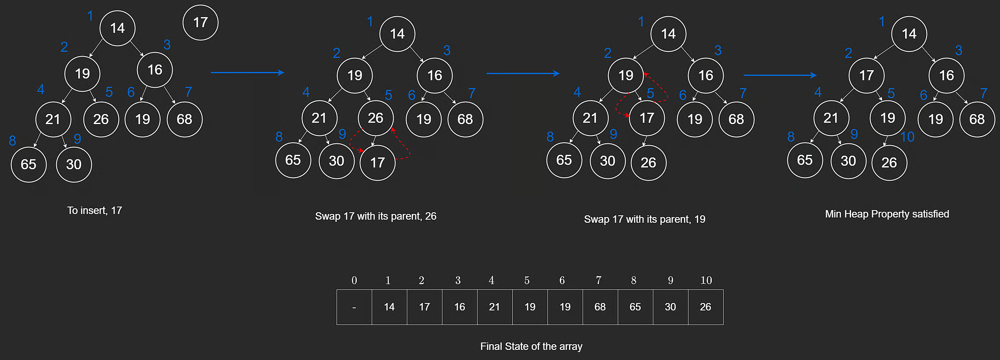
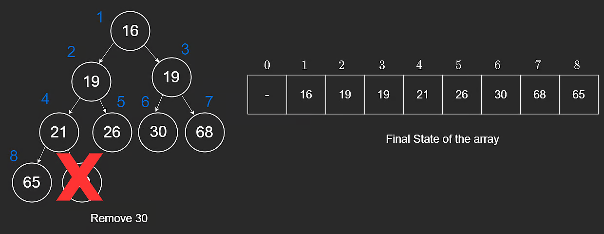

# Heaps: Push and Pop

With heaps, reading the minimum or maximum value is **O(1)** (just read the root).

Insertion and removal are more involved, but both stay efficient at **O(log n)**.

## Push

Using heap `[14,19,16,21,26,19,68,65,30,null,null,null,null,null,null]`, suppose we push `17`.

Because the heap is a complete binary tree, `17` is first placed at the next contiguous index.

Then we restore order by **percolating up** (bubble up):

1. Compare `17` with parent `26`, swap.
2. Compare `17` with parent `19`, swap.
3. Compare `17` with parent `14`, stop.



```javascript
push(val) {
    this.heap.push(val);
    let i = this.heap.length - 1;

    // Percolate up
    while (i > 1 && this.heap[i] < this.heap[Math.floor(i / 2)]) {
        const tmp = this.heap[i];
        this.heap[i] = this.heap[Math.floor(i / 2)];
        this.heap[Math.floor(i / 2)] = tmp;
        i = Math.floor(i / 2);
    }
}
```

`Math.floor` is used because array indices are integers.

## Pop

Popping removes the highest-priority element (root in min-heap = smallest value).

### Why Not Replace Root with min(left, right)?

That can break the **structure property** (completeness).

### Correct Strategy

1. Save root value.
2. Move the right-most node of the last level to root.
3. Percolate that value down by swapping with smaller child until heap order is restored.



```javascript
pop() {
    if (this.heap.length === 1) {
        // Normally we'd throw an error for empty heap.
        return -1;
    }
    if (this.heap.length === 2) {
        return this.heap.pop();
    }

    const res = this.heap[1];
    this.heap[1] = this.heap.pop();
    let i = 1;

    // Percolate down
    while (2 * i < this.heap.length) {
        if (
            2 * i + 1 < this.heap.length &&
            this.heap[2 * i + 1] < this.heap[2 * i] &&
            this.heap[i] > this.heap[2 * i + 1]
        ) {
            const tmp = this.heap[i];
            this.heap[i] = this.heap[2 * i + 1];
            this.heap[2 * i + 1] = tmp;
            i = 2 * i + 1;
        } else if (this.heap[i] > this.heap[2 * i]) {
            const tmp = this.heap[i];
            this.heap[i] = this.heap[2 * i];
            this.heap[2 * i] = tmp;
            i = 2 * i;
        } else {
            break;
        }
    }

    return res;
}
```

## Complexity Summary

| Operation   | Time     |
| ----------- | -------- |
| Get Min/Max | O(1)     |
| Push        | O(log n) |
| Pop         | O(log n) |

---

## NeetCode Practice (Heaps)

### 1) Kth Largest Element in a Stream

- Difficulty: **Easy**
- Pattern: **Fixed-size min-heap**
- Core idea: Keep only the `k` largest values. The heap root is the `k`th largest.

**Problem statement (summary):**
Design a class with:

1. `constructor(k, nums)`
2. `add(val)` returning current `k`th largest value in the stream

**Example:**

- Input: `["KthLargest", [3, [1, 2, 3, 3]], "add", [3], "add", [5], "add", [6], "add", [7], "add", [8]]`
- Output: `[null, 3, 3, 3, 5, 6]`

### Approach 1: Min-Heap of Size k

**Intuition:**
If the heap stores exactly the `k` largest values seen so far, the smallest among them is exactly the `k`th largest overall.

```typescript
class KthLargest {
  constructor(k, nums) {
    this.k = k;
    this.heap = [];

    for (const num of nums) {
      this.add(num);
    }
  }

  add(val) {
    this.heap.push(val);

    // Bubble up
    let i = this.heap.length - 1;
    while (i > 0) {
      const parent = Math.floor((i - 1) / 2);
      if (this.heap[parent] <= this.heap[i]) break;
      [this.heap[parent], this.heap[i]] = [this.heap[i], this.heap[parent]];
      i = parent;
    }

    // Keep only k values
    if (this.heap.length > this.k) {
      this.heap[0] = this.heap.pop();

      // Bubble down
      i = 0;
      while (true) {
        let smallest = i;
        const left = 2 * i + 1;
        const right = 2 * i + 2;

        if (left < this.heap.length && this.heap[left] < this.heap[smallest]) {
          smallest = left;
        }
        if (
          right < this.heap.length &&
          this.heap[right] < this.heap[smallest]
        ) {
          smallest = right;
        }
        if (smallest === i) break;

        [this.heap[i], this.heap[smallest]] = [
          this.heap[smallest],
          this.heap[i],
        ];
        i = smallest;
      }
    }

    return this.heap[0];
  }
}
```

**Complexity:**

- `add`: **O(log k)**
- Space: **O(k)**
