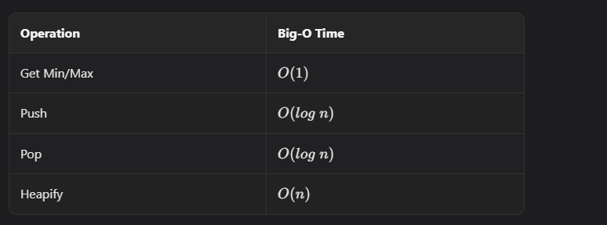

# Heapify

If we build a heap by inserting `n` elements one by one, total time is **O(n log n)**.

`heapify` builds a heap in **O(n)** time by fixing the tree bottom-up.

## Core Idea

To build a valid min-heap, we need:

1. structure property (complete tree) - handled naturally by array layout
2. order property (parent <= children) - enforced using percolate-down

Leaf nodes are already heaps, so we start from the last non-leaf node and move backward to the root.

## Implementation

```javascript
heapify(arr) {
    // Move 0th value to end so we can use one-based indexing.
    arr.push(arr[0]);

    this.heap = arr;

    // Start from the last non-leaf node.
    let cur = Math.floor((this.heap.length - 1) / 2);

    while (cur > 0) {
        let i = cur;

        // Percolate down
        while (2 * i < this.heap.length) {
            if (
                2 * i + 1 < this.heap.length &&
                this.heap[2 * i + 1] < this.heap[2 * i] &&
                this.heap[i] > this.heap[2 * i + 1]
            ) {
                // Swap with right child
                const tmp = this.heap[i];
                this.heap[i] = this.heap[2 * i + 1];
                this.heap[2 * i + 1] = tmp;
                i = 2 * i + 1;
            } else if (this.heap[i] > this.heap[2 * i]) {
                // Swap with left child
                const tmp = this.heap[i];
                this.heap[i] = this.heap[2 * i];
                this.heap[2 * i] = tmp;
                i = 2 * i;
            } else {
                break;
            }
        }

        cur--;
    }
}
```

Step-by-step:

1. Compute index of last non-leaf (`n / 2`).
2. Percolate-down that node.
3. Decrement index and repeat.
4. Stop after processing the root.


## Why Time Is O(n)

Intuitively:

- About half the nodes are leaves (no work).
- Nodes near the bottom move very little.
- Only a few nodes near the top can move many levels.

Summing this work yields **O(n)** total time.

We skip the formal proof here since interview settings usually focus on knowing and applying the result.


