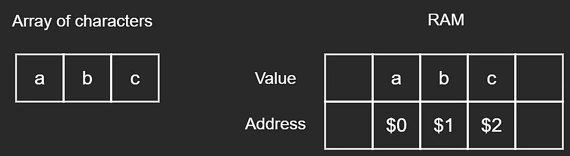

# RAM and Arrays

Data structures are a way to store data efficiently inside a computer component called **Random Access Memory (RAM)**.

Because RAM supports direct indexing by address, we can access any element in an array in **constant time, $O(1)$**.

RAM is often just referred to as _memory_. Let's understand how an array is stored in RAM.

## Arrays in Memory

An array is an ordered collection of **contiguous** elements, for example: `[1, 3, 5]`.

However, computers represent everything as bits: `0`s and `1`s.

Most computers today have gigabytes (GBs) of RAM. For example, your machine might have **8 GB** (about **$10^9$ bytes** per GB). A byte is made of exactly **8 bits**.

## Binary Representation Example

Each integer in `[1, 3, 5]` has a binary representation:

- `1` -> `00000001`
- `3` -> `00000011`
- `5` -> `00000101`

If we use a single byte to store each value, those are the exact bit patterns.

When we store an array in RAM, each element is stored **continuously** and in order.

## Addresses and Element Size

Integers commonly occupy **4 bytes (32 bits)** in memory.

When an integer is stored in RAM, it is associated with:

- an **address** (its location in memory), and
- a **value**.

Since array elements are contiguous, each next element is placed right after the previous one.

### Storing an Integer Array in RAM

Each integer occupies 4 bytes, so addresses are **4 bytes apart**.

Instead of integers, we could also store characters in an array.

### Storing a Character Array in RAM

Each character takes **8 bits = 1 byte**, so addresses are **1 byte apart**.

Each character occupies 1 byte of space, hence addresses are 1 byte apart.

## Key Takeaway

The size or type of stored data does not fundamentally change the model, as long as address increments are relative to the data type's size.

Most of this is abstracted away in day-to-day development, but this mental model is still very relevant for understanding algorithms, data structures, and _system design_.
