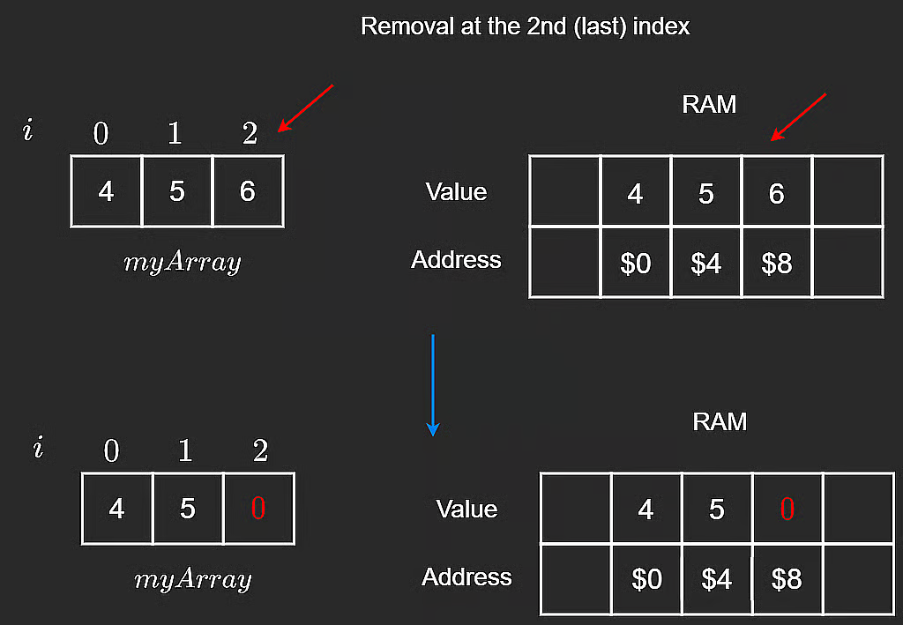
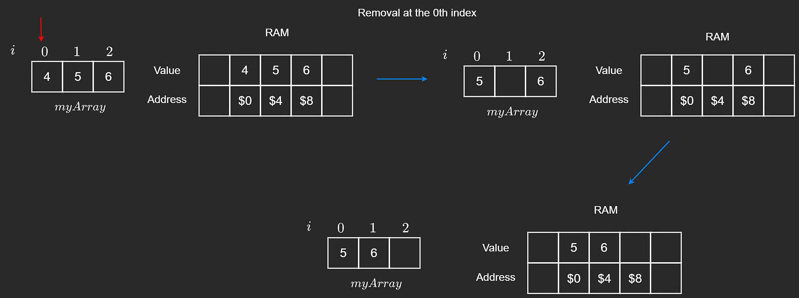
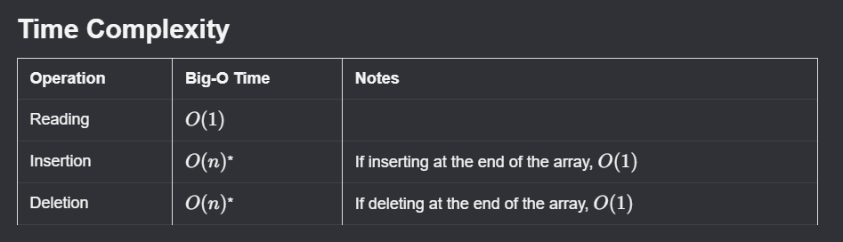

# Static Arrays

In statically typed languages like **Java**, **C++**, and **C#**, arrays must have a fixed **size** and **type** when initialized. These are called **static arrays**.

They are called *static* because their size cannot change after declaration. Once the array is full, it cannot store additional elements.

Some dynamically typed languages (such as Python and JavaScript) do not expose static arrays directly. They use alternatives, which are discussed in the next lesson.

Let's cover key array operations and the time complexity of each.

## 1) Reading From an Array

To read an element, we access it by index.

```javascript
// initialize myArray
let myArray = [1, 3, 5];

// access an arbitrary element, where i is the index of the desired value
myArray[i];
```


Accessing one array element is constant time because each index maps directly to a RAM address.

- Time complexity: **$O(1)$**

### Important Clarification About $O(1)$

There is a common confusion that **$O(1)$ always means fast**. Not necessarily.

An operation could do 1000 steps and still be $O(1)$ if that number does **not grow** with input size. Big-O measures growth, not absolute runtime.

## 2) Traversing an Array

To read all values, we traverse from start to end.

```javascript
for (let i = 0; i < myArray.length; i++) {
  console.log(myArray[i]);
}

// OR

let i = 0;
while (i < myArray.length) {
  console.log(myArray[i]);
  i++;
}
```

The last element is always at index **$n - 1$**, where $n$ is array size.

If size is 3, the last valid index is 2.

Traversing an array of size $n$ takes:

- Time complexity: **$O(n)$**

The number of operations grows linearly with array size (10 elements -> about 10 visits, 100 elements -> about 100 visits, etc.).

## 3) Deleting From an Array

### Deleting From the End

In statically typed languages, array slots are typically initialized with default values (like `0`, `null`, etc.).

When removing the last element, we usually perform a **soft delete**:

- overwrite with a default/sentinel value (`0`, `null`, `-1`, etc.), and
- decrement logical length by 1.

```javascript
// Remove from the last position in the array if the array
// is not empty (i.e. length is non-zero).
removeEnd(arr, length) {
    if (length > 0) {
        // Overwrite last element with some default value.
        // We would also consider the length to be decreased by 1.
        arr[length - 1] = 0;
        length--;
    }
}
```



In `[4, 5, 6]`, value `6` is overwritten by `0` or `-1` to mark it removed, and length becomes one less.

### Deleting at an I-th Index

If we delete at a random index `i`, we cannot just replace with `0`, because that would break contiguity in the middle.

Deleting from the end preserves contiguity. Deleting from the middle requires shifting.

Better approach:

1. Given deletion index `i`.
2. Iterate from `i + 1` to end.
3. Shift each element one position left.
4. Optionally set last slot to `0`/`null` and decrement length.

```javascript
// Remove value at index i before shifting elements to the left.
// Assuming i is a valid index.
removeMiddle(arr, i, length) {
    // Shift starting from i + 1 to end.
    for (let index = i + 1; index < length; index++) {
        arr[index - 1] = arr[index];
    }
    // No need to 'remove' arr[i], since we already shifted
}
```



Worst case: deleting the first element requires shifting nearly all elements.

- Time complexity: **$O(n)$**

## 4) Insertion

### Inserting at the End

To insert at the end, place the new value at index `length` (next free slot).

```javascript
// Insert n into arr at the next open position.
// Length is the number of 'real' values in arr, and capacity
// is the size (aka memory allocated for the fixed size array).
insertEnd(arr, n, length, capacity) {
    if (length < capacity) {
        arr[length] = n;
    }
}
```

This writes one value:

- Time complexity: **$O(1)$**

**Note:** `length` is current element count, while `capacity` is maximum storable elements.

### Inserting at the I-th Index

Inserting at arbitrary index `i` is more involved because insertion may happen in the middle.

Example: array `[4, 5, 6]`, insert at `i = 1` (or `i = 0`).

We cannot overwrite existing values, so we shift values one step right, starting from the end down to `i`.

```javascript
// Insert n into index i after shifting elements to the right.
// Assuming i is a valid index and arr is not full.
insertMiddle(arr, i, n, length) {
    // Shift starting from the end to i.
    for (let index = length - 1; index > i - 1; index--) {
        arr[index + 1] = arr[index];
    }
    // Insert at i
    arr[i] = n;
}
```

The image below shows inserting `8` at index `1` in `[4, 5, 6]`. If there is no extra capacity, last element `6` is lost.


This demonstrates why shifting must happen **before** insertion to avoid overwriting.

## Static Array Time Complexity Summary

