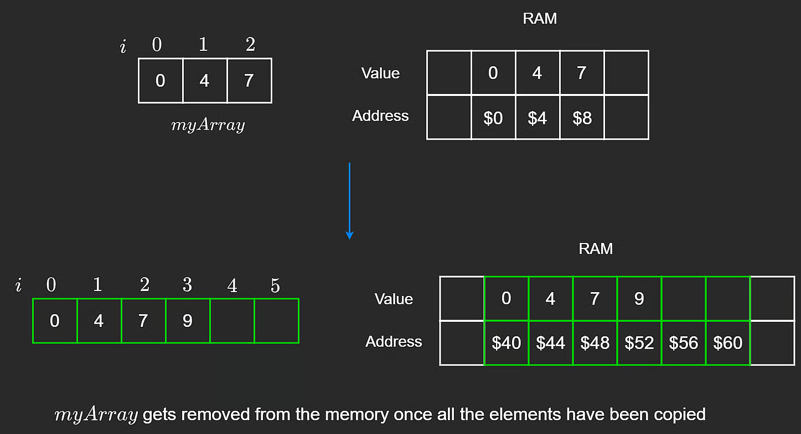
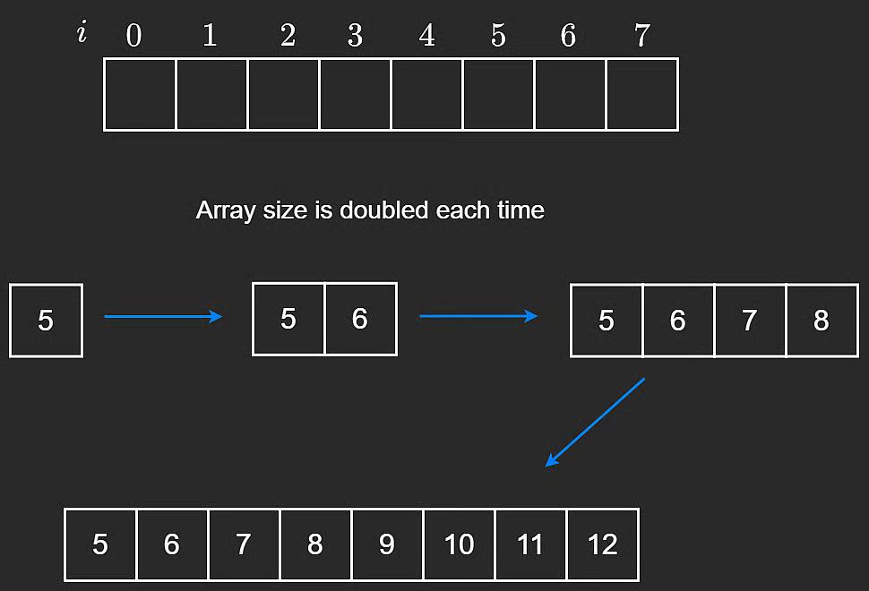
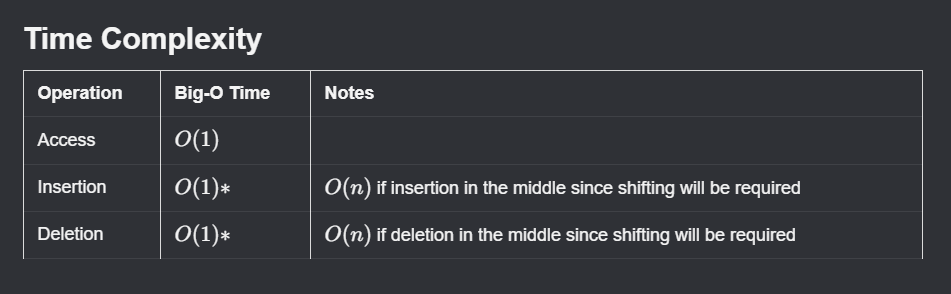

# Dynamic Arrays

Dynamic arrays are a common alternative to static arrays because they can grow as elements are added.

In JavaScript and Python, these are the default arrays. Unlike static arrays, dynamic arrays do not require you to manually set a fixed size at initialization.

Some languages still start with a default internal capacity (for example, Java and C#), but that capacity grows automatically at runtime.

## Push to the End (Append)

When appending, the new element is placed at the next free index.

```javascript
// Insert n at the end of the array
pushBack(n) {
    if (this.length === this.capacity) {
        this.resize();
    }

    // Insert at next empty position
    this.arr[this.length] = n;
    this.length++;
}
```

If the array is full, we resize first.

## How Resize Works

When capacity is reached, implementations usually **double** capacity. This reduces how often expensive resize operations happen.

Resizing creates a new, larger static array and copies existing elements into it.

```javascript
resize() {
    // Create new array with double capacity
    this.capacity = 2 * this.capacity;
    const newArr = new Array(this.capacity);

    // Copy elements
    for (let i = 0; i < this.length; i++) {
        newArr[i] = this.arr[i];
    }

    this.arr = newArr;
}
```



After copying completes, the old underlying array can be deallocated.

## Amortized $O(1)$ Insertion

Appending to a dynamic array is **$O(1)$ amortized**.

Amortized time means average cost per operation over a sequence of operations.

- A resize event is expensive: **$O(n)$**
- Most appends are cheap: **$O(1)$**
- Averaged across many appends, each append is **$O(1)$ amortized**

## Why Doubling Capacity Works

Suppose capacity grows as: `1 -> 2 -> 4 -> 8`.

To reach size 8, total copied/placed work follows a geometric sum:

$$
1 + 2 + 4 + 8 = 15
$$

And $15 < 2 \cdot 8$, so for general size $n$, total work is bounded by about $2n$, which is still linear:

$$
O(2n) = O(n)
$$

That is why inserting $n$ elements overall is $O(n)$, and per insertion (amortized) is $O(1)$.



## Other Operations

Inserting or removing from the **middle** of a dynamic array is similar to static arrays: elements must be shifted left or right.

- Middle insertion: **$O(n)$**
- Middle deletion: **$O(n)$**

## Dynamic Array Time Complexity Summary


